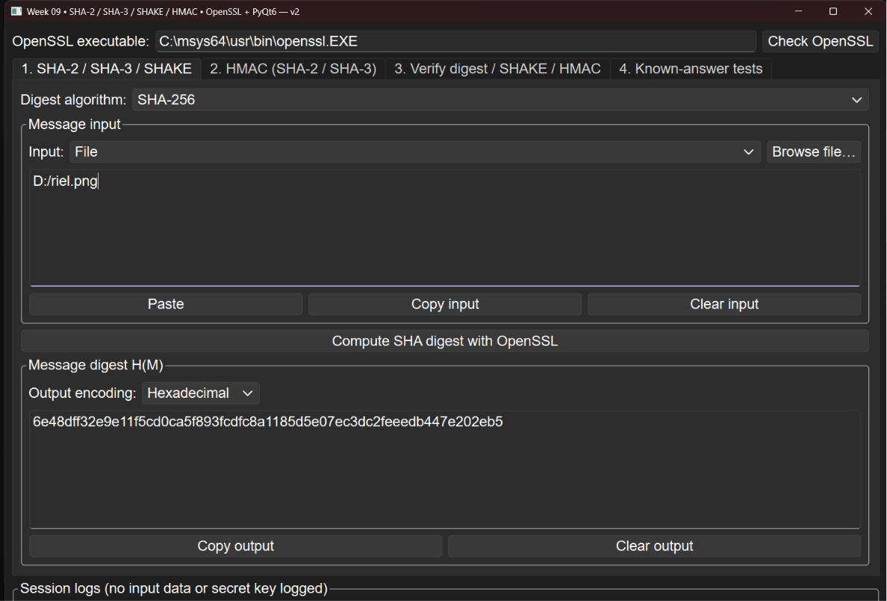
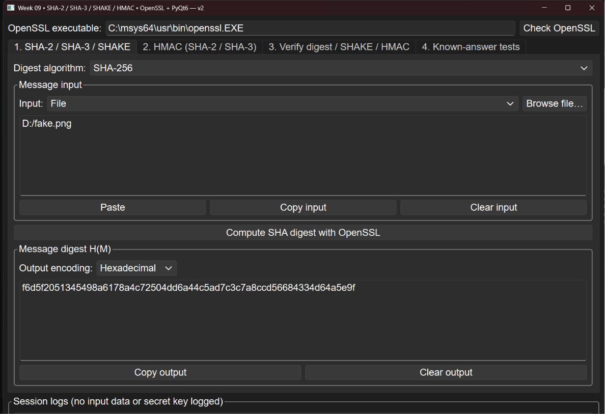

# 1) So sánh SHA256 giữa ảnh chưa sửa và đã sửa

Ảnh chưa sửa: 

Mã SHA256:

> 6e48dff32e9e11f5cd0ca5f893fcdfc8a1185d5e07ec3dc2feeedb447e202eb5

Ảnh đã sửa:

Mã SHA256:

> f6d5f2051345498a6178a4c72504dd6a44c5ad7c3c7a8ccd56684334d64a5e9f

$\Rightarrow$ Sau khi so sánh ta thấy nó khác hoàn toàn.
---
# 2) Đề xuất ứng dụng:
- Chữ kí số, chứng chỉ an toàn
- Tạo khóa bí mật
- Tạo mật khẩu cho vào trong hash

