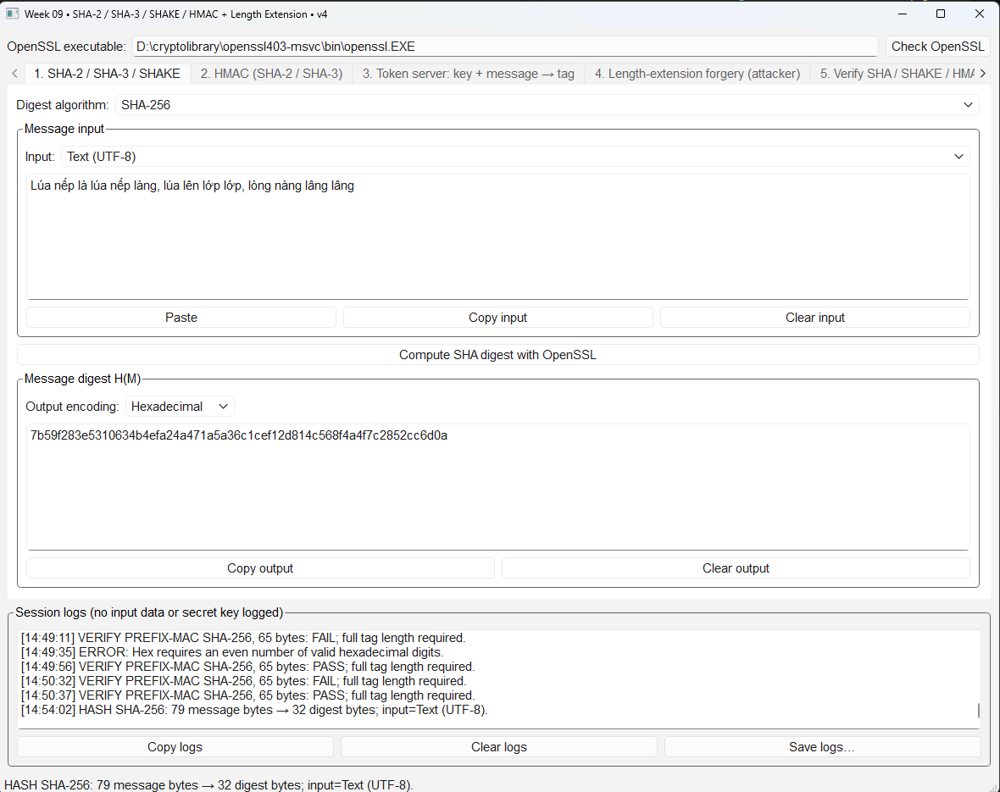
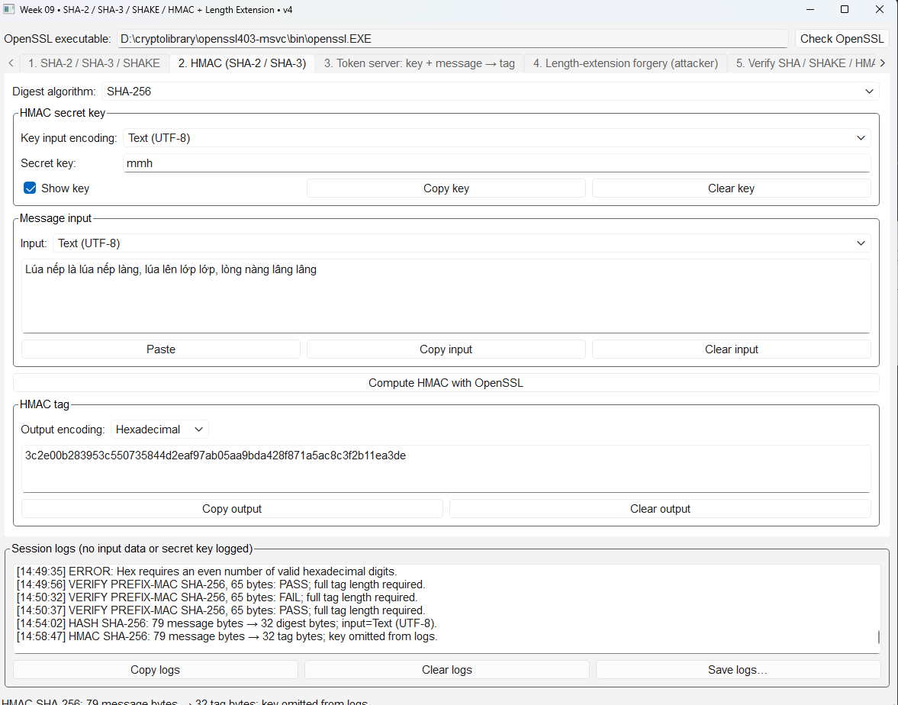
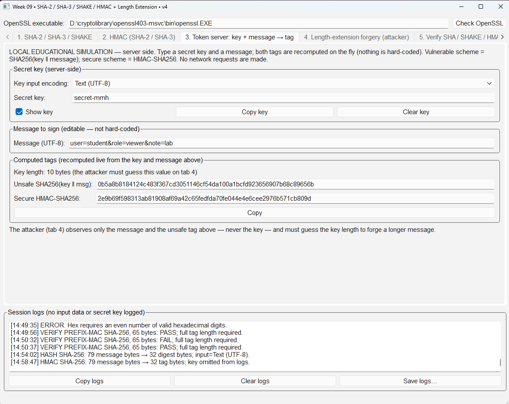
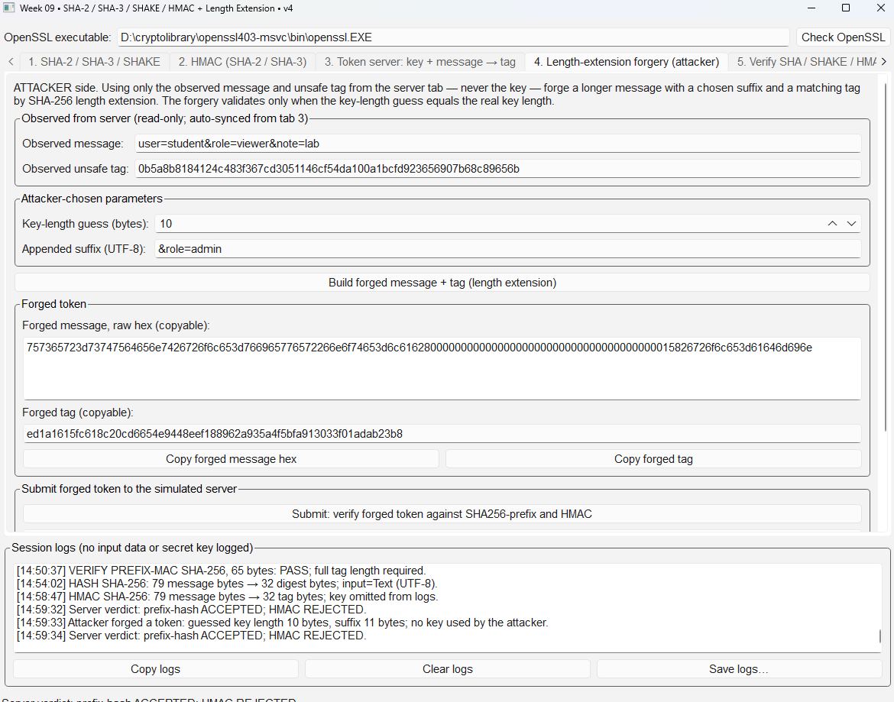
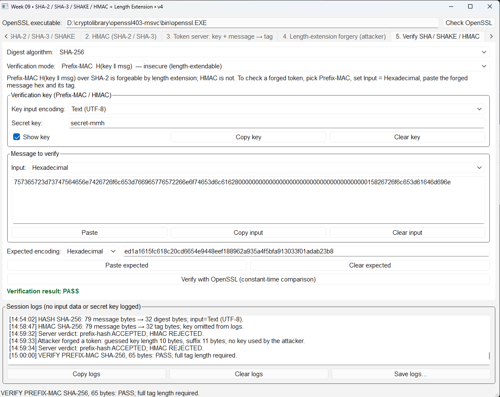
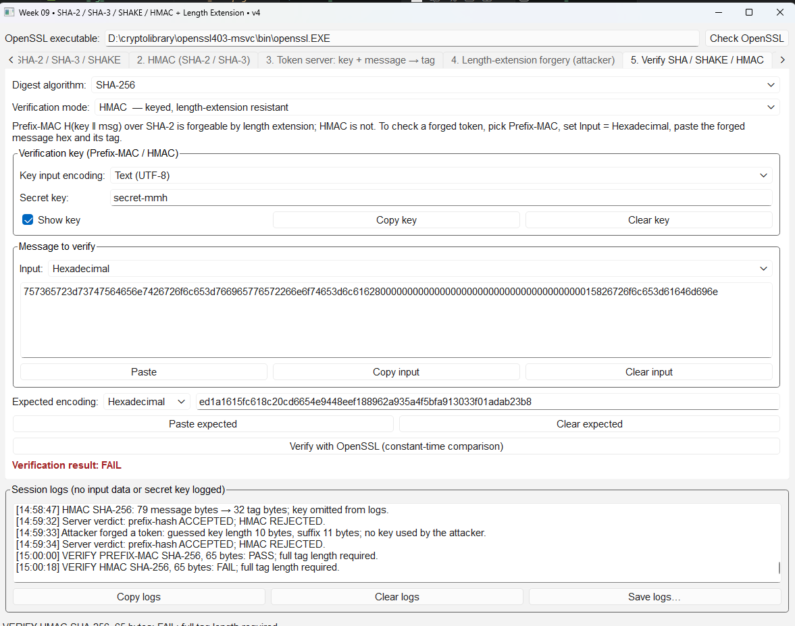

# Length-extension attacks

## Kiến thức cần nhớ
- SHA là thuật toán Hash để check xem nội dung file có bị thay đổi hay không, nó không thể dịch ngược, chỉ tính ra key để so sánh. Nó xử lý theo từng block.
- SHA-2: SHA-224, SHA-256, SHA-384, SHA-512, SHA-512/224, SHA-512/256
- SHA-3: SHA3-224, SHA3-256, SHA3-384, SHA3-512, và 2 hàm độ dài output tùy chỉnh SHAKE128, SHAKE256

### Vì sao token = H(secret_key || data) nguy hiểm
Ví dụ: signature = SHA256(secret + "user=guest&role=user")

Nếu kẻ tấn công biết signature, biết độ dài của data (thường suy ra được từ độ dài chuỗi gốc), và biết (hoặc đoán được) độ dài của secret_key, họ có thể:

- Tính padding Merkle-Damgård đúng chuẩn mà hệ thống sẽ tự thêm vào.
- Dùng chính signature cũ làm trạng thái nội bộ khởi đầu.
- Nối thêm dữ liệu tùy ý, ví dụ &role=admin.
- Tính ra một signature' hợp lệ cho chuỗi mới "user=guest&role=user" + padding + "&role=admin" — mà server vẫn xác thực được, dù kẻ tấn công chưa từng biết secret_key.

Kết quả: họ có thể giả mạo quyền hạn (leo thang đặc quyền) trong token mà không cần crack khóa bí mật.

### Cách phòng chống
- Dùng HMAC thay vì H(key||message) trực tiếp — HMAC băm khóa hai lần theo cấu trúc đặc biệt (H(key ⊕ opad || H(key ⊕ ipad || message))) nên miễn nhiễm với length-extension.
- Dùng các hàm họ SHA-3/BLAKE2/BLAKE3 nếu cần băm trực tiếp với khóa.
- Dùng chuẩn token đã được kiểm chứng như JWT với thuật toán HS256 (vốn dùng HMAC), RS256, hoặc Ed25519 thay vì tự chế cơ chế ký.
- Không bao giờ tự implement sơ đồ xác thực dựa trên hash(secret + data).
---

## Phần bài nộp
- Hiểu rõ vào cơ chế SHA

- HMAX

- Các server tạo token

- Attacker

- Sự khác biệt giữa Prefix-MAC và HMAC

-> H(mess||key) bị attacks nhưng HMAC=H(key||H(mes||key)) không bị attack