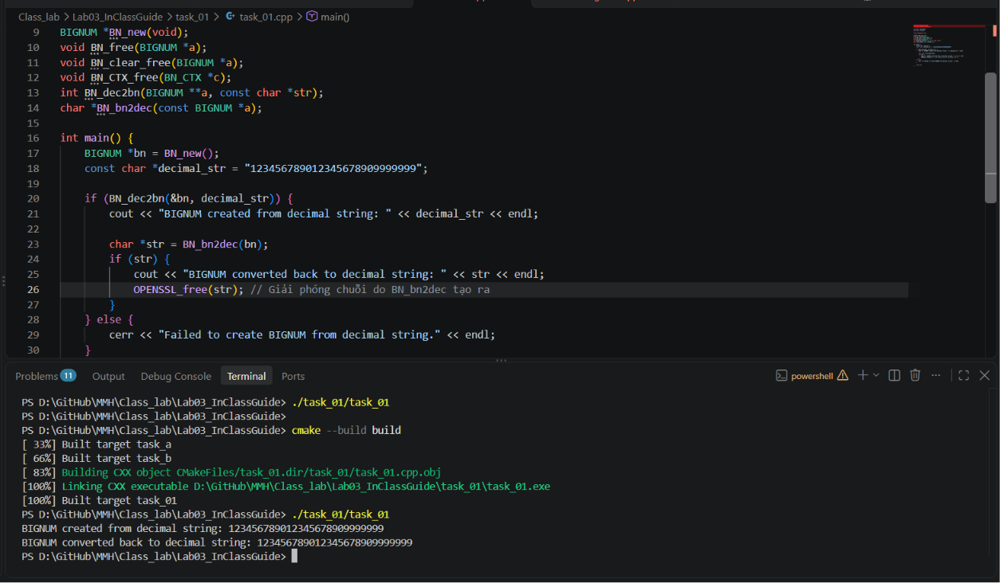

# Task 01: demo API ref


## Code 
```c++
#include <openssl/bn.h>
#include <openssl/crypto.h>

#include <iostream>
#include <string>

using namespace std;

BIGNUM *BN_new(void);
void BN_free(BIGNUM *a);
void BN_clear_free(BIGNUM *a);
void BN_CTX_free(BN_CTX *c);
int BN_dec2bn(BIGNUM **a, const char *str);
char *BN_bn2dec(const BIGNUM *a);

int main() {
    BIGNUM *bn = BN_new(); 
    const char *decimal_str = "123456789012345678909999999";

    if (BN_dec2bn(&bn, decimal_str)) {
        cout << "BIGNUM created from decimal string: " << decimal_str << endl;

        char *str = BN_bn2dec(bn);
        if (str) {
            cout << "BIGNUM converted back to decimal string: " << str << endl;
            OPENSSL_free(str); // Giải phóng chuỗi do BN_bn2dec tạo ra
        }
    } else {
        cerr << "Failed to create BIGNUM from decimal string." << endl;
    }

    return 0;
}

```