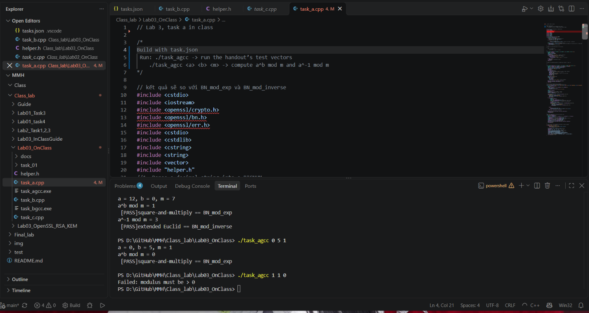
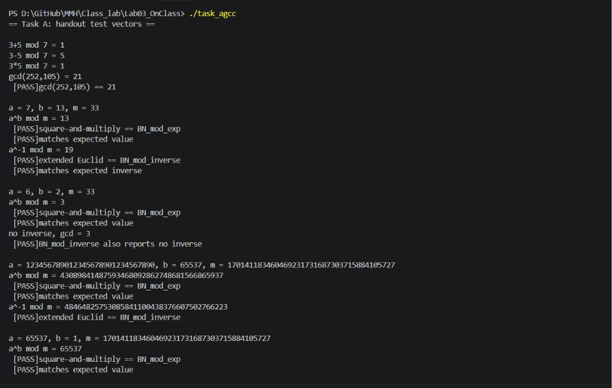
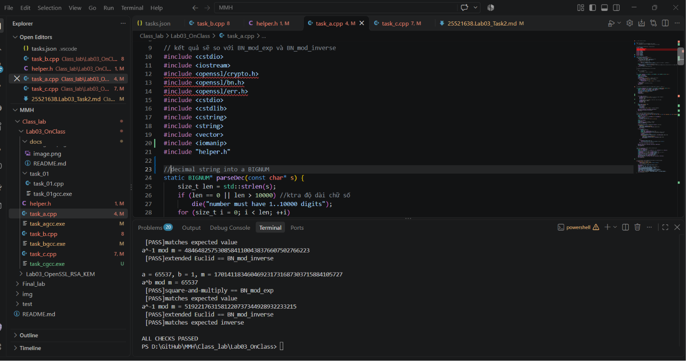
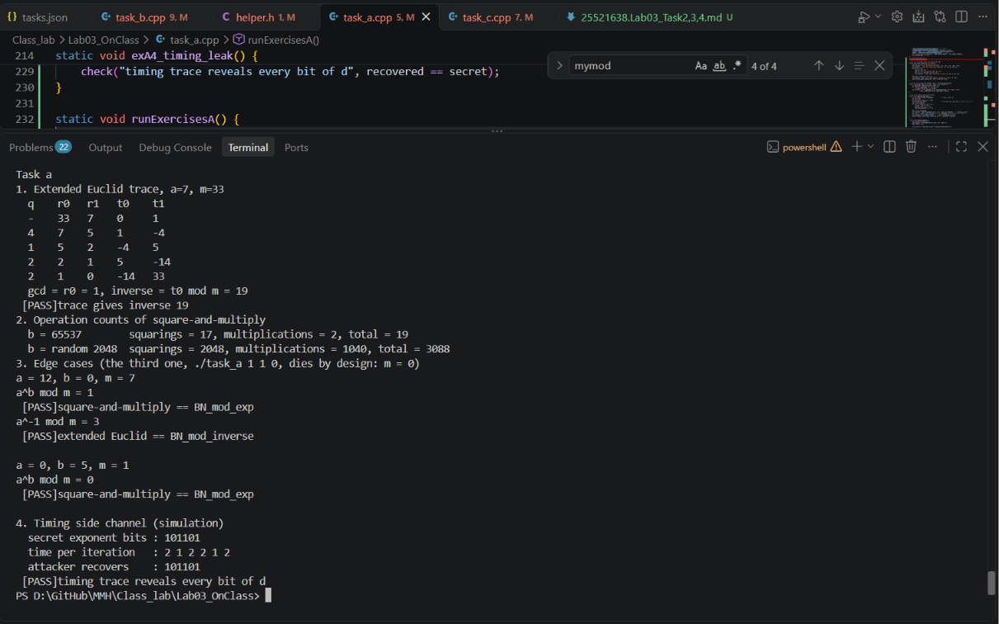
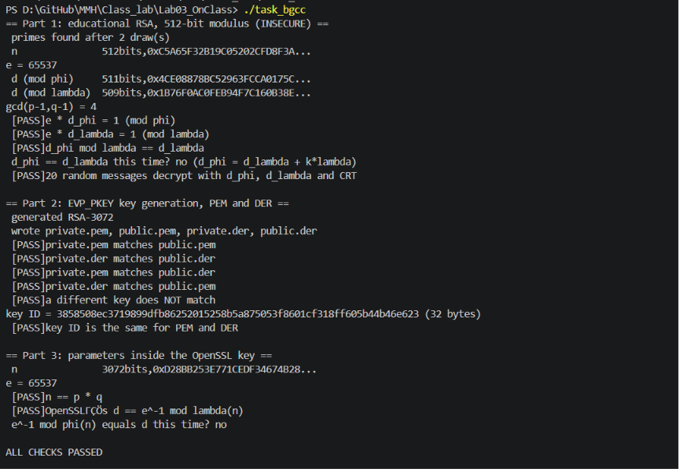
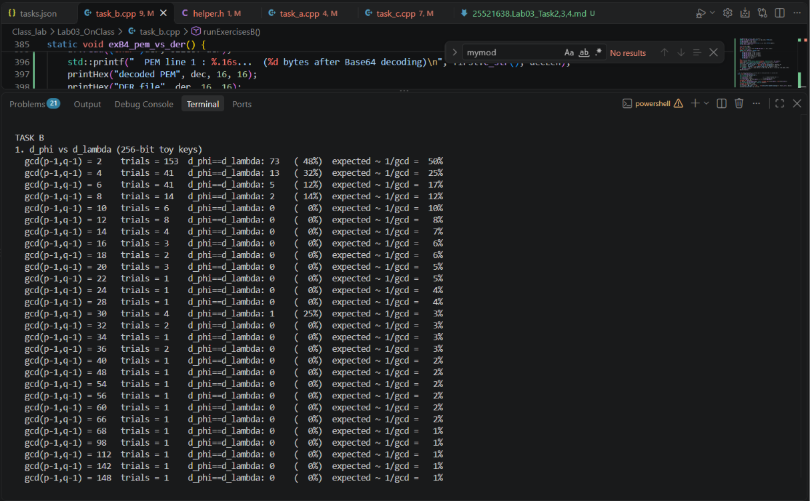
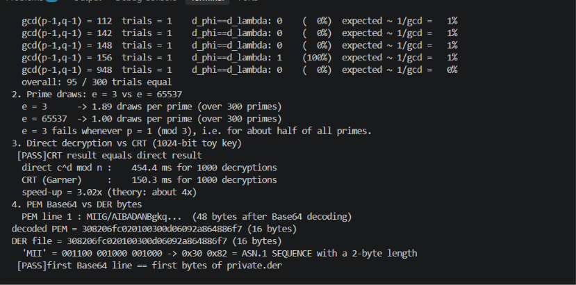
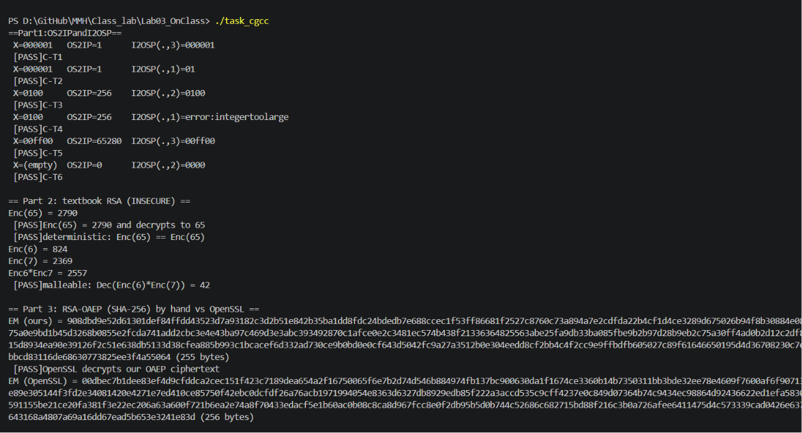
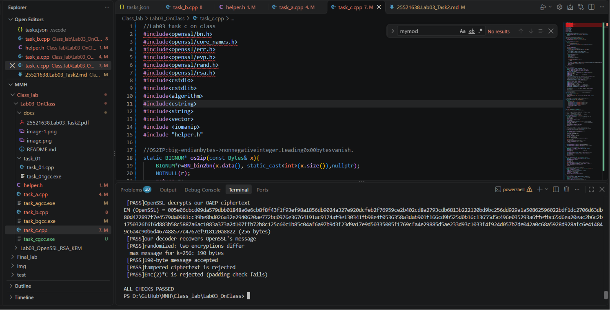
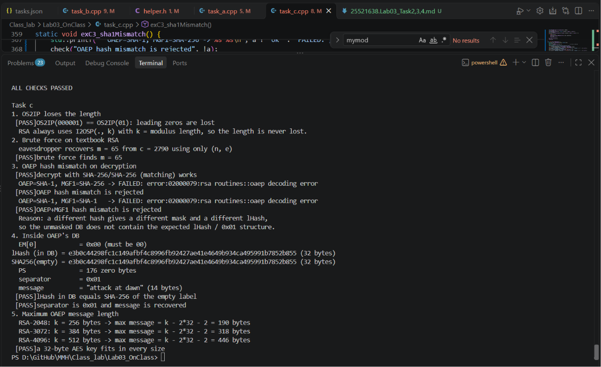

# File "helper.h", use in task b,c
## Source code
```c++
// Helper blocks
#include<iostream>
using Bytes = std::vector<unsigned char>;
static int g_failures = 0;


[[noreturn]] static void die(const char* what) {
    std::fprintf(stderr, "Failed: %s\n", what);
    ERR_print_errors_fp(stderr);
    std::exit(1);
}

//OK1: trả về 1 khi success
#define OK1(call)\
do{\
    if((call)!=1)\
        die(#call);\
}while(0)

//OKPOS: EVP_PKEY_* functions returning > 0 on success
#define OKPOS(call) \
do{\
    if((call)<=0)\
        die(#call);\
}while(0)

//NOTNULL: func return a pointer
#define NOTNULL(ptr)\
do{\
    if((ptr)==nullptr)\
        die(#ptr"isNULL");\
}while(0)

[[maybe_unused]] static void printBnBits(const char* label, const BIGNUM* x){
    //long values
    char* s = BN_bn2hex(x);
    NOTNULL(s);
    std::printf(" %-16s%dbits,0x%.24s...\n",label,BN_num_bits(x),s);
    OPENSSL_free(s);
}

[[maybe_unused]]static void check(const char*name,bool ok){
    std::printf(" [%s]%s\n",ok? "PASS":"FAIL",name);
    if(!ok)++g_failures;
}

inline void printBn(const char* label, const BIGNUM* bn) {
    if (!bn) {
        std::cout << label << " = (null)" << std::endl;
        return;
    }
    char* str = BN_bn2dec(bn);  // OpenSSL cấp phát chuỗi
    NOTNULL(str);
    std::cout << label << " = " << str << std::endl;
    OPENSSL_free(str); // bắt buộc giải phóng, tránh rò rỉ bộ nhớ
}

inline void printHex(const char* label, const unsigned char* data, size_t len, size_t maxBytes = 0) {
    size_t n = (maxBytes != 0 && len > maxBytes) ? maxBytes : len;

    std::cout << label << " = ";
    std::ios_base::fmtflags oldFlags = std::cout.flags(); // lưu định dạng cũ
    std::cout << std::hex << std::setfill('0');
    for (size_t i = 0; i < n; i++) {
        std::cout << std::setw(2) << static_cast<unsigned>(data[i]);
    }
    std::cout.flags(oldFlags);// khôi phục
    std::cout << std::setfill(' ');

    if (n < len) std::cout << "...";
    std::cout << " (" << len << " bytes)" << std::endl;
}
```

# Task a
```c++
// Lab 3, task a in class

/*
Build with task.json
 Run: ./task_agcc -> run the handout’s test vectors
    ./task_agcc <a> <b> <m> -> compute a^b mod m and a^-1 mod m
*/

// kết quả sẽ so với BN_mod_exp và BN_mod_inverse
#include <cstdio>
#include <iostream>
#include <openssl/crypto.h>
#include <openssl/bn.h>
#include <openssl/err.h>
#include <cstdio>
#include <cstdlib>
#include <cstring>
#include <string>
#include <vector>
#include <iomanip>
#include "helper.h"

//decimal string into a BIGNUM
static BIGNUM* parseDec(const char* s) {
    size_t len = std::strlen(s);
    if (len == 0 || len > 10000) //ktra độ dài chữ số
        die("number must have 1..10000 digits");
    for (size_t i = 0; i < len; ++i)
    {
        if (s[i] < '0' || s[i] > '9') 
            die("not a nonnegative decimal integer"); //ktra ký tự có phải là số không âm
    }
    BIGNUM* x = nullptr; // BN_dec2bn allocates *x for us
    if (BN_dec2bn(&x, s) != static_cast<int>(len)) //check xem số lượng chữ số có đúng với độ dài của chuỗi không 
        die("BN_dec2bn");
    return x; // caller frees with BN_free
}

//2.thuật toán square-and-multiply để tính a^b mod m
/*
    r=1
    for i = k-1 downto 0 do
        r = r^2 mod m
        if bit i of b = 1 then r = r*a mod m
*/

static BIGNUM* myModExp(const BIGNUM* a, const BIGNUM* b, const BIGNUM* m, BN_CTX* ctx) {
    BIGNUM* r = BN_new();
    BIGNUM* base = BN_new();
    NOTNULL(r); NOTNULL(base);
    OK1(BN_one(r));
    OK1(BN_nnmod(base, a, m, ctx)); // reduce a into [0, m)
    for (int i = BN_num_bits(b) - 1; i >= 0; --i) {
        OK1(BN_mod_sqr(r, r, m, ctx)); // r = r^2 mod m
        if (BN_is_bit_set(b, i))
            OK1(BN_mod_mul(r, r, base, m, ctx)); // r = r*a mod m
    }
    if (BN_is_one(m)) 
        BN_zero(r); // everything is 0 mod 1
    BN_free(base);
    return r;
}

//3.thuật toán Extended Euclidean để tìm nghịch đảo a^-1(mod m) và gcd(a, m)

static BIGNUM* myModInverse(const BIGNUM* a, const BIGNUM* m, BIGNUM* gcdOut, BN_CTX* ctx) {
    BIGNUM *r0 = BN_dup(m), *r1 = BN_new(), *t0 = BN_new(), *t1 = BN_new();
    BIGNUM *q = BN_new(), *tmp = BN_new(), *prod = BN_new();
    NOTNULL(r0); NOTNULL(r1); NOTNULL(t0); NOTNULL(t1);
    NOTNULL(q); NOTNULL(tmp); NOTNULL(prod);
    OK1(BN_nnmod(r1, a, m, ctx));
    BN_zero(t0);
    OK1(BN_one(t1));
    
    while (!BN_is_zero(r1)) {
        OK1(BN_div(q, tmp, r0, r1, ctx)); // q = r0 / r1, tmp = r0 mod r1
        BN_swap(r0, r1); // (r0, r1) = (r1, r0 mod r1)
        BN_swap(r1, tmp);

        OK1(BN_mul(prod, q, t1, ctx)); // (t0, t1) = (t1, t0 - q*t1)
        OK1(BN_sub(tmp, t0, prod));
        BN_swap(t0, t1);
        BN_swap(t1, tmp);

    }
    NOTNULL(BN_copy(gcdOut, r0));
    BIGNUM* inv = nullptr;
    if (BN_is_one(r0)) {
        inv = BN_new();
        NOTNULL(inv);
        OK1(BN_nnmod(inv, t0, m, ctx)); // t0 may be negative
    }
    BN_free(r0); BN_free(r1); BN_free(t0); BN_free(t1);
    BN_free(q); BN_free(tmp); BN_free(prod);
    return inv;
}

//4.so kết quả chạy thuật toán tay với openssl
// run a test case, compare with BN_mod_exp and BN_mod_inverse
static void runCase(const char* sa, const char* sb, const char* sm, const char* expectExp, const char* expectInv) {
    BN_CTX* ctx = BN_CTX_new();
    NOTNULL(ctx);
    BIGNUM *a = parseDec(sa), *b = parseDec(sb), *m = parseDec(sm);
    if (BN_is_zero(m)) 
        die("modulus must be > 0");
    std::printf("a = %s, b = %s, m = %s\n", sa, sb, sm);

    BIGNUM* r1 = BN_new();
    NOTNULL(r1);
    OK1(BN_mod_exp(r1, a, b, m, ctx)); 
    BIGNUM* r2 = myModExp(a, b, m, ctx); 
    printBn("a^b mod m", r1);

    check("square-and-multiply == BN_mod_exp", BN_cmp(r1, r2) == 0);
    if (expectExp) {
        BIGNUM* want = parseDec(expectExp);
        check("matches expected value", BN_cmp(r1, want) == 0);
        BN_free(want);
    }
    if (!BN_is_one(m)) {
            BIGNUM* g = BN_new();
            NOTNULL(g);
            BIGNUM* mine = myModInverse(a, m, g, ctx);
            BIGNUM* lib = BN_mod_inverse(nullptr, a, m, ctx); // NULL if none
            if (!lib) ERR_clear_error(); // "no inverse" is not a bug here
            if (mine) {
            printBn("a^-1 mod m", mine);
            check("extended Euclid == BN_mod_inverse", lib && BN_cmp(mine, lib) == 0);
            if (expectInv) {
                BIGNUM* want = parseDec(expectInv);
                check("matches expected inverse", BN_cmp(mine, want) == 0);
                BN_free(want);
            }
        } 
        else {
            printBn("no inverse, gcd", g);
            check("BN_mod_inverse also reports no inverse", lib == nullptr);
        }
        BN_free(g); BN_free(mine); BN_free(lib);
    }
    BN_free(a); BN_free(b); BN_free(m); BN_free(r1); BN_free(r2);
    BN_CTX_free(ctx);
    std::printf("\n");
}

//demo other operations: mod add, mod sub, mod mul, gcd
static void demoOtherOps() {
    BN_CTX* ctx = BN_CTX_new();
    BIGNUM *a = parseDec("3"), *b = parseDec("5"), *m = parseDec("7"), *r = BN_new();
    NOTNULL(ctx); NOTNULL(r);
    OK1(BN_mod_add(r, a, b, m, ctx)); printBn("3+5 mod 7", r);
    OK1(BN_mod_sub(r, a, b, m, ctx)); printBn("3-5 mod 7", r); // 5, not -2
    OK1(BN_mod_mul(r, a, b, m, ctx)); printBn("3*5 mod 7", r);
    BIGNUM *x = parseDec("252"), *y = parseDec("105");
    OK1(BN_gcd(r, x, y, ctx)); printBn("gcd(252,105)", r);
    check("gcd(252,105) == 21", BN_is_word(r, 21));
    BN_free(a); BN_free(b); BN_free(m); BN_free(r); BN_free(x); BN_free(y);
    BN_CTX_free(ctx);
    std::printf("\n");
}

//5. main function: run the handout’s test vectors, or your own values
int main(int argc, char** argv) {
    if (argc == 4) { // your own values
        runCase(argv[1], argv[2], argv[3], nullptr, nullptr);
        return g_failures ? 1 : 0;
    }
    std::printf("== Task A: handout test vectors ==\n\n");
    demoOtherOps();
    runCase("7", "13", "33", "13", "19"); // A-T1, A-T3
    runCase("6", "2", "33", "3", nullptr); // A-T4: no inverse
    runCase("123456789012345678901234567890", "65537",
    "170141183460469231731687303715884105727", // 2^127 - 1
    "43089841487593468092862748681566865937", nullptr); // A-T7
    runCase("65537", "1", "170141183460469231731687303715884105727",
    "65537", "5192217631581220737344928932233215"); // A-T8
    std::printf("%s\n", g_failures ? "SOME CHECKS FAILED" : "ALL CHECKS PASSED");
    return g_failures ? 1 : 0;
}
```
## Demo







## Answer
Bài 1: vết Euclid kết thúc với r0 = 1, t0 = -14 -> nghịch đảo là -14 mod 33 = 19.

Bài 2: với 65537 = $2^{16}$+1 chỉ có 17 phép bình phương và 2 phép nhân, vì chỉ có 2 bit 1(10000000000000001). 

Số mũ 2048 bit ngẫu nhiên cần khoảng 2048 bình phương và khoảng 1024 phép nhân -> lý do mã hóa/xác minh với e = 65537 nhanh.

Bài 3:
- 12 0 7: xác định, kết quả $12^0$ = 1 và nghịch đảo của 12 mod 7 là 3.
- 0 5 1: xác định, mọi thứ đều bằng 0 mod 1. Chương trình bỏ qua phần nghịch đảo.
- 1 1 0: m = 0 thì không xác định, chương trình dừng với FAILED: modulus must be > 0.

Bài 4: bit 1 làm vòng lặp lâu hơn (bình phương + nhân), bit 0 nhanh hơn. Kẻ tấn công đo thời gian từng vòng sẽ đọc ra từng bit của d. Cách phòng chống là dùng thuật toán thời gian hằng số khiến kẻ gian không phân biệt được. Vd khóa thật của OpenSSL.

# Task b
## Source code
```c++
// Build: g++ -std=c++17 -Wall -Wextra task_b_rsa_keys.cpp -o task_b -lcrypto
// Run: ./task_b [edu-bits] (default 512; writes 4 key files here)
#include <openssl/bio.h>
#include <openssl/bn.h>
#include <openssl/core_names.h>
#include <openssl/err.h>
#include <openssl/evp.h>
#include <openssl/pem.h>
#include <openssl/x509.h>
#include <openssl/crypto.h>
#include <chrono>
#include <cstring>
#include <fstream>
#include <map>
#include <cstdio>
#include <cstdlib>
#include <string>
#include <vector>
#include <iostream>
#include <vector>
#include <iomanip>
#include <string>

#include "helper.h"

//Part 1. Educational RSA parameters (NOT for real use)
// Draws probable primes until gcd(e, prime - 1) = 1. Returns the number of draws.
static int drawPrime(BIGNUM* prime, BIGNUM* primeMinus1, const BIGNUM* e, int bits, BN_CTX* ctx) {
    BIGNUM* g = BN_new();
    NOTNULL(g);
    int draws = 0;
    do {
        ++draws;
        OK1(BN_generate_prime_ex2(prime, bits, /*safe=*/0, nullptr, nullptr,
        nullptr, ctx));
        NOTNULL(BN_copy(primeMinus1, prime));
        OK1(BN_sub_word(primeMinus1, 1));
        OK1(BN_gcd(g, e, primeMinus1, ctx));
    } while (!BN_is_one(g));
    BN_free(g);
    return draws;
}

static void part1EducationalRsa(int bits) {
    std::printf("== Part 1: educational RSA, %d-bit modulus (INSECURE) ==\n", bits);
    BN_CTX* ctx = BN_CTX_new();
    NOTNULL(ctx);
    BIGNUM *e = BN_new(), *p = BN_new(), *q = BN_new(), *pm1 = BN_new(),
    *qm1 = BN_new(), *g = BN_new(), *n = BN_new(), *phi = BN_new(),
    *lambda = BN_new();
    NOTNULL(e); NOTNULL(p); NOTNULL(q); NOTNULL(pm1); NOTNULL(qm1);
    NOTNULL(g); NOTNULL(n); NOTNULL(phi); NOTNULL(lambda);
    OK1(BN_set_word(e, 65537));

    // Step 1: primes p != q with gcd(e, p-1) = gcd(e, q-1) = 1.
    // If the gcd test fails we draw a new prime instead of changing e.
    int attempts = drawPrime(p, pm1, e, bits / 2, ctx);
    do {
        attempts += drawPrime(q, qm1, e, bits / 2, ctx);
    } while (BN_cmp(p, q) == 0);
    std::printf(" primes found after %d draw(s)\n", attempts);

    // Step 2: n = p*q, phi = (p-1)(q-1), lambda = lcm(p-1, q-1)
    OK1(BN_mul(n, p, q, ctx));
    OK1(BN_mul(phi, pm1, qm1, ctx));
    OK1(BN_gcd(g, pm1, qm1, ctx));
    OK1(BN_div(lambda, nullptr, phi, g, ctx)); // lambda = phi / gcd

    // Step 3: the two valid private exponents
    BIGNUM* dPhi = BN_mod_inverse(nullptr, e, phi, ctx);
    BIGNUM* dLam = BN_mod_inverse(nullptr, e, lambda, ctx);
    NOTNULL(dPhi); NOTNULL(dLam);

    // Step 4: CRT values dP = d mod (p-1), dQ = d mod (q-1), qInv = q^-1 mod p
    BIGNUM *dP = BN_new(), *dQ = BN_new();
    NOTNULL(dP); NOTNULL(dQ);
    OK1(BN_nnmod(dP, dLam, pm1, ctx));
    OK1(BN_nnmod(dQ, dLam, qm1, ctx));
    BIGNUM* qInv = BN_mod_inverse(nullptr, q, p, ctx);
    NOTNULL(qInv);
    printBnBits("n", n);
    printBn("e", e);
    printBnBits("d (mod phi)", dPhi);
    printBnBits("d (mod lambda)", dLam);
    printBn("gcd(p-1,q-1)", g);

    // Step 5: verify e*d = 1 (mod phi) and (mod lambda)
    BIGNUM* t = BN_new();
    NOTNULL(t);
    OK1(BN_mod_mul(t, e, dPhi, phi, ctx));
    check("e * d_phi = 1 (mod phi)", BN_is_one(t));
    OK1(BN_mod_mul(t, e, dLam, lambda, ctx));
    check("e * d_lambda = 1 (mod lambda)", BN_is_one(t));

    // d_phi and d_lambda agree modulo lambda; since phi = gcd(p-1,q-1) * lambda,
    // d_phi may equal d_lambda + k*lambda. Both exponents decrypt correctly.
    OK1(BN_nnmod(t, dPhi, lambda, ctx));
    check("d_phi mod lambda == d_lambda", BN_cmp(t, dLam) == 0);
    std::printf(" d_phi == d_lambda this time? %s\n",
    BN_cmp(dPhi, dLam) == 0 ? "yes" : "no (d_phi = d_lambda + k*lambda)");

    // Step 6: for random m, (m^e)^d = m with both exponents and with CRT
    bool allOk = true;
    BIGNUM *m = BN_new(), *c = BN_new(), *r = BN_new(), *m1 = BN_new(),
    *m2 = BN_new(), *h = BN_new();
    NOTNULL(m); NOTNULL(c); NOTNULL(r); NOTNULL(m1); NOTNULL(m2); NOTNULL(h);
    for (int i = 0; i < 20; ++i) {
        OK1(BN_rand_range(m, n)); // m uniform in [0, n)
        OK1(BN_mod_exp(c, m, e, n, ctx)); // c = m^e mod n
        OK1(BN_mod_exp(r, c, dPhi, n, ctx));
        allOk &= BN_cmp(r, m) == 0;
        OK1(BN_mod_exp(r, c, dLam, n, ctx));
        allOk &= BN_cmp(r, m) == 0;

        // CRT (Garner): m1 = c^dP mod p, m2 = c^dQ mod q,
        // h = qInv (m1 - m2) mod p, m = m2 + h q
        OK1(BN_mod_exp(m1, c, dP, p, ctx));
        OK1(BN_mod_exp(m2, c, dQ, q, ctx));
        OK1(BN_mod_sub(h, m1, m2, p, ctx));
        OK1(BN_mod_mul(h, qInv, h, p, ctx));
        OK1(BN_mul(r, h, q, ctx));
        OK1(BN_add(r, r, m2));
        allOk &= BN_cmp(r, m) == 0;
    }
    check("20 random messages decrypt with d_phi, d_lambda and CRT", allOk);
    std::printf("\n");
    for (BIGNUM* x : {e, p, q, pm1, qm1, g, n, phi, lambda, dPhi, dLam, dP, dQ,  qInv, t, m, c, r, m1, m2, h})
        BN_clear_free(x); // wipe private values
    BN_CTX_free(ctx);
}


//Part 2. Production key generation and key files
static EVP_PKEY* generateKey(int bits) {
    EVP_PKEY_CTX* kctx = EVP_PKEY_CTX_new_from_name(nullptr, "RSA", nullptr);
    NOTNULL(kctx);
    OKPOS(EVP_PKEY_keygen_init(kctx));
    OKPOS(EVP_PKEY_CTX_set_rsa_keygen_bits(kctx, bits)); // e = 65537 default
    EVP_PKEY* key = nullptr;
    OKPOS(EVP_PKEY_generate(kctx, &key));
    EVP_PKEY_CTX_free(kctx);
    return key;
}

static void writeKeyFiles(EVP_PKEY* key) {
    // PEM private key: PKCS#8 "BEGIN PRIVATE KEY", no encryption (lab only)
    BIO* b = BIO_new_file("private.pem", "wb"); NOTNULL(b);
    OK1(PEM_write_bio_PrivateKey(b, key, nullptr, nullptr, 0, nullptr, nullptr));
    BIO_free(b);

    // PEM public key: SubjectPublicKeyInfo "BEGIN PUBLIC KEY"
    b = BIO_new_file("public.pem", "wb"); NOTNULL(b);
    OK1(PEM_write_bio_PUBKEY(b, key));
    BIO_free(b);

    // DER private key: PKCS#8 (NOT i2d_PrivateKey, which writes PKCS#1)
    b = BIO_new_file("private.der", "wb"); NOTNULL(b);
    OK1(i2d_PKCS8PrivateKey_bio(b, key, nullptr, nullptr, 0, nullptr, nullptr));
    BIO_free(b);

    // DER public key: SubjectPublicKeyInfo
    b = BIO_new_file("public.der", "wb"); NOTNULL(b);
    OK1(i2d_PUBKEY_bio(b, key));
    BIO_free(b);
    std::printf(" wrote private.pem, public.pem, private.der, public.der\n");
}

static EVP_PKEY* loadKey(const char* path, bool isPrivate, bool isPem) {
    BIO* b = BIO_new_file(path, "rb");
    NOTNULL(b);
    EVP_PKEY* k = nullptr;
    if (isPrivate)
    k = isPem ? PEM_read_bio_PrivateKey(b, nullptr, nullptr, nullptr)
    : d2i_PrivateKey_bio(b, nullptr);
    else
    k = isPem ? PEM_read_bio_PUBKEY(b, nullptr, nullptr, nullptr)
    : d2i_PUBKEY_bio(b, nullptr);
    BIO_free(b);
    NOTNULL(k);
    return k;
}

// Key ID = SHA-256 over the DER SubjectPublicKeyInfo (used again in Task E)
static Bytes keyId(EVP_PKEY* key) {
    unsigned char* der = nullptr;
    int len = i2d_PUBKEY(key, &der); // allocates der
    if (len <= 0) die("i2d_PUBKEY");
    Bytes id(32);
    unsigned int outLen = 0;
    OK1(EVP_Digest(der, static_cast<size_t>(len), id.data(), &outLen,
    EVP_sha256(), nullptr));
    OPENSSL_free(der);
    return id;
}

static EVP_PKEY* part2KeyFiles() {
    std::printf("== Part 2: EVP_PKEY key generation, PEM and DER ==\n");
    EVP_PKEY* key = generateKey(3072);
    std::printf(" generated RSA-%d\n", EVP_PKEY_get_bits(key));
    writeKeyFiles(key);
    EVP_PKEY* privPem = loadKey("private.pem", true, true);
    EVP_PKEY* privDer = loadKey("private.der", true, false);
    EVP_PKEY* pubPem = loadKey("public.pem", false, true);
    EVP_PKEY* pubDer = loadKey("public.der", false, false);

    // EVP_PKEY_eq compares the public components (n, e)
    check("private.pem matches public.pem", EVP_PKEY_eq(privPem, pubPem) == 1);
    check("private.der matches public.der", EVP_PKEY_eq(privDer, pubDer) == 1);
    check("private.pem matches public.der", EVP_PKEY_eq(privPem, pubDer) == 1);
    check("private.der matches public.pem", EVP_PKEY_eq(privDer, pubPem) == 1);
    EVP_PKEY* other = generateKey(2048);
    check("a different key does NOT match", EVP_PKEY_eq(other, pubPem) != 1);
    ERR_clear_error();
    Bytes id1 = keyId(pubPem), id2 = keyId(pubDer);
    printHex("key ID", id1.data(), id1.size(), 32);
    check("key ID is the same for PEM and DER", id1 == id2);
    std::printf("\n");
    for (EVP_PKEY* k : {privPem, privDer, pubPem, pubDer, other}) EVP_PKEY_free(k);
    return key;
}

//Part 3. Inside OpenSSL’s key
// d is computed modulo lambda(n)
static BIGNUM* getParam(EVP_PKEY* key, const char* name) {
    BIGNUM* x = nullptr; // EVP allocates x
    OK1(EVP_PKEY_get_bn_param(key, name, &x));
    return x;
}
static void part3InsideTheKey(EVP_PKEY* key) {
    std::printf("== Part 3: parameters inside the OpenSSL key ==\n");
    BN_CTX* ctx = BN_CTX_new();
    NOTNULL(ctx);
    BIGNUM* n = getParam(key, OSSL_PKEY_PARAM_RSA_N);
    BIGNUM* e = getParam(key, OSSL_PKEY_PARAM_RSA_E);
    BIGNUM* d = getParam(key, OSSL_PKEY_PARAM_RSA_D);
    BIGNUM* p = getParam(key, OSSL_PKEY_PARAM_RSA_FACTOR1);
    BIGNUM* q = getParam(key, OSSL_PKEY_PARAM_RSA_FACTOR2);
    printBnBits("n", n);
    printBn("e", e);
    BIGNUM *pq = BN_new(), *pm1 = BN_dup(p), *qm1 = BN_dup(q), *phi = BN_new(),
    *g = BN_new(), *lambda = BN_new();
    NOTNULL(pq); NOTNULL(pm1); NOTNULL(qm1); NOTNULL(phi); NOTNULL(g); NOTNULL(lambda);
    OK1(BN_mul(pq, p, q, ctx));
    check("n == p * q", BN_cmp(pq, n) == 0);
    OK1(BN_sub_word(pm1, 1));
    OK1(BN_sub_word(qm1, 1));
    OK1(BN_mul(phi, pm1, qm1, ctx));
    OK1(BN_gcd(g, pm1, qm1, ctx));
    OK1(BN_div(lambda, nullptr, phi, g, ctx));
    BIGNUM* dLam = BN_mod_inverse(nullptr, e, lambda, ctx);
    BIGNUM* dPhi = BN_mod_inverse(nullptr, e, phi, ctx);
    NOTNULL(dLam); NOTNULL(dPhi);
    check("OpenSSL’s d == e^-1 mod lambda(n)", BN_cmp(d, dLam) == 0);
    std::printf(" e^-1 mod phi(n) equals d this time? %s\n",
    BN_cmp(d, dPhi) == 0 ? "yes (happens by chance)" : "no");
    std::printf("\n");
    for (BIGNUM* x : {n, e, d, p, q, pq, pm1, qm1, phi, g, lambda, dLam, dPhi})
    BN_clear_free(x);
    BN_CTX_free(ctx);
}
int main(int argc, char** argv) {
    int eduBits = (argc > 1) ? std::atoi(argv[1]) : 512;
    if (eduBits < 128 || eduBits > 1024 || eduBits % 2) die("edu-bits must be even, 128..1024");
    part1EducationalRsa(eduBits);
    EVP_PKEY* key = part2KeyFiles();
    part3InsideTheKey(key);
    EVP_PKEY_free(key);
    std::printf("%s\n", g_failures ? "SOME CHECKS FAILED" : "ALL CHECKS PASSED");
    return g_failures ? 1 : 0;
}
```
## Demo






## Answer
Bài 1: p−1 và q−1 đều chẵn nên gcd luôn >= 2. d_φ = d_λ + k·λ với k nằm trong $[0, gcd)$, nên xác suất hai số bằng nhau xấp xỉ 1/gcd. Với gcd = 2 là khoảng 50%.

Bài 2: e = 65537 cần khoảng 1 lần rút. e = 3 cần khoảng 2 lần, vì p ≡ 1 (mod 3) xảy ra với khoảng một nửa số nguyên tố.

Bài 3: CRT thường nhanh hơn khoảng 3–4 lần, gần với dự đoán lý thuyết là 4 lần (hai phép mũ trên số mũ và modulus nửa kích thước).

Bài 4: MII giải mã Base64 thành 30 82, là byte SEQUENCE của ASN.1, khớp với đầu file DER.

# Task c
## Source code
```c++
//Lab03 task c on class
#include<openssl/bn.h>
#include<openssl/core_names.h>
#include<openssl/err.h>
#include<openssl/evp.h>
#include<openssl/rand.h>
#include<openssl/rsa.h>
#include<cstdio>
#include<cstdlib>
#include<algorithm>
#include<cstring>
#include<string>
#include<vector>
#include <iomanip>
#include "helper.h"

//OS2IP:big-endianbytes->nonnegativeinteger.Leading0x00bytesvanish.
static BIGNUM* os2ip(const Bytes& x){
    BIGNUM*r=BN_bin2bn(x.data(), static_cast<int>(x.size()),nullptr);
    NOTNULL(r);
    return r;
}
//I2OSP:integer->exactlylenbytes,left-paddedwith0x00.
//Returnsfalse("integertoolarge")ifx>=256^len.
static bool i2osp(const BIGNUM* x,size_t len,Bytes& out){
    out.assign(len,0);
    return BN_bn2binpad(x,out.data(),static_cast<int>(len))>=0;
}

static Bytes hexToBytes(const char* h){
    Bytes b;
    for(size_t i=0;h[i]&&h[i+1];i+=2){
            char two[3]={h[i],h[i+1],0};
            b.push_back(static_cast<unsigned char>(std::strtoul(two,nullptr,16)));
    }
    return b;
}

    static void part1Encoding(){
    std::printf("==Part1:OS2IPandI2OSP==\n");
    struct Case{
        const char* id;const char* hex;size_t width;const char* expect;
    };
    const Case cases[]={
        {"C-T1","000001",3,"000001"},{"C-T2","000001",1,"01"},
        {"C-T3","0100",2,"0100"}, {"C-T4","0100",1,nullptr/*toolarge*/},
        {"C-T5","00ff00",3,"00ff00"},{"C-T6","",2,"0000"},
    };
    for(const Case& c:cases){
        Bytes in=hexToBytes(c.hex),out;
        BIGNUM* x=os2ip(in);
        char* dec=BN_bn2dec(x);
        NOTNULL(dec);
        bool fits=i2osp(x,c.width,out);
        std::string got;

        for(unsigned char v:out){
            char t[3];std::snprintf(t,3,"%02x",v);
            got+=t;
        }

        std::printf(" X=%-8s OS2IP=%-6s I2OSP(.,%zu)=%s\n",c.hex[0]?c.hex:"(empty)", dec,c.width,fits?got.c_str():"error:integertoolarge");
        check(c.id,c.expect?(fits&&got==c.expect):!fits);
        OPENSSL_free(dec);
        BN_free(x);
    }
    std::printf("\n");
}

static void part2Textbook() {
    std::printf("== Part 2: textbook RSA (INSECURE) ==\n");
    BN_CTX* ctx = BN_CTX_new();
    BIGNUM *n = BN_new(), *e = BN_new(), *d = BN_new(), *m = BN_new(),
           *c = BN_new(), *c2 = BN_new(), *r = BN_new(), *c6 = BN_new(),
           *c7 = BN_new(), *forged = BN_new();
    NOTNULL(ctx); NOTNULL(forged);
    OK1(BN_set_word(n, 3233)); OK1(BN_set_word(e, 17)); OK1(BN_set_word(d, 2753));

    OK1(BN_set_word(m, 65));
    OK1(BN_mod_exp(c, m, e, n, ctx));             // c = m^e mod n
    OK1(BN_mod_exp(r, c, d, n, ctx));             // m = c^d mod n
    printBn("Enc(65)", c);
    check("Enc(65) = 2790 and decrypts to 65", BN_is_word(c, 2790) && BN_is_word(r, 65));

    // Determinism: same message, same ciphertext -> an eavesdropper can
    // test guesses (e.g. "yes"/"no") by encrypting them with the public key.
    OK1(BN_mod_exp(c2, m, e, n, ctx));
    check("deterministic: Enc(65) == Enc(65)", BN_cmp(c, c2) == 0);

    // Malleability: Enc(6) * Enc(7) = Enc(42) without knowing d.
    BIGNUM *six = BN_new(), *seven = BN_new();
    NOTNULL(six); NOTNULL(seven);
    OK1(BN_set_word(six, 6)); OK1(BN_set_word(seven, 7));
    OK1(BN_mod_exp(c6, six, e, n, ctx));
    OK1(BN_mod_exp(c7, seven, e, n, ctx));
    OK1(BN_mod_mul(forged, c6, c7, n, ctx));     // attacker's step
    OK1(BN_mod_exp(r, forged, d, n, ctx));       // victim decrypts
    printBn("Enc(6)",c6);printBn("Enc(7)",c7);printBn("Enc6*Enc7",forged);
    check("malleable: Dec(Enc(6)*Enc(7)) = 42", BN_is_word(r, 42));

    std::printf("\n");
    for (BIGNUM* x : {n, e, d, m, c, c2, r, c6, c7, forged, six, seven}) BN_free(x);
    BN_CTX_free(ctx);
}
//Part 3. RSA-OAEP by hand
static const size_t hLen = 32;// SHA-256 output size

static Bytes sha256(const Bytes& data) {
    Bytes out(hLen);
    unsigned int len = 0;
    OK1(EVP_Digest(data.data(), data.size(), out.data(), &len, EVP_sha256(), nullptr));
    return out;
}

//MGF1 (RFC 8017 B.2.1): T = H(seed || C(0)) || H(seed || C(1)) || ...
//C(i) = I2OSP(i, 4); output the first maskLen bytes.
static Bytes mgf1(const Bytes& seed, size_t maskLen) {
    Bytes t;
    for (uint32_t counter = 0; t.size() < maskLen; ++counter) {
        Bytes block = seed;
        block.push_back(static_cast<unsigned char>(counter >> 24));
        block.push_back(static_cast<unsigned char>(counter >> 16));
        block.push_back(static_cast<unsigned char>(counter >> 8));
        block.push_back(static_cast<unsigned char>(counter));
        Bytes h = sha256(block);
        t.insert(t.end(), h.begin(), h.end());
    }
    t.resize(maskLen);
    return t;
}

static void xorInto(Bytes& a, const Bytes& b) {
    for (size_t i = 0; i < a.size(); ++i) a[i] ^= b[i];
}

// EME-OAEP encoding (RFC 8017 7.1.1 step 2). Label L = empty.
// DB = lHash || PS (zeros) || 0x01 || M       (k - hLen - 1 bytes)
// maskedDB = DB XOR MGF1(seed, k - hLen - 1)
// maskedSeed = seed XOR MGF1(maskedDB, hLen)
// EM = 0x00 || maskedSeed || maskedDB          (k bytes)
static Bytes oaepEncode(const Bytes& M, size_t k) {
    if (M.size() > k - 2 * hLen - 2) die("message too long for OAEP");
    Bytes lHash = sha256(Bytes()); // hash of the empty label
    Bytes db = lHash;
    db.insert(db.end(), k - M.size() - 2 * hLen - 2, 0x00); // PS
    db.push_back(0x01);
    db.insert(db.end(), M.begin(), M.end());

    Bytes seed(hLen);
    OK1(RAND_bytes(seed.data(), static_cast<int>(hLen))); // fresh randomness
    xorInto(db, mgf1(seed, k - hLen - 1)); // db is now maskedDB
    xorInto(seed, mgf1(db, hLen)); // seed is now maskedSeed

    Bytes em(0x00);
    em.insert(em.end(), seed.begin(), seed.end());
    em.insert(em.end(), db.begin(), db.end());
    return em;
}

//EME-OAEP decoding (RFC 8017 7.1.2 step 3). Returns false on any error.
//A real implementation must not reveal WHICH check failed (Manger's attack).
static bool oaepDecode(const Bytes& em, size_t k, Bytes& M) {
    if (em.size() != k || k < 2 * hLen + 2) return false;

    Bytes maskedSeed(em.begin() + 1, em.begin() + 1 + hLen);
    Bytes maskedDB(em.begin() + 1 + hLen, em.end());

    Bytes seed = maskedSeed;
    xorInto(seed, mgf1(maskedDB, hLen));

    Bytes db = maskedDB;
    xorInto(db, mgf1(seed, k - hLen - 1));

    Bytes lHash = sha256(Bytes());
    bool good = (em[0] == 0x00) &&
                std::equal(lHash.begin(), lHash.end(), db.begin());

    size_t i = 1 + hLen;
    while (i < db.size() && db[i] == 0x00) ++i;    // skip PS
    good = good && i < db.size() && db[i] == 0x01;
    if (good) M.assign(db.begin() + i + 1, db.end());
    return good;
}

static void configureOaep(EVP_PKEY_CTX* ctx) {     // both sides must match
    OKPOS(EVP_PKEY_CTX_set_rsa_padding(ctx, RSA_PKCS1_OAEP_PADDING));
    OKPOS(EVP_PKEY_CTX_set_rsa_oaep_md(ctx, EVP_sha256())); // default is SHA-1!
    OKPOS(EVP_PKEY_CTX_set_rsa_mgf1_md(ctx, EVP_sha256()));
}

static Bytes evpOaepEncrypt(EVP_PKEY* key, const Bytes& M) {
    EVP_PKEY_CTX* ctx = EVP_PKEY_CTX_new_from_pkey(nullptr, key, nullptr);
    NOTNULL(ctx);
    OKPOS(EVP_PKEY_encrypt_init(ctx));
    configureOaep(ctx);                          

    size_t outLen = 0;
    OKPOS(EVP_PKEY_encrypt(ctx, nullptr, &outLen, M.data(), M.size())); // size
    Bytes out(outLen);
    OKPOS(EVP_PKEY_encrypt(ctx, out.data(), &outLen, M.data(), M.size()));
    out.resize(outLen);
    EVP_PKEY_CTX_free(ctx);
    return out;
}

static bool evpOaepDecrypt(EVP_PKEY* key, const Bytes& C, Bytes& M) {
    EVP_PKEY_CTX* ctx = EVP_PKEY_CTX_new_from_pkey(nullptr, key, nullptr);
    NOTNULL(ctx);
    OKPOS(EVP_PKEY_decrypt_init(ctx));
    configureOaep(ctx);

    size_t outLen = 0;
    OKPOS(EVP_PKEY_decrypt(ctx, nullptr, &outLen, C.data(), C.size()));
    M.assign(outLen, 0);
    bool ok = EVP_PKEY_decrypt(ctx, M.data(), &outLen, C.data(), C.size()) > 0;
    if (ok) M.resize(outLen); else ERR_clear_error();
    EVP_PKEY_CTX_free(ctx);
    return ok;
}

//Raw RSA on byte strings: I2OSP(OS2IP(x)^exp mod n, k)
static Bytes rsaRaw(const Bytes& x, const BIGNUM* exp, const BIGNUM* n, size_t k) {
    BN_CTX* ctx = BN_CTX_new();
    BIGNUM* xi = os2ip(x), *yi = BN_new();
    NOTNULL(ctx); NOTNULL(yi);
    if (BN_cmp(xi, n) >= 0) die("representative out of range");
    OK1(BN_mod_exp(yi, xi, exp, n, ctx));
    Bytes y;
    if (!i2osp(yi, k, y)) die("I2OSP");
    BN_free(xi); BN_clear_free(yi); BN_CTX_free(ctx);
    return y;
}

static void part3Oaep() {
    std::printf("== Part 3: RSA-OAEP (SHA-256) by hand vs OpenSSL ==\n");
    EVP_PKEY* key = EVP_RSA_gen(2048);              // short form of keygen
    NOTNULL(key);
    BIGNUM *n = nullptr, *e = nullptr, *d = nullptr;
    OK1(EVP_PKEY_get_bn_param(key, OSSL_PKEY_PARAM_RSA_N, &n));
    OK1(EVP_PKEY_get_bn_param(key, OSSL_PKEY_PARAM_RSA_E, &e));
    OK1(EVP_PKEY_get_bn_param(key, OSSL_PKEY_PARAM_RSA_D, &d));
    const size_t k = static_cast<size_t>(BN_num_bytes(n)); // 256
    const char* text = "attack at dawn";
    Bytes M(text, text + std::strlen(text));

    //our encoding + raw RSA -> OpenSSL decrypts it
    Bytes em = oaepEncode(M, k);
    printHex("EM (ours)", em.data(), em.size());
    Bytes C1 = rsaRaw(em, e, n, k);
    Bytes back;
    check("OpenSSL decrypts our OAEP ciphertext", evpOaepDecrypt(key, C1, back) && back == M);

    //OpenSSL encrypts -> raw RSA with d + our decoding
    Bytes C2 = evpOaepEncrypt(key, M);
    Bytes em2 = rsaRaw(C2, d, n, k);
    printHex("EM (OpenSSL)", em2.data(), em2.size());
    Bytes M2;
    check("our decoder recovers OpenSSL's message", oaepDecode(em2, k, M2) && M2 == M);
    //properties
    Bytes C3 = evpOaepEncrypt(key, M);
    check("randomized: two encryptions differ", C2 != C3);
    std::printf("  max message for k=%zu: %zu bytes\n", k, k - 2 * hLen - 2);
    Bytes big(k - 2 * hLen - 2, 'A');
    check("190-byte message accepted",
          evpOaepDecrypt(key, evpOaepEncrypt(key, big), back) && back == big);

    Bytes tampered = C2;
    tampered[10] ^= 0x01;
    check("tampered ciphertext is rejected",
          !evpOaepDecrypt(key, tampered, back));

    //Textbook malleability no longer works: multiply by Enc(2)
    BIGNUM *two = BN_new(), *c2i = os2ip(C2), *t = BN_new();
    BN_CTX* ctx = BN_CTX_new();
    NOTNULL(two); NOTNULL(t); NOTNULL(ctx);
    OK1(BN_set_word(two, 2));
    OK1(BN_mod_exp(t, two, e, n, ctx));
    OK1(BN_mod_mul(t, t, c2i, n, ctx));
    Bytes mauled;
    if (!i2osp(t, k, mauled)) die("I2OSP");
    check("Enc(2)*C is rejected (padding check fails)", !evpOaepDecrypt(key, mauled, back));

    std::printf("\n");

    for (BIGNUM* x : {n, e, two, c2i, t}) BN_free(x);
    BN_clear_free(d);
    BN_CTX_free(ctx);
    EVP_PKEY_free(key);
}

int main() {
    part1Encoding();
    part2Textbook();
    part3Oaep();
    std::printf("%s\n", g_failures ? "SOME CHECKS FAILED" : "ALL CHECKS PASSED");
    return g_failures ? 1 : 0;
}
```
## Demo






## Answer
Bài 1: 000001 và 01 đều cho OS2IP = 1, nên OS2IP làm mất thông tin độ dài. RSA luôn dùng I2OSP với độ dài cố định k nên không gặp vấn đề này.

Bài 2: vòng lặp tìm ra m = 65. Mã hóa tất định nên ai cũng thử đoán rồi so sánh với bản mã được.

Bài 3: giải mã bằng SHA-1 trong khi mã hóa bằng SHA-256 báo oaep decoding error. Hash khác nên lHash và mặt nạ MGF1 khác, DB sau khi gỡ mặt nạ chỉ là dữ liệu rác.

Bài 4: DB gồm lHash (e3b0c442…), PS gồm 176 byte 0, byte phân cách 0x01, rồi đến “attack at dawn”.

Bài 5: tối đa 190 byte (2048 bit), 318 byte (3072 bit) và 446 byte (4096 bit). Khóa AES 32 byte luôn nhỏ hơn các giới hạn này.
