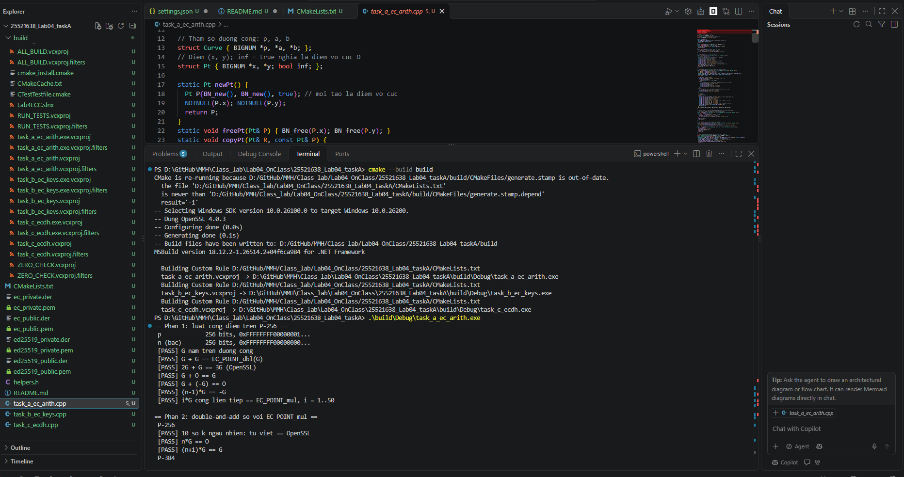
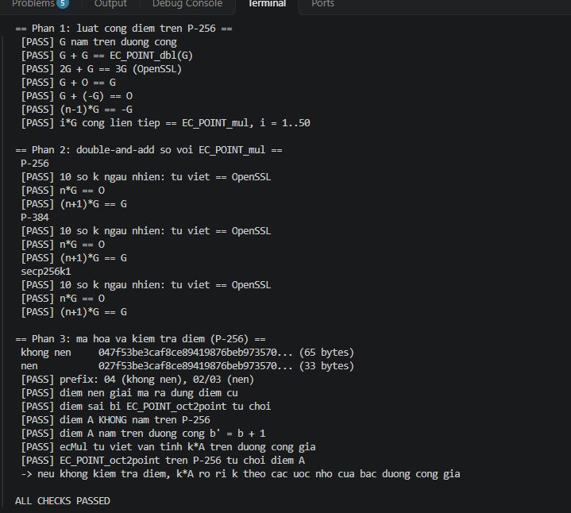
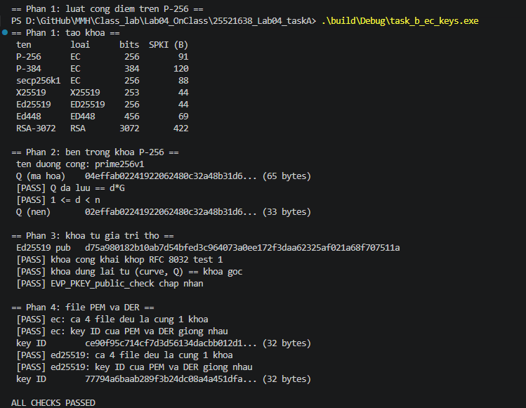
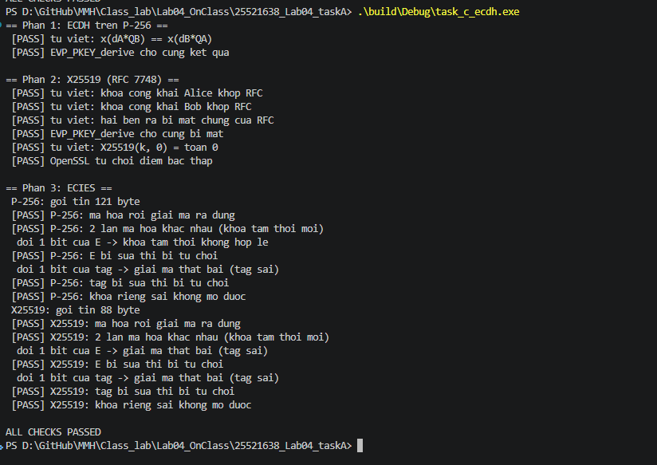

# Task a, b, c Lab 04

1) Cmake
```c
cmake_minimum_required(VERSION 3.16)
project(Lab4ECC CXX)

set(CMAKE_CXX_STANDARD 17)
set(CMAKE_CXX_STANDARD_REQUIRED ON)

# Yeu cau OpenSSL phien ban >= 4.0
find_package(OpenSSL 4.0 REQUIRED COMPONENTS Crypto)
message(STATUS "Dung OpenSSL ${OPENSSL_VERSION}")


foreach(task task_a_ec_arith task_b_ec_keys task_c_ecdh)
  add_executable(${task} ${task}.cpp)
  target_link_libraries(${task} PRIVATE OpenSSL::Crypto)
  if(MSVC)
    target_compile_options(${task} PRIVATE /W3)
  else()
    target_compile_options(${task} PRIVATE -Wall -Wextra)
  endif()
  add_test(NAME ${task} COMMAND ${task})
endforeach()

enable_testing()
```







