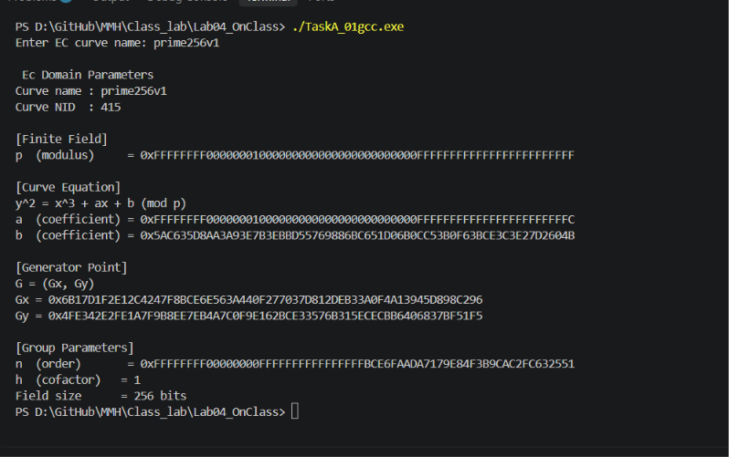

Dùng task.json để compile

```c
#include <stdio.h>
#include <string.h>
#include <openssl/ec.h>
#include <openssl/obj_mac.h>
#include <openssl/bn.h>
#include <openssl/objects.h>
#include <openssl/crypto.h>

static void print_bn(const char *label, const BIGNUM *bn)
{
    char *hex = BN_bn2hex(bn);  
    printf("%s = 0x%s\n", label, hex ? hex : "(loi)");
    OPENSSL_free(hex);         
}

static int get_curve_nid(const char *name)
{
    int nid = OBJ_sn2nid(name);
    if (nid == NID_undef)
        nid = EC_curve_nist2nid(name);
    return nid;
}

static void print_basic_info(int nid)
{
    printf("\nEc Domain Parameters \n");
    printf("Curve name : %s\n", OBJ_nid2sn(nid));
    printf("Curve NID  : %d\n", nid);
}

static int print_field_and_curve(const EC_GROUP *group)
{
    BIGNUM *p = BN_new(), *a = BN_new(), *b = BN_new();
    int ok = 0;

    if (p && a && b && EC_GROUP_get_curve(group, p, a, b, NULL)) {
        printf("\n[Finite Field]\n");
        print_bn("p  (modulus)    ", p);

        printf("\n[Curve Equation]\n");
        printf("y^2 = x^3 + ax + b (mod p)\n");
        print_bn("a  (coefficient)", a);
        print_bn("b  (coefficient)", b);
        ok = 1;
    }
    BN_free(p); BN_free(a); BN_free(b);
    return ok;
}

static int print_generator(const EC_GROUP *group)
{
    const EC_POINT *G = EC_GROUP_get0_generator(group);
    BIGNUM *x = BN_new(), *y = BN_new();
    int ok = 0;

    if (G && x && y &&
        EC_POINT_get_affine_coordinates(group, G, x, y, NULL)) {
        printf("\n[Generator Point]\n");
        printf("G = (Gx, Gy)\n");
        print_bn("Gx", x);
        print_bn("Gy", y);
        ok = 1;
    }
    BN_free(x); BN_free(y);
    return ok;
}

static void print_group_params(const EC_GROUP *group)
{
    const BIGNUM *order = EC_GROUP_get0_order(group);    
    BIGNUM *h = BN_new();

    printf("\n[Group Parameters]\n");
    if (order)
        print_bn("n  (order)      ", order);
    if (h && EC_GROUP_get_cofactor(group, h, NULL)) {
        char *hex = BN_bn2dec(h);
        printf("h  (cofactor)   = %s\n", hex);
        OPENSSL_free(hex);
    }
    printf("Field size      = %d bits\n", EC_GROUP_get_degree(group));
    BN_free(h);
}

int main(){
    char name[64];

    printf("Enter EC curve name: ");
    if (scanf("%63s", name) != 1)
        return 1;

    int nid = get_curve_nid(name);
    if (nid == NID_undef) {
        fprintf(stderr, "Khong nhan ra ten duong cong: %s\n", name);
        return 1;
    }

    EC_GROUP *group = EC_GROUP_new_by_curve_name(nid);
    if (group == NULL) {
        fprintf(stderr, "Khong tao duoc EC_GROUP\n");
        return 1;
    }

    print_basic_info(nid);
    print_field_and_curve(group);
    print_generator(group);
    print_group_params(group);

    EC_GROUP_free(group);
    return 0;
}
```