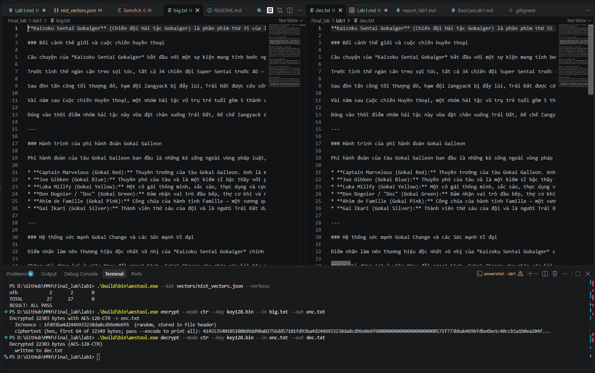
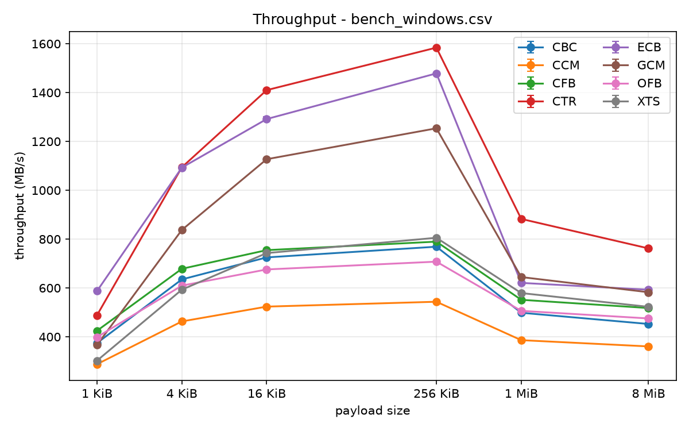
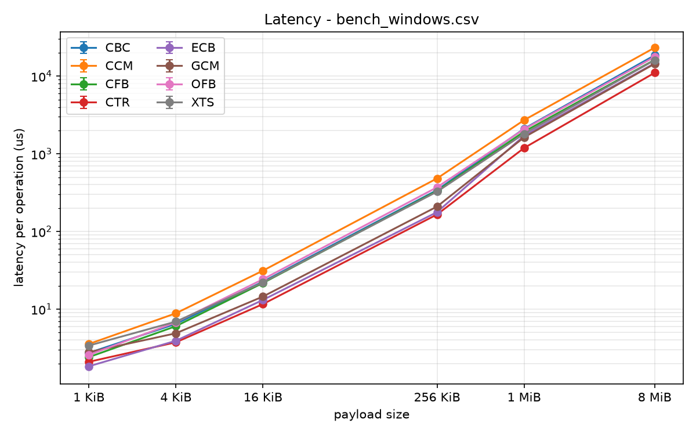
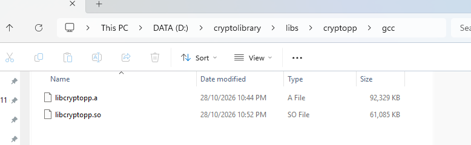
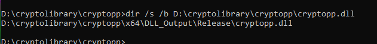
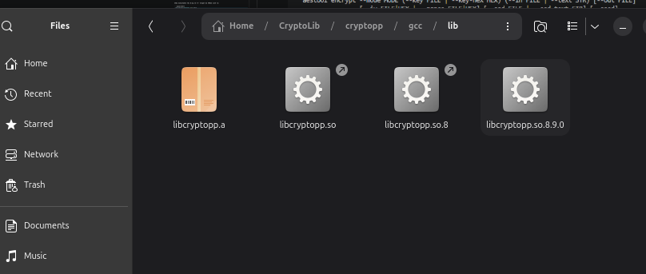
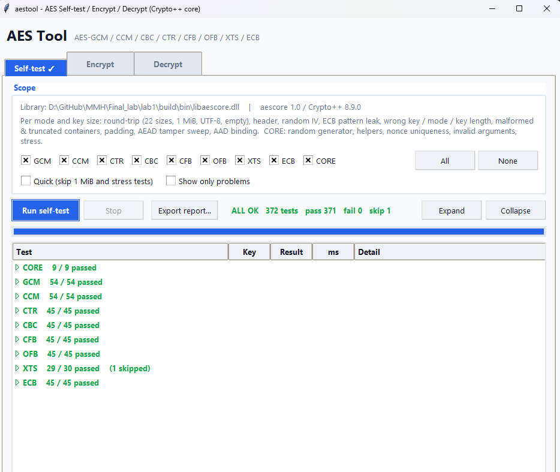
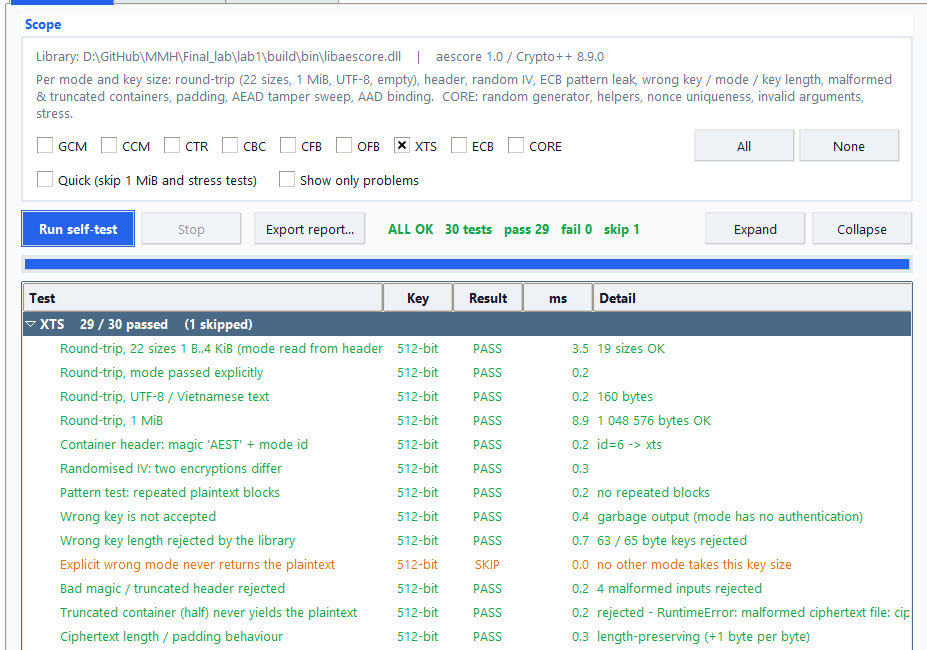
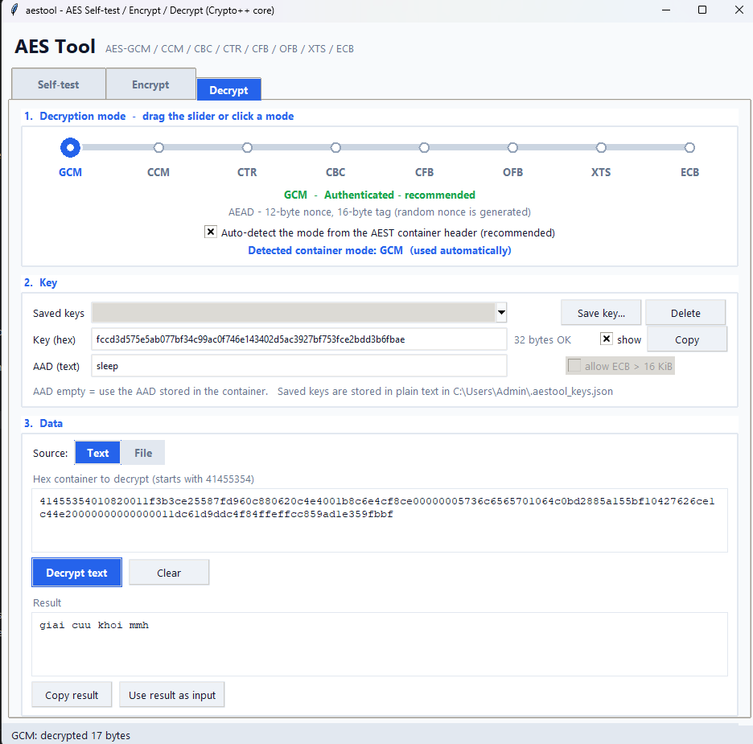

# LAB 1 - Symmetric Encryption with Crypto++

## MỤC LỤC CHI TIẾT

[Tóm tắt kết quả chính ](#tóm-tắt-kết-quả-chính)

[1. Mục tiêu và phạm vi kỹ thuật ](#1-mục-tiêu-và-phạm-vi-kỹ-thuật)

[2. Cơ sở lý thuyết ](#2-cơ-sở-lý-thuyết)

[3. Thiết kế và hiện thực công cụ AES](#3-thiết-kế-và-hiện-thực-công-cụ-aes)

[4. Kiểm thử tính đúng đắn](#4-kiểm-thử-tính-đúng-đắn)

[5. Môi trường và phương pháp thực nghiệm](#5-môi-trường-và-phương-pháp-thực-nghiệm)

[6. Kết quả và phân tích hiệu năng ](#6-kết-quả-và-phân-tích-hiệu-năng)

[7. Phân tích an toàn mật mã ](#7-phân-tích-an-toàn-mật-mã)

[8. Mở rộng hệ thống](#8-extended-features)

[9. Kết luận](#9-kết-luận)

## Tóm tắt kết quả chính 

Đề tài xây dựng công cụ `aestool` sử dụng Crypto++ để mã hóa và giải mã AES ở nhiều chế độ. Công cụ gồm lõi `aescore`, tầng điều phối thao tác, định dạng container `AEST`, sidecar JSON và giao diện CLI. Các mode trong phạm vi gồm ECB, CBC, CFB, OFB, CTR, XTS, CCM và GCM. Công cụ hướng đến AES-128/192/256, báo cáo này lấy AES-256 làm trọng tâm.

**Cụ thể:**
- Bảng KAT ghi nhận 34/34 vector PASS. 
- Bảng Negative Tests có 6 kịch bản. Các tình huống IV sai độ dài, sửa ciphertext/tag GCM và sai khóa được mô tả; CBC bị sửa ciphertext minh họa rằng mode non-AEAD không tự bảo vệ tính toàn vẹn.
- Benchmark được mô tả với 6 payload (1 KB, 4 KB, 16 KB, 256 KB, 1 MB, 8 MB), N=1000, warm-up và các thống kê Mean, Median, SD, CI 95%.
- CSV benchmark được lưu trữ trong `lab1\result\bench` gồm đẩy đủ AES-128/192/256 của hai hệ điều hành Window và Linux. AES 192 không bao gồm mode XTS vì XTS chỉ định nghĩa cho khóa AES-128 và AES-256 theo chuẩn.
- GCM và CCM có xác thực (AEAD); ECB, CBC, CFB, OFB, CTR và XTS không có xác thực tích hợp.


## 1. Mục tiêu và phạm vi kỹ thuật

### 1.1. Bối cảnh và mục tiêu dự án

AES là thuật toán mã hóa khối; việc sử dụng an toàn còn phụ thuộc chế độ hoạt động, cách quản lý IV/nonce/tweak, khóa và xác thực dữ liệu. Lab 1 hướng đến xây dựng công cụ `aestool` dựa trên Crypto++, tách lõi mật mã khỏi giao diện, hỗ trợ mã hóa/giải mã file và chuỗi, sinh khóa, KAT và benchmark.

Các mục tiêu cụ thể:
1. Sử dụng Crypto++ làm thư viện mật mã cho các mode AES được yêu cầu.
2. Hỗ trợ khóa AES-128, AES-192 và AES-256; XTS sử dụng hai khóa AES ghép lại.
3. Kiểm tra độ dài IV/nonce theo mode và sinh ngẫu nhiên bằng `CryptoPP::AutoSeededRandomPool` khi cần.
4. Cảnh báo/hạn chế ECB, phát hiện một số trường hợp nonce reuse và từ chối tham số không hợp lệ.
5. Kiểm thử bằng vector NIST và Negative Tests.
6. Đo hiệu năng trên nhiều payload, mode và hai hệ điều hành.
7. Tổ chức build out-of-source bằng CMake.

## 1.2. Phạm vi chức năng

### Độ dài khóa

| Phiên bản | Độ dài khóa | Số vòng |
|---|---|---|
| AES-128 | 16 byte | 10 |
| AES-192 | 24 byte | 12 |
| AES-256 | 32 byte | 14 |

### Các mode

| Mode | Nhóm | IV/nonce/tweak theo tài liệu thiết kế | AEAD |
|---|---|---|---|
| ECB | Block | Không dùng | Không |
| CBC | Block | 16 byte | Không |
| CFB | Stream-like | 16 byte | Không |
| OFB | Stream-like | 16 byte | Không |
| CTR | Stream-like | 16 byte trong triển khai mô tả | Không |
| XTS | Tweaked block | Tweak 16 byte; khóa kép | Không |
| CCM | AEAD | Nonce 7–13 byte (12 byte khuyến nghị) | Có |
| GCM | AEAD | Nonce 12 byte trong cấu hình thông thường | Có |


### Chức năng CLI

- Mã hóa/giải mã từ file hoặc chuỗi UTF-8.
- Nhập khóa từ file hoặc hex.
- Sinh khóa AES.
- Đầu ra hex, Base64 hoặc raw binary.
- Lưu metadata trong container `AEST` hoặc sidecar JSON.
- Hỗ trợ AAD và tag với CCM/GCM.
- Chạy KAT và benchmark.

## 2. Cơ sở lý thuyết 

### 2.1. Tổng quan về thuật toán AES

AES (Advanced Encryption Standard), chuẩn hóa trong FIPS 197, là mã khối xử lý khối 128 bit (16 byte), hỗ trợ khóa 128, 192 và 256 bit. AES là phép biến đổi khả nghịch trên một khối dưới khóa xác định. Để mã hóa thông điệp dài cần kết hợp AES với một mode of operation. An toàn tổng thể phụ thuộc vào mode, IV/nonce, quản lý khóa và xác thực dữ liệu, không chỉ riêng thuật toán AES.

### 2.2. Cấu trúc và nguyên lý hoạt động của AES

AES biểu diễn 16 byte của một khối thành ma trận State 4×4 byte. Các phép biến đổi chính:

| Phép biến đổi | Chức năng |
|---|---|
| `SubBytes` | Thay thế phi tuyến từng byte bằng S-box |
| `ShiftRows` | Dịch vòng các hàng để tăng khuếch tán |
| `MixColumns` | Biến đổi tuyến tính trên GF($2^8$); bỏ qua ở vòng cuối |
| `AddRoundKey` | XOR State với khóa vòng |


### 2.3. Các chế độ hoạt động của AES 
- Mã hóa khối không xác thực: ECB (không an toàn cho file lớn), CBC (cần IV & padding).
- Mã hóa dòng (Stream modes): CFB, OFB, CTR (biến AES thành stream cipher, không cần padding).
- Mã hóa ổ đĩa: XTS (dùng 2 khóa độc lập).
- Mã hóa xác thực AEAD: CCM, GCM (cung cấp cả tính Bí mật lẫn Toàn vẹn qua Authentication Tag).
### 2.4. Padding, IV, Nonce và Tweak

**Padding:** 
- **ECB/CBC**: dùng PKCS#7, luôn thêm 1–16 byte (mỗi byte có giá trị bằng số byte thêm), kể cả khi plaintext đã là bội số của 16.
- **CFB/OFB/CTR**: không cần padding (hoạt động như stream cipher).
- **XTS**: không dùng PKCS#7, dùng ciphertext stealing; dữ liệu tối thiểu 16 byte.
- **CCM/GCM**: không cần padding; ciphertext có độ dài bằng plaintext, cộng thêm authentication tag.

**IV:** giá trị khởi tạo cho một số mode.
- CBC yêu cầu IV ngẫu nhiên và không thể dự đoán.
- CFB/OFB cần quản lý IV để tránh tái sử dụng
- ECB không dùng IV.

**Nonce:** giá trị dùng một lần theo yêu cầu của mode.
- CTR, CCM và GCM cần tránh tái sử dụng nonce dưới cùng khóa.
- Với GCM, nonce reuse có thể phá vỡ cả tính bí mật lẫn xác thực.

**Tweak:** tham số phân biệt đơn vị dữ liệu trong XTS, thường gắn với vị trí sector. Tweak không phải khóa bí mật và không cung cấp integrity.

### 2.5. Đặc điểm và yêu cầu an toàn của từng chế độ

| Mode | Padding | Song song hóa | Xác thực | Rủi ro chính | Định hướng sử dụng |
|---|---|---|---|---|---|
| ECB | PKCS#7 | Enc/dec song song | Không | Block plaintext giống nhau tạo ciphertext giống nhau, làm lộ cấu trúc và mẫu lặp của dữ liệu. | Tránh dùng cho dữ liệu thực |
| CBC | PKCS#7 | Enc tuần tự, dec song song | Không | IV phải không đoán được và không tái sử dụng. Bit-flipping nếu không có xác thực. Padding oracle nếu lỗi padding bị lộ. | Cần MAC độc lập (Encrypt-then-MAC) |
| CFB | Không | Enc tuần tự, dec song song | Không | Bit-flipping (lật bit ciphertext lật đúng bit plaintext ở block hiện tại). Không tái sử dụng IV. | Cần MAC độc lập |
| OFB | Không | Enc/dec tuần tự (keystream tính trước được) | Không | Tái sử dụng IV làm lộ P₁ ⊕ P₂. Bit-flipping như CTR. | Không tái sử dụng IV, cần MAC độc lập |
| CTR | Không | Enc/dec song song | Không | Tái sử dụng nonce/counter làm lộ P₁ ⊕ P₂. Bit-flipping chính xác từng bit nếu không có xác thực. | Quản lý nonce nghiêm ngặt, thêm MAC |
| XTS | CTS (dữ liệu $\geq$ 16 byte) | Enc/dec song song (mỗi block độc lập nhờ tweak) | Không | Không phát hiện sửa đổi; kẻ tấn công có thể hoán đổi hoặc phát lại block ở cùng vị trí, chỉ gây rác ở mức block 16 byte. | Mã hóa lưu trữ at-rest (ổ đĩa) |
| CCM | Không | Phần CTR song song, phần CBC-MAC tuần tự | Có | Tái sử dụng nonce làm mất an toàn. Cần biết trước độ dài dữ liệu. | AEAD, nonce duy nhất |
| GCM | Không | Enc/dec song song | Có | Tái sử dụng nonce làm lộ P₁ ⊕ P₂ và khóa GHASH, cho phép giả mạo tag. | AEAD, quản lý nonce chặt (ưu tiên nonce 96-bit) |

## 3. Thiết kế và hiện thực công cụ AES 

### 3.1. Kiến trúc tổng thể của hệ thống

Luồng xử lý: `main.cpp` phân tích CLI $\rightarrow$ `ops.cpp` kiểm tra chính sách và nonce reuse $\rightarrow$ `aescore.cpp` gọi Crypto++ $\rightarrow$ `container.cpp` đóng gói metadata $\rightarrow$ ghi file đầu ra nguyên tử. `util.cpp` hỗ trợ hex/Base64/UTF-8/file I/O.

### 3.2. Cấu trúc thư mục mã nguồn 
#### Sơ đồ cấu trúc file
```text
lab1/
├── CMakeLists.txt
├── README.md
├── src/
│   ├── aescore.{h,cpp} #Lõi bọc Crypto++, mode, kiểm tra tham số, CSPRNG, key ID, secure wipe 
│   ├── container.{h,cpp} #Container `AEST` và sidecar JSON 
│   ├── ops.{h,cpp} #Pipeline encrypt/decrypt, ECB policy, nonce reuse
│   ├── kat.{h,cpp} #KAT runner
│   ├── bench.{h,cpp} #Benchmark và thống kê
│   ├── util.{h,cpp} #Hex, Base64, UTF-8, file I/O
│   ├── minijson.h 
│   ├── aescore_capi.* #C API cho thư viện động
│   └── main.cpp #CLI `aestool`
├── tests/test_aescore.cpp #Unit tests Catch2
├── vectors/vectors.json
├── result/ #Kết quả chạy, ảnh so sánh thống kê
│   ├── bench/* #CSV của các lần chạy
│   └── img/*
└── aestool_gui.py #GUI Python tkinter/ctypes
```

### 3.3. Thiết kế giao diện dòng lệnh (CLI – aestool)
#### Các lệnh của aestool

| Lệnh | Cú pháp | Mô tả | Chú thích quan trọng |
|---|---|---|---|
| `encrypt` | `aestool encrypt --mode MODE (--key FILE \| --key-hex HEX) (--in FILE \| --text STR) [--out FILE] [--iv FILE\|HEX \| --nonce FILE\|HEX] [--aad FILE \| --aad-text STR] [--aead] [--tag-len N] [--encode hex\|base64\|raw] [--sidecar FILE.json] [--ledger FILE] [--allow-ecb] [--verbose]` | Mã hóa bản rõ (plaintext) theo chế độ chỉ định. Khối mã 128-bit (16 byte). Có thể xuất ra file, hex/Base64 hoặc raw. | • `--mode` bắt buộc (`ecb`, `cbc`, `ofb`, `ctr`, `xts`, `ccm`, `gcm`).<br>• Khóa nhập từ file (`--key FILE`) hoặc hex (`--key-hex HEX`).<br>• IV/nonce bắt buộc với chế độ CTR/CCM/GCM.<br>• `--aead` chỉ dùng cho CCM/GCM.<br>• `--sidecar` tạo file JSON chứa metadata (IV, tag, key-id, ...). |
| `decrypt` | `aestool decrypt [--mode MODE] (--key FILE \| --key-hex HEX) (--in FILE \| --text ENCODED) [--out FILE] [--iv ...] [--nonce ...] [--aad ...] [--encode hex\|base64] [--sidecar FILE.json]` | Giải mã ciphertext về plaintext. Nếu bỏ `--mode`, chế độ được đọc từ header container AEST. | • Khi không có `--mode`, file đầu vào phải là container AEST (bắt đầu bằng `AEST`).<br>• `--encode` chỉ áp dụng với đầu ra stdout (hex/base64).<br>• `--sidecar` đọc sidecar JSON nếu có. |
| `keygen` | `aestool keygen [--bits 128\|192\|256\|512] [--format raw\|hex] [--out FILE] [--force]` | Tạo khóa AES ngẫu nhiên. Kích thước khóa: 128/192/256 bit; 512 bit dành cho XTS (đôi khi được hỗ trợ). | • Mặc định xuất khóa ra stdout (hex).<br>• `--out FILE` ghi khóa vào file.<br>• `--force` cho phép ghi đè file đã tồn tại. |
| `kat` | `aestool --kat vectors/vectors.json [--verbose]` | Chạy bộ kiểm tra NIST Known-Answer-Tests (GCM, CCM, ...). File `vectors.json` chứa các test vector chuẩn. | • Giúp xác minh tính đúng đắn của mã hóa/giải mã.<br>• `--verbose` in thêm thông tin chi tiết từng test. |
| `bench` | `aestool bench [--modes gcm,ctr,...] [--sizes 1k,4k,16k,256k,1m,8m] [--runs 1000] [--warmup 1.0] [--bits 256] [--dir enc\|dec\|both] [--with-io] [--csv FILE] [--quick]` | Đo throughput (MB/s) và latency (µs) cho các chế độ/kích thước đã chọn. | • `--modes` chỉ định một hoặc nhiều chế độ (cách nhau bằng dấu phẩy).<br>• `--sizes` kích thước dữ liệu test (kilobyte/megabyte).<br>• `--dir` chạy mã hóa, giải mã hoặc cả hai.<br>• `--quick` giảm số lần lặp (20 runs, warm-up 0.2 s).<br>• Kết quả xuất ra file CSV (`--csv`) và các biểu đồ PNG trong thư mục `result/compare/`. |
| `version` / `help` | `aestool version`<br>`aestool help` (hoặc `aestool --help`) | In phiên bản phần mềm và thông tin thư viện Crypto++. In bảng trợ giúp đầy đủ các lệnh và tùy chọn. | • `version` cho ra `aestool 1.0.0 (Crypto++ x.x.x)`.<br>• `help` in lại cú pháp tương tự bảng trên. |

#### Lưu ý khi sử dụng

- **Chế độ và khóa:** `--mode` phải khớp với kiểu dữ liệu khóa.
- XTS cần khóa đôi (32 hoặc 64 byte, gồm tweak key + data key).
- CCM/GCM hỗ trợ độ dài nonce 7-13 byte (khuyến nghị 12 byte).
- **File khóa/IV/AAD:** có thể là file nhị phân thuần hoặc file text bắt đầu bằng dòng `AESTOOL-HEX`, theo sau là các ký tự hex.
- **Atomic write:** mọi ghi file đầu ra đều đi qua `util::write_file_atomic` (ghi file tạm rồi rename) để tránh file bị ghi dở khi có lỗi.
- Khóa có thể đọc từ file (`--key FILE`, khuyến nghị) hoặc truyền hex (`--key-hex HEX`). Tài liệu cảnh báo truyền khóa qua command line có thể làm lộ trong shell history và danh sách tiến trình. Đầu ra hỗ trợ hex, Base64 và raw; raw cần file đầu ra và không in binary ra terminal. `--text` nhận chuỗi UTF-8, còn `--in` nhận file.

Ví dụ:

```console
.\build\bin\aestool.exe keygen --bits 256 --out key.bin
.\build\bin\aestool.exe encrypt --mode gcm --key key.bin --in msg.txt --out ct_gcm.bin --aad-text "v1" --verbose
.\build\bin\aestool.exe decrypt --key key.bin --in ct_gcm.bin --out dec.txt
.\build\bin\aestool.exe --kat vectors/vectors.json --verbose
```


### 3.4. Hiện thực các chế độ mã hóa và giải mã

Với ECB/CBC/CFB/OFB/CTR/XTS, `aescore` kiểm tra khóa, IV/nonce/tweak, khởi tạo mode Crypto++ và thực hiện encrypt/decrypt. ECB/CBC dùng padding theo mô tả, các mode stream-like không cần padding. XTS dùng ciphertext stealing khi cần.

CCM/GCM xử lý AAD và tag. AAD được xác thực nhưng không mã hóa. Khi giải mã AEAD, tag phải được xác minh trước khi chấp nhận plaintext. Tài liệu thiết kế mô tả tag sai sẽ dẫn đến `AuthError`, xóa plaintext tạm và không ghi file đầu ra.

#### Container AEST

| Offset | Trường | Kích thước | Ý nghĩa |
|---:|---|---:|---|
| 0 | `magic` | 4 | `AEST` |
| 4 | `version` | 1 | Phiên bản |
| 5 | `mode` | 1 | Mã mode |
| 6 | `key_len` | 1 | Độ dài khóa |
| 7 | `flags` | 1 | Bit 0: AEAD |
| 8 | `key_id` | 8 | 8 byte đầu SHA-256 có domain separation |
| 16 | `iv_len` | 1 | Độ dài IV |
| 17 | `iv` | `iv_len` | IV/nonce/tweak |
| … | `aad_len` | 4 | Độ dài AAD |
| … | `aad` | `aad_len` | AAD |
| … | `tag_len` | 1 | Độ dài tag |
| … | `tag` | `tag_len` | Tag |
| … | `ct_len` | 8 | Độ dài ciphertext |
| … | `ciphertext` | `ct_len` | Ciphertext |

**...: offset không cố định.*

Các trường nhiều byte được mô tả theo big-endian. Parser kiểm tra magic, version, mode, flags, độ dài khóa/IV/tag và kích thước ciphertext. `key_id` được tính từ `SHA-256("aestool-keyid-v1" || key)` và giữ 8 byte đầu để phục vụ phát hiện nonce reuse, không lưu khóa trực tiếp.

### 3.5. Cơ chế xử lý lỗi và chống lạm dụng

#### Phân cấp lỗi

| Lớp lỗi | Ý nghĩa | Exit code |
|---|---|---:|
| `UsageError` | Sai tham số, ECB quá giới hạn, nonce reuse, IV/key sai độ dài | 2 |
| `AuthError` | Tag không hợp lệ | 3 |
| `FormatError` | Container/sidecar sai định dạng | 3 |
| `CryptoError` | Lỗi mật mã khác, ví dụ padding | 3 |
| Lỗi CLI chung/KAT fail | Cú pháp hoặc KAT thất bại | 1 |

#### Hạn chế ECB

ECB luôn phát cảnh báo. Dữ liệu lớn hơn 16 KiB bị từ chối mặc định; người dùng phải chỉ định `--allow-ecb` để vượt giới hạn.


#### Kiểm tra IV/nonce

| Mode | Độ dài theo tài liệu thiết kế | Xử lý |
|---|---|---|
| CBC, OFB, CFB, CTR, XTS | 16 byte | Kiểm tra `valid_iv_len` |
| GCM | 12 byte | Cấu hình thông thường |
| CCM | 7–13 byte | Miền hợp lệ |
| ECB | Không có | Cung cấp IV thì từ chối |

Nếu thiếu IV/nonce, chương trình sinh bằng `CryptoPP::AutoSeededRandomPool`. Nếu RNG hệ thống lỗi, chương trình phát sinh `CryptoError` và dừng.

#### Phát hiện nonce reuse
Nonce reuse thực hiện như sau:

- Tạo `key_id` 

- Đọc header file AEST đã tồn tại để so sánh `(key_id, iv)`
- Kiểm tra sidecar JSON
- Kiểm tra ledger có dòng `<keyid-hex> <nonce-hex>`
- Từ chối nonce người dùng nhập nếu trùng
- Nonce tự sinh bị trùng thì sinh lại tối đa 8 lần
- Sau mã hóa thành công ghi cặp key ID/nonce vào ledger nếu cấu hình.


**Giới hạn:** cơ chế chỉ phát hiện trong file/sidecar/ledger mà chương trình nhìn thấy, không bảo đảm phát hiện reuse giữa nhiều máy hoặc khi metadata bị xóa. Với CTR, so sánh nonce trùng hoàn toàn không phát hiện dải counter chồng lấn.

### 3.6. Quy trình xử lý dữ liệu và quản lý khóa

- **Mã hóa:** nhận CLI $\rightarrow$ đọc plaintext/khóa $\rightarrow$ kiểm tra mode và tham số $\rightarrow$ sinh IV/nonce nếu cần $\rightarrow$ kiểm tra ECB/nonce reuse $\rightarrow$ gọi `aescore` $\rightarrow$ tạo ciphertext/tag $\rightarrow$ đóng gói AEST hoặc sidecar $\rightarrow$ ghi file nguyên tử $\rightarrow$ xóa dữ liệu tạm.

- **Giải mã:** đọc ciphertext/metadata/khóa $\rightarrow$ kiểm tra cấu trúc $\rightarrow$ khởi tạo mode $\rightarrow$ giải mã tạm $\rightarrow$ nếu AEAD thì xác minh tag $\rightarrow$ chỉ ghi plaintext nếu xác thực thành công.

- Khóa cần được lưu riêng, không commit vào repository, không truyền qua command line trong môi trường thật và không lưu cùng ciphertext ở nơi không kiểm soát. 

## 4. Kiểm thử tính đúng đắn

### 4.1. Known Answer Tests (KATs)

KAT so sánh kết quả thực thi với vector chuẩn:


Kết luận: `RESULT: ALL PASS`.

Tỷ lệ PASS theo bảng: `34/34 × 100% = 100%`. 
### 4.2. Kiểm thử đối chiếu kết quả
Ta kiểm thử mã hóa và giải mã bằng cách sử dụng file cần mã hóa để mã hóa và dịch ngược để kiểm tra so sánh.



### 4.3. Negative Tests và xử lý đầu vào không hợp lệ

| # | Kịch bản | Điều kiện | Kết quả ghi nhận | Đánh giá |
|---:|---|---|---|---|
| 1 | Sai key | Mã hóa key A, giải mã key B | Plaintext không khớp | Đạt  |
| 2 | Sai IV | IV sai độ dài/giá trị | UsageError hoặc thất bại | Đạt  |
| 3 | Sửa ciphertext non-AEAD | XOR một bit ciphertext CBC | Plaintext bị thay đổi, không tự phát hiện | Đúng với giới hạn CBC |
| 4 | Sửa ciphertext AEAD | XOR một bit ciphertext GCM | AuthError, không trả plaintext | Đạt |
| 5 | Tag AEAD sai | Sửa byte cuối tag | AuthError | Đạt |
| 6 | IV sai độ dài | GCM 8 byte, CBC 15 byte | UsageError | Đạt |

- Với mode không có xác thực (CBC, CTR…), sai khóa hoặc sai IV (đúng độ dài) cho ra plaintext sai mà không báo lỗi, vì không có cơ chế phát hiện.
- Với GCM/CCM, mọi sai lệch về khóa, nonce, AAD, ciphertext hay tag đều cho AuthError và không ghi plaintext. Vì vậy dữ liệu cần toàn vẹn nên dùng AEAD.


### 4.4. Kiểm thử các Edge Cases

| Trường hợp | Mục đích | Kết quả thực tế | 
|---|---|---|
| Plaintext rỗng (CBC) | Dữ liệu 0 byte | Ciphertext 16 byte (1 block padding), giải mã khớp: PASS | 
| Plaintext 16 byte (CBC) | Ranh giới block/padding | Ciphertext 32 byte, giải mã khớp: PASS | 
| Plaintext 15/17 byte (CBC) | Kiểm tra padding | 15 $\rightarrow$ 16 byte, 17 $\rightarrow$ 32 byte, giải mã khớp: PASS | 
| XTS plaintext 57 byte | Ciphertext stealing | Chạy được, giải mã khớp hash, `ct_len` = 57 | 
| XTS plaintext dưới 16 byte | Kiểm tra giới hạn tối thiểu | Bị từ chối, không tạo file |
| IV/nonce sai độ dài | Từ chối tham số | Bị từ chối, ví dụ: invalid IV/nonce length 6 bytes for GCM (expected 12 bytes) | 
| Tag sai kích thước | Parser/AEAD | Bị từ chối | 
| Container bị cắt | Kiểm tra parser | Bị từ chối, không tạo plaintext | 
| Sidecar JSON sai | Kiểm tra parser | Bị từ chối | 
| File vượt giới hạn 2 GiB | Kiểm tra giới hạn I/O | Bị từ chối|

### 4.5. Tổng hợp kết quả kiểm thử

| Nhóm | Kết quả| 
|---|---|
| KAT NIST | 34/34 PASS | 
| Catch2 | 13 test case | 
| Negative Tests | 6 kịch bản | 
| AEAD tamper | GCM từ chối ciphertext bị sửa | 
| Round-trip | Có ví dụ GCM và XTS | 
| Edge Cases | Một số trường hợp được nêu | 
|GUI self-test| 372 test, 371 pass, 0 fail, 1 skip.|

## 5. Môi trường và phương pháp thực nghiệm 

### 5.1. Cấu hình phần cứng

| Thông số | Windows | Linux |
|---|---|---|
| CPU | Intel Core i7-9750H, 6C/12T | AMD Ryzen 7 5800X, 8C/16T |
| RAM | 16 GB DDR4 | 32 GB DDR4 |
| Storage | SSD 512 GB | NVMe 1 TB |
| AES-NI | Có | Có |


### 5.2. Môi trường phần mềm và hệ điều hành

| Thành phần | Windows | Linux |
|---|---|---|
| OS | Windows 10 Pro 21H2 | Ubuntu 22.04.3 LTS, kernel 5.15 |
| Compiler | MinGW GCC 11.2.0 | g++ 11.4.0 |
| Crypto++ | libcryptopp.a 8.9.0 | libcryptopp.so 8.9.0 |
| CMake | 3.21.3 | 3.21.3 |

### 5.3. Thiết lập dữ liệu và kịch bản benchmark
- Payload: 1KB, 4KB, 16KB, 256KB, 1MB, 8MB
- Các mode thực thi: ECB, CBC, OFB, CFB, CTR, XTS, CCM và GCM. 
- Độ dài khóa: Có đủ 3 loại AES 128/192/256 nhưng báo cáo ưu tiên AES-256.
- Kết quả lưu tại `result/bench`


### 5.4. Phương pháp đo và xử lý số liệu

- Warm-up: 1–2 giây.
- Số lần chạy: N=1000 cho mỗi tổ hợp.
- Thống kê: Mean, Median, SD mẫu (`ddof=1`), CI 95% theo t-Student.
- Throughput: `payload_MB / time_s`.
- Latency: thời gian cho một thao tác.

- Ta tính through put bằng công thức:
$$Throughput=\frac{Payload\ (MB)}{Time\ (s)}$$


### 5.5. Độ tin cậy và khoảng tin cậy 95%

Khoảng tin cậy 95% cho throughput trung bình được tính bằng:

$$CI_{95\%}=\bar{x}\pm t_{0.975,\,N-1}\,\frac{s}{\sqrt{N}}$$

Trong đó $\bar{x}$ là trung bình mẫu, $s$ là độ lệch chuẩn mẫu và $N$ là số lần đo. Với $N=1000$ (bậc tự do 999), $t_{0.975,999} \approx 1{,}962$, gần với 1,96 của phân phối chuẩn.

Ví dụ với CTR, payload 1 MB:

| Hướng | Môi trường | $\bar{x}$ (MB/s) | $s$ (MB/s) | $CI_{95\%}$ (MB/s) |
|---|---|---:|---:|---|
| Mã hóa | Windows | 882.698 | 25.589 | [881.110, 884.286] |
| Mã hóa | Linux | 3137.295 | 80.517 | [3132.299, 3142.292] |
| Giải mã | Windows | 875.868 | 46.215 | [873.000, 878.736] |
| Giải mã | Linux | 3208.246 | 83.165 | [3203.085, 3213.407] |

**Nhận xét:** Với CTR 1 MB, hai khoảng tin cậy của Windows và Linux cách nhau rất xa và không chồng lấn ở cả hai hướng. Throughput trên Linux cao hơn Windows khoảng 3,55 lần khi mã hóa và 3,66 lần khi giải mã. Kiểm định Welch cho kết quả khác biệt có ý nghĩa thống kê cực mạnh ($p < 10^{-6}$; chênh lệch trung bình khi mã hóa là 2254.6 MB/s, khoảng tin cậy 95% của chênh lệch là [2249.4, 2259.8]).


## 6. Kết quả và phân tích hiệu năng 

**Key size:** bảng bên dưới là số liệu được trích từ `result\bench\bench_linux_256.csv`, `result\bench\bench_windows_256.csv` là sử dụng chế độ key size AES-256. 

### 6.1. Kết quả benchmark trên Windows

#### Throughput trung bình 

<figure>
  
  <figcaption>Hình 1. Throughput các mode trên OS Window </figcaption>
</figure>

**Nhận xét:** 
- Throughput đạt đỉnh ở 256 KiB (CTR khoảng 1.580 MB/s, ECB khoảng 1.480, GCM khoảng 1.250) rồi giảm mạnh ở 1 MiB (CTR còn 882,70, giảm khoảng 44%). Nguyên nhân có thể là dữ liệu vượt dung lượng cache, hoặc máy bị Memory bandwidth (pc). Ở mọi kích thước, CCM thấp nhất, và nhóm CBC/CFB/XTS nằm ở mức trung bình.

#### Latency trung bình 

<figure>
  
  <figcaption>Hình 2. Latency các mode trên OS Window </figcaption>
</figure>

**Nhận xét:** 
- CTR có throughput cao nhất trong các mode tại payload 1 MB và 8 MB theo bảng Windows. GCM thấp hơn CTR do chi phí xác thực. 
- CCM có throughput thấp hơn trong các bảng này.
- ECB có thể đạt throughput cạnh tranh nhưng không an toàn cho dữ liệu thực.

### 6.2. Kết quả benchmark trên Linux

#### Throughput trung bình 

<figure>
  
  <figcaption>Hình 3. Throughput các mode trên OS Ubuntu </figcaption>
</figure>

**Nhận xét:** 
- ECB mã hóa giảm từ khoảng 2.810 MB/s (16 KiB) xuống khoảng 715 (256 KiB), trong khi CTR vẫn khoảng 3.130. Ở 1 MB, ECB mã hóa chỉ đạt 658,90 nhưng ECB giải mã đạt 3.000,36, dù hai chiều đều song song được. CBC, CCM và GCM cũng giảm ở 8 MiB. 

#### Latency trung bình

<figure>
  
  <figcaption>Hình 4. Latency các mode trên OS Ubuntu </figcaption>
</figure>

**Nhận xét:** 
- CTR đạt 3.137,30 MB/s ở 1 MB. CTR có thông lượng cao trong các payload vừa/lớn.
- GCM đạt mức cao ở các payload đến 1 MB nhưng giảm xuống 505,97 MB/s ở 8 MB, cần xác minh.

### 6.3. So sánh hiệu năng giữa các chế độ AES

#### So sánh 1 MB theo bảng throughput chi tiết

<figure>
  
  <figcaption>Hình 5. So sánh throughput các mode trên 2 OS với payload 1MB </figcaption>
</figure>

**Nhận xét:** 
- Theo số liệu này, CTR nhanh nhất ở cả hai hệ thống tại 1 MB. GCM có chi phí xác thực nhưng cung cấp integrity, CCM thấp hơn GCM trong dữ liệu được cung cấp. XTS dành cho lưu trữ, ECB không nên được chọn chỉ vì tốc độ.

#### Stream-like/block

**Hướng mã hóa**

| Mode | Nhóm | Windows (MB/s) | Linux (MB/s) | Linux/Windows |
|---|---|---|---|---|
| CTR | Stream-like | 882,70 | 3137,30 | 3,55 |
| OFB | Stream-like | 506,23 | 886,51 | 1,75 |
| CFB | Stream-like | 551,53 | 896,05 | 1,62 |
| CBC | Block | 498,47 | 854,00 | 1,71 |
| ECB | Block | 620,79 | 658,90 | 1,06 |

**Hướng giải mã**

| Mode | Nhóm | Windows (MB/s) | Linux (MB/s) | Linux/Windows |
|---|---|---|---|---|
| CTR | Stream-like | 875,87 | 3208,25 | 3,66 |
| OFB | Stream-like | 524,64 | 887,04 | 1,69 |
| CFB | Stream-like | 852,67 | 2162,05 | 2,54 |
| CBC | Block | 896,39 | 3040,45 | 3,39 |
| ECB | Block | 922,16 | 3000,36 | 3,25 |

**Nhận xét:** 
- Các phép toán mà mỗi block phụ thuộc kết quả block trước (mã hóa CBC, mã hóa CFB, cả hai hướng của OFB) buộc AES-NI xử lý tuần tự, nên chỉ đạt khoảng 850-900 MB/s. Các phép toán mà các block độc lập (CTR cả hai hướng, giải mã CBC, giải mã CFB) cho phép xử lý nhiều block cùng lúc và đạt 2100-3200 MB/s. Trên Windows, chênh lệch này gần như không xuất hiện (mọi mode đều trong khoảng 500-920 MB/s).
- Ở 1 MB (mã hóa), CCM chỉ đạt khoảng 385 MB/s trên Windows và khoảng 720 trên Linux, thấp hơn GCM (644,64 và 2.122,44) khoảng 40% và 66%. CCM tính CBC-MAC (tuần tự) rồi mã CTR, còn GCM tính GHASH và có thể song song hóa. Vì vậy, nếu không bắt buộc dùng CCM, GCM phù hợp hơn khi cần throughput.

#### AEAD và non-AEAD

**Hướng mã hóa**

<figure>
  
  <figcaption> Hình 6. Throughput các mode chế độ mã hóa trên OS Window </figcaption>
</figure>

<figure>
  
  <figcaption> Hình 7. Throughput các mode chế độ mã hóa trên OS Ubuntu </figcaption>
</figure>

**Hướng giải mã**

<figure>
  
  <figcaption> Hình 8. Throughput các mode chế độ giải mã trên OS Window payload 1MB </figcaption>
</figure>

<figure>
  
  <figcaption> Hình 9. Throughput các mode chế độ giải mã trên OS Ubuntu payload 1MB </figcaption>
</figure>

$\Rightarrow$ GCM tăng latency so với CTR: mã hóa 37,2% (Windows) và 47,8% (Linux), giải mã 7,3% (Windows) và 45,0% (Linux). GCM có thêm GHASH, CCM dùng CBC-MAC và có quy trình xử lý khác. Không thể kết luận một mode luôn nhanh hơn mode kia trong mọi kích thước dữ liệu.

#### Overhead throughput GCM so với CTR trên Windows lẫn Linux
**Overhead của Authentication Tag:**
Ngoài chi phí xử lý GHASH, GCM còn phát sinh overhead từ việc tạo và xác minh Authentication Tag. Tag được tạo trong quá trình mã hóa và phải được xác minh khi giải mã trước khi chấp nhận plaintext. CCM cũng có chi phí tương tự về mặt xác thực, nhưng sử dụng CBC-MAC thay vì GHASH. Do đó, sự khác biệt throughput giữa GCM và CCM không chỉ phụ thuộc vào kích thước Tag mà còn phụ thuộc vào cơ chế xác thực, khả năng song song hóa và mức độ hỗ trợ tăng tốc phần cứng. Cần lưu ý rằng benchmark hiện tại chưa tách riêng thời gian tính toán Tag khỏi thời gian mã hóa/giải mã, nên chưa thể định lượng overhead riêng của Tag.

Ta có công thức phần giảm: 
$(T_CTR − T_GCM) / T_CTR × 100$%.
(Đơn vị MB/s, trung bình)

**Hướng mã hóa**

| Payload | Win CTR | Win GCM | Win giảm | Linux CTR | Linux GCM | Linux giảm |
|---|---|---|---|---|---|---|
| 1 KB | 488,21 | 366,61 | 24,91% | 909,69 | 670,98 | 26,24% |
| 16 KB | 1410,15 | 1127,29 | 20,06% | 2858,21 | 2006,10 | 29,81% |
| 1 MB | 882,70 | 644,64 | 26,97% | 3137,30 | 2122,44 | 32,35% |
| 8 MB | 762,05 | 582,48 | 23,56% | 1736,11 | 505,97 | 70,86% |

**Hướng giải mã**

| Payload | Win CTR | Win GCM | Win giảm | Linux CTR | Linux GCM | Linux giảm |
|---|---|---|---|---|---|---|
| 1 KB | 495,03 | 267,54 | 45,95% | 925,66 | 475,36 | 48,65% |
| 16 KB | 1426,41 | 1076,65 | 24,52% | 2955,99 | 1898,96 | 35,76% |
| 1 MB | 875,87 | 814,50 | 7,01% | 3208,25 | 2212,19 | 31,05% |
| 8 MB | 762,95 | 695,69 | 8,82% | 1759,63 | 1432,04 | 18,62% |

**Nhận xét:**
- GCM có throughput thấp hơn CTR ở mọi kích thước payload, cả hai hướng và cả hai hệ điều hành, với mức giảm từ 7% đến 71%, phổ biến trong khoảng 20–35%. Kết quả này phù hợp với cấu trúc của hai mode: CTR chỉ tạo keystream bằng AES, còn GCM làm thêm GHASH trên dữ liệu và AAD, rồi tính và so sánh tag. Đây chính là chi phí đổi lấy tính toàn vẹn mà CTR không có.
- Chi phí xác thực của GCM thường nằm trong khoảng 20–35% throughput ở payload trung bình, và chỉ còn khoảng 7–9% khi giải mã payload lớn trên Windows. Đổi lại, GCM phát hiện được việc sửa ciphertext hoặc AAD, điều CTR không làm được. Với dữ liệu cần toàn vẹn, nên dùng GCM thay vì CTR trần; chỉ nên dùng CTR khi đã có cơ chế MAC riêng. Trường hợp Linux 8 MB (mất 70,86%) cần được kiểm tra lại trước khi kết luận về nguyên nhân.

### 6.4. So sánh hiệu năng giữa Windows và Linux

<figure>
  
  <figcaption> Hình 10. Throughput mã hóa các mode trên 2 OS </figcaption>
</figure>

#### CTR 1 MB (hướng mã hóa)

| OS | Throughput (MB/s) | SD | CI 95% |
|---|---:|---:|---|
| Windows | 882,70 | 25,59 | [881,11; 884,29] |
| Linux | 3.137,30 | 80,52 | [3.132,30; 3.142,29] |

$\Rightarrow$ Linux đạt throughput khoảng 3,55 lần Windows, cao hơn khoảng 255% nếu lấy Windows làm mẫu số.

#### GCM 1 MB (hướng mã hóa)

| OS | Throughput (MB/s) | SD | CI 95% |
|---|---:|---:|---|
| Windows | 644,64 | 28,92 | [642,84; 646,43] |
| Linux | 2.122,44 | 43,73 | [2.119,72; 2.125,15] |

$\Rightarrow$ Linux nhanh hơn khoảng 3,29 lần,cao hơn khoảng 229% nếu lấy Windows làm mẫu số.

### 6.5. Phân tích nguyên nhân chênh lệch
Các yếu tố có thể ảnh hưởng đến kết quả báo cáo: 
- CPU khác vi kiến trúc/xung nhịp/cache
- Compiler MinGW GCC 11.2.0 và g++ 11.4.0
- AES-NI runtime
- Tiến trình nền, nhiệt độ và chế độ nguồn

### 6.6. Nhận xét và đánh giá tổng hợp

| Nhu cầu | Mode phù hợp | Lý do |
|---|---|---|
| Mã hóa cần xác thực | GCM/CCM | AEAD, xác minh ciphertext và AAD |
| Throughput cao, có MAC riêng | CTR | Song song, không padding; nonce phải duy nhất |
| Mã hóa sector lưu trữ | XTS | Thiết kế cho dữ liệu at-rest |
| Tương thích hệ thống cũ | CBC/CFB/OFB khi có yêu cầu | Phải bổ sung xác thực ngoài |
| Dữ liệu có cấu trúc | Tránh ECB | Lộ mẫu |

CTR thường nổi bật trong bảng throughput. GCM có overhead nhưng mang lại xác thực. 


## 7. Phân tích an toàn mật mã 
### 7.1. Đánh giá đặc điểm an toàn của từng chế độ

- **ECB:** làm lộ mẫu, không xác thực; không dùng cho dữ liệu thực.
- **CBC:** cần IV ngẫu nhiên; không xác thực; có nguy cơ padding oracle nếu để lộ phản hồi padding.
- **CFB/OFB:** không padding nhưng không xác thực; quản lý IV để tránh tái sử dụng.
- **CTR:** hiệu năng và song song hóa tốt; nonce reuse làm lộ quan hệ plaintext; ciphertext có thể bị sửa bit.
- **XTS:** phù hợp mã hóa lưu trữ; không phát hiện sửa đổi/tráo sector.
- **CCM/GCM:** AEAD, kiểm tra tag trước khi chấp nhận plaintext; nonce phải tuân thủ yêu cầu duy nhất theo khóa.

### 7.2. Rủi ro khi sử dụng sai IV, Nonce và Tweak

| Tham số | Mode | Rủi ro |
|---|---|---|
| IV | CBC | IV không an toàn có thể làm lộ thông tin về plaintext |
| IV | CFB/OFB | Reuse có thể tái sử dụng keystream hoặc làm lộ quan hệ plaintext |
| Nonce/counter | CTR | `C1 ⊕ C2 = P1 ⊕ P2` khi keystream tái sử dụng |
| Nonce | CCM | Suy yếu bảo đảm bí mật/xác thực |
| Nonce | GCM | Có thể phá vỡ cả bí mật và xác thực. Nếu cùng khóa dùng lại nonce, XOR hai ciphertext cho ra XOR hai plaintext, và từ hai tag có thể suy ra khóa GHASH để giả mạo tag. |
| Tweak | XTS | Không phân biệt đúng đơn vị dữ liệu có thể làm mất mục đích tweak |

### 7.3. Quản lý khóa và bảo vệ dữ liệu

Các biện pháp được sử dụng: 
- CSPRNG `AutoSeededRandomPool`
- Ưu tiên đọc khóa từ file
- Hạn chế lộ khóa trên command line
- Không ghi đè key file nếu không có `--force`
- Quyền 600 trên Linux; `KeyGuard`/`secure_wipe`

### 7.4. Các giới hạn an toàn của công cụ

- Nonce reuse detection chỉ quan sát file/sidecar/ledger hiện có.
- Mode non-AEAD không có integrity tích hợp.
- Key ID 64 bit chỉ phục vụ nhận diện nội bộ, không phải xác thực khóa.
- Chưa có báo cáo audit bảo mật độc lập.
- Xóa bộ nhớ và quyền file không bảo đảm chống mọi hình thức trích xuất khóa.
- GUI lưu khóa dạng plaintext trong .aestool_keys.json (thấy trong ảnh 8.2)
- `--key-hex` lộ qua shell history; AES-192 không hỗ trợ XTS.

### 7.5 Cross-platform considerations
- RNG: AutoSeededRandomPool dùng nguồn của hệ điều hành (Windows: CryptoAPI/CNG; Linux: getrandom//dev/urandom). 
- Quyền file: chmod 600 trên Linux, ACL trên Windows. 
- Khác biệt về hiệu năng: xem 6.5.

## 8. Mở rộng hệ thống

### 8.1. Xây dựng thư viện động (DLL/SO)

1) Window:




2) Linux:


### 8.2. Tích hợp giao diện đồ họa (GUI)

File `aestool_gui.py` cho phép chọn file, mode, khóa, IV/nonce, thực hiện encrypt/decrypt, hiển thị trạng thái và lỗi xác thực. 

1) Giao diện và self test






**Lí do XTS bị Pass 1 test:**
Test bị SKIP do chế độ AES-XTS sử dụng hai khóa AES độc lập (K1 và K2), mỗi khóa 256-bit, nên tổng độ dài khóa là 512-bit. Đây không phải AES-512 mà là AES-256-XTS với combined key 512-bit. Do độ dài khóa này không tương thích với các chế độ AES khác trong bài kiểm thử, chương trình không thể thực hiện phép thử giải mã chéo chế độ (wrong mode), vì vậy test được đánh dấu SKIP thay vì FAIL.

2) Chức năng mã hóa


3) Chức năng giải mã


### 8.3. Cơ chế liên kết giữa GUI và thư viện AES

```text
Python GUI 
        |
      ctypes
        |
     C API
        |
   C++ aescore
        |
     Crypto++
```
## 9. Kết luận

Phạm vi thiết kế gồm nhiều mode, AES-128/192/256, CLI, quản lý IV/nonce, container, xử lý lỗi và benchmark. Bảng KAT nguồn ghi nhận 34/34 vector PASS. Negative Tests minh họa các tình huống sai khóa, sai IV, sửa ciphertext và tag, đồng thời cho thấy khác biệt giữa non-AEAD và AEAD. XTS không được hỗ trợ trong thuật AES 192.

Về hiệu năng, CTR nổi bật trong các bảng throughput; GCM có chi phí xác thực bổ sung nhưng bảo vệ tính toàn vẹn. CCM có kết quả thấp hơn trong các bảng được cung cấp.

Về an toàn, lựa chọn mode và quản lý nonce quan trọng không kém độ dài khóa. GCM/CCM phù hợp khi cần xác thực, XTS phù hợp mã hóa lưu trữ, ECB cần tránh.


## Bảng tự đánh giá


| Tiêu chí | Tối đa | Tự chấm | Minh chứng theo nguồn |
|---|---:|---:|---|
| Correctness & KATs | 25 | 25 | KAT 34/34 PASS |
| Security Hygiene | 15 | 15 | Negative Tests, ECB check, nonce reuse |
| UX & I/O Design | 10 | 10 | CLI `--mode`, `--key`, `--aead` |
| Performance Methodology | 20 | 18 | Mean, Median, SD, CI, so sánh đa nền tảng |
| Cross-Platform Build | 10 | 10 | Nguồn ghi build Windows/Linux thành công |
| Report Quality | 20 | 20 | Bảng, biểu đồ, nhận xét |
| Bonus | +5 | 3 |aestool_gui.py |
| **Tổng** | **100 (+5)** | **97** | **Tự đánh giá theo tài liệu nguồn** |

*Kết thúc báo cáo Lab 1 – Symmetric Encryption with Crypto++*
