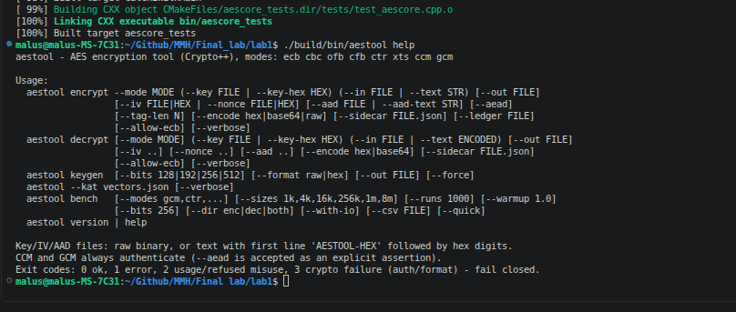
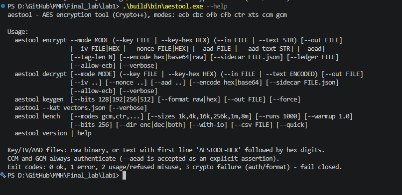

# Lab 1 — Mã hóa đối xứng với Crypto++ (`aestool`)

Công cụ dòng lệnh AES xây dựng trên **Crypto++**. Hỗ trợ các mode ECB, CBC, OFB, CFB, CTR, XTS và hai mode AEAD là CCM, GCM, kèm kiểm tra chống dùng sai (misuse prevention), trình chạy KAT (vector NIST) và chế độ benchmark.

> Crypto++ là thư viện mật mã duy nhất được sử dụng. Không dùng OpenSSL, libsodium hay thư viện mật mã nào khác. C++ STL được dùng cho I/O, phân tích CLI và đo thời gian.

## 1. Danh sách phụ thuộc (Dependencies)

| Thành phần | Phiên bản | Ghi chú |
|---|---|---|
| CMake | >= 3.16  | Build out-of-source |
| Trình biên dịch C++ | C++17 | GCC 11+ (Ubuntu), MSVC 2019/2022, MinGW-w64 GCC 11+ |
| Crypto++ | 8.9.0  | Thư viện mật mã duy nhất |
| vcpkg | mới nhất | Chỉ cho Windows / MSVC (cung cấp Crypto++) |
| Ubuntu LTS | 22.04 / 24.04 | Môi trường Linux đã kiểm thử |
| Windows | 10 / 11 | MSVC và MinGW-w64 |


## 2. Build
### 2.1 Linux

```bash
cmake -S . -B build
cmake --build build 
ctest --test-dir build --output-on-failure
```



### 2.2 Windows — MinGW-w64

```powershell
cmake -S . -B build -G "MinGW Makefiles"
cmake --build build -j
ctest --test-dir build --output-on-failure
```


### 3.3 Windows — MSVC

```powershell
cmake -S . -B build -DCMAKE_TOOLCHAIN_FILE=C:/vcpkg/scripts/buildsystems/vcpkg.cmake
cmake --build build --config Release
ctest --test-dir build -C Release --output-on-failure
```


> MSVC là generator đa cấu hình (multi-config), nên bắt buộc phải có `--config Release` / `-C Release`.

### 3.4 Ghi chú về cấu hình build

- `if(MSVC)`: dùng `/W4 /EHsc`, định nghĩa `NOMINMAX`, `WIN32_LEAN_AND_MEAN`
- `if(MINGW)`: dùng tùy chọn static linking
- `if(WIN32)`: link `ws2_32` và `advapi32` (thư viện hệ thống; Crypto++ cần `advapi32` cho RNG của hệ điều hành)

### 3.5 Vị trí file thực thi

| Nền tảng | File thực thi |
|---|---|
| Linux | `./build/bin/aestool` |
| Windows (MinGW) | `.\build\bin\aestool.exe` |
| Windows (MSVC) | `.\build\bin\aestool.exe`  |

---

## 3. Cách sử dụng

```
aestool <lệnh> [--in INFILE | --text "..."] [--out OUTFILE]
        [--key KEYFILE | --key-hex HEX] [--iv IV] [--nonce NONCE]
        [--mode ecb|cbc|ofb|cfb|ctr|xts|ccm|gcm] [--aead]
        [--aad FILE | --aad-text STRING] [--encode hex|base64|raw]
        [--threads N] [--kat vectors.json] [--allow-ecb] [--verbose]
```



Các lệnh: `keygen`, `encrypt`, `decrypt`, `bench`, và `--kat` để chạy KAT.

### 3.1 Ví dụ

Trên Windows dùng `aestool.exe` (đường dẫn như mục 3.5).

```bash
./build/bin/aestool keygen --bits 256 --out key.bin
./build/bin/aestool encrypt --mode gcm --key key.bin --in plaintext.bin --out ciphertext.aest
./build/bin/aestool decrypt --key key.bin --in ciphertext.aest --out recovered.bin
./build/bin/aestool --kat vectors/nist_vectors.json
```


### 3.2 Xử lý khóa, IV và nonce

- Khóa: `--key KEYFILE` (nhị phân thô hoặc hex có header) hoặc `--key-hex HEX`.
- IV/nonce: nếu không cung cấp (trừ ECB/XTS), công cụ tự sinh bằng `AutoSeededRandomPool` của Crypto++ và lưu vào header của file đầu ra.
- IV/nonce có độ dài không hợp lệ sẽ bị từ chối.
- CTR/CCM/GCM: nếu phát hiện dùng lại cùng khóa + nonce thì thao tác bị từ chối *(TODO: mô tả logic phát hiện của bạn ở đây; đề yêu cầu phải ghi rõ)*.

### 3.3 Chống dùng sai (Misuse prevention)

- **ECB**: in cảnh báo WARNING và từ chối file lớn hơn 16 KiB, trừ khi có `--allow-ecb`.
- **AEAD**: tag luôn được xác thực khi giải mã; nếu sai thì công cụ dừng (fail closed) và không ghi plaintext ra.
- Đầu vào sai định dạng (header hỏng, độ dài sai, dữ liệu bị cắt) đều bị từ chối với mã thoát khác 0.

### 3.4 Mã hóa đầu ra (Encoding)

- Hiển thị trên màn hình mặc định là hex; ghi ra file mặc định là nhị phân thô.
- Có thể đổi bằng `--encode hex|base64|raw`.
- Đầu vào/đầu ra an toàn với UTF-8 và dữ liệu nhị phân.


## 4. Kiểm thử

```bash
ctest --test-dir build --output-on-failure           # unit test
./build/bin/aestool --kat vectors/nist_vectors.json  # KAT
```

- KAT: vector NIST SP 800-38A (CBC, CFB, OFB, CTR), NIST GCM và CCM. Kết quả in PASS/FAIL cho từng case kèm bảng tổng kết.
- Negative test: sai khóa, sai IV, sửa ciphertext (non-AEAD và AEAD), tag không hợp lệ, độ dài IV không hợp lệ.
---

## Phụ lục A – Bảng kết quả benchmark chi tiết

Throughput (MB/s), giá trị trung bình của 1.000 lần đo.

### A.1. AES-128 – Windows

**Mã hóa**

| Mode | 1 KB | 4 KB | 16 KB | 256 KB | 1 MB | 8 MB |
|---|---|---|---|---|---|---|
| ECB | 704,50 | 1.866,53 | 2.275,25 | 2.843,68 | 662,58 | 636,92 |
| CBC | 465,14 | 833,24 | 976,48 | 430,14 | 467,63 | 409,47 |
| OFB | 459,22 | 815,53 | 918,75 | 983,63 | 560,69 | 452,77 |
| CFB | 465,38 | 833,42 | 979,77 | 1.047,44 | 553,70 | 468,14 |
| CTR | 603,83 | 1.728,16 | 2.661,16 | 3.207,84 | 791,37 | 674,19 |
| XTS | 365,06 | 742,33 | 976,91 | 1.074,21 | 522,30 | 447,73 |
| CCM | 377,96 | 683,70 | 822,19 | 862,83 | 461,78 | 431,76 |
| GCM | 487,12 | 1.277,61 | 1.861,46 | 2.203,45 | 674,34 | 625,07 |

**Giải mã**

| Mode | 1 KB | 4 KB | 16 KB | 256 KB | 1 MB | 8 MB |
|---|---|---|---|---|---|---|
| ECB | 734,90 | 2.022,46 | 2.934,43 | 3.511,35 | 1.019,01 | 808,56 |
| CBC | 623,10 | 1.748,44 | 2.718,62 | 3.242,74 | 961,50 | 786,18 |
| OFB | 446,37 | 777,98 | 884,41 | 929,78 | 511,98 | 462,23 |
| CFB | 615,38 | 1.488,86 | 2.100,92 | 2.320,54 | 774,68 | 630,18 |
| CTR | 621,27 | 1.778,75 | 2.632,95 | 2.634,57 | 662,53 | 675,97 |
| XTS | 412,10 | 910,58 | 1.124,36 | 1.106,62 | 676,45 | 523,39 |
| CCM | 267,48 | 580,61 | 795,36 | 893,23 | 583,53 | 524,84 |
| GCM | 316,80 | 952,45 | 1.733,78 | 2.388,22 | 941,31 | 757,06 |

### A.2. AES-128 – Linux

**Mã hóa**

| Mode | 1 KB | 4 KB | 16 KB | 256 KB | 1 MB | 8 MB |
| --- | --- | --- | --- | --- | --- | --- |
| ECB | 1.073,53 | 2.633,19 | 3.343,04 | 724,64 | 634,91 | 510,78 |
| CBC | 610,60 | 957,71 | 1.075,24 | 1.096,67 | 1.056,50 | 389,01 |
| OFB | 607,91 | 949,67 | 1.068,48 | 1.103,71 | 1.076,84 | 763,86 |
| CFB | 581,87 | 941,95 | 1.086,86 | 1.125,54 | 1.127,83 | 778,61 |
| CTR | 958,86 | 2.329,98 | 3.352,89 | 3.738,67 | 3.621,75 | 1.578,42 |
| XTS | 534,33 | 938,82 | 1.196,19 | 1.265,40 | 1.259,76 | 837,67 |
| CCM | 480,59 | 767,82 | 892,81 | 921,01 | 915,71 | 374,25 |
| GCM | 684,21 | 1.617,13 | 2.258,30 | 2.434,55 | 2.151,19 | 473,55 |

| Mode | 1 KB | 4 KB | 16 KB | 256 KB | 1 MB | 8 MB |
| --- | --- | --- | --- | --- | --- | --- |
| ECB | 1.157,39 | 2.734,31 | 3.758,39 | 4.067,01 | 4.045,23 | 1.935,55 |
| CBC | 988,96 | 2.508,76 | 3.609,30 | 3.912,78 | 3.909,36 | 1.624,28 |
| OFB | 611,56 | 937,36 | 1.103,21 | 1.132,79 | 1.126,84 | 871,46 |
| CFB | 855,78 | 1.997,91 | 2.621,53 | 2.811,48 | 2.778,76 | 1.434,02 |
| CTR | 969,88 | 2.532,12 | 3.605,20 | 3.918,30 | 3.985,50 | 1.962,09 |
| XTS | 593,10 | 1.144,03 | 1.347,21 | 1.274,80 | 1.271,88 | 967,16 |
| CCM | 377,41 | 708,46 | 896,13 | 954,22 | 958,08 | 775,00 |
| GCM | 485,48 | 1.275,75 | 2.161,05 | 2.633,60 | 2.648,78 | 1.551,95 |

### A.3. AES-192 – Windows

**Mã hóa** (không có XTS)

| Mode | 1 KB | 4 KB | 16 KB | 256 KB | 1 MB | 8 MB |
| --- | --- | --- | --- | --- | --- | --- |
| ECB | 702,98 | 1.781,67 | 2.277,23 | 2.472,64 | 584,67 | 538,47 |
| CBC | 433,54 | 684,14 | 813,56 | 719,13 | 357,86 | 334,22 |
| OFB | 422,09 | 715,10 | 803,26 | 863,98 | 536,21 | 469,63 |
| CFB | 439,48 | 740,78 | 859,49 | 899,32 | 544,79 | 492,85 |
| CTR | 592,50 | 1.545,27 | 2.206,09 | 2.651,88 | 914,68 | 758,87 |
| CCM | 335,80 | 584,14 | 673,90 | 713,09 | 407,88 | 380,18 |
| GCM | 479,68 | 1.220,30 | 1.666,27 | 2.027,01 | 661,74 | 581,58 |

**Giải mã** (không có XTS)

| Mode | 1 KB | 4 KB | 16 KB | 256 KB | 1 MB | 8 MB |
| --- | --- | --- | --- | --- | --- | --- |
| ECB | 734,22 | 1.946,60 | 2.669,87 | 2.808,47 | 992,50 | 771,97 |
| CBC | 597,47 | 1.684,95 | 2.440,17 | 2.957,55 | 843,47 | 693,54 |
| OFB | 435,73 | 750,96 | 845,24 | 898,06 | 565,86 | 469,83 |
| CFB | 615,67 | 1.494,32 | 1.975,34 | 2.233,97 | 921,75 | 671,30 |
| CTR | 636,88 | 1.704,73 | 2.471,59 | 2.986,13 | 965,87 | 771,72 |
| CCM | 242,47 | 504,89 | 667,57 | 774,01 | 510,97 | 492,24 |
| GCM | 294,47 | 902,59 | 1.465,64 | 1.316,23 | 794,06 | 730,95 |
### A.4. AES-192 – Linux

**Mã hóa** (không có XTS)

| Mode | 1 KB | 4 KB | 16 KB | 256 KB | 1 MB | 8 MB |
|---|---:|---:|---:|---:|---:|---:|
| ECB | 999,72 | 2.391,18 | 3.084,54 | 726,95 | 657,12 | 514,41 |
| CBC | 563,97 | 853,09 | 940,55 | 970,19 | 942,17 | 377,78 |
| OFB | 573,76 | 842,04 | 939,54 | 948,20 | 914,12 | 711,60 |
| CFB | 588,20 | 858,30 | 952,61 | 983,95 | 979,45 | 750,13 |
| CTR | 910,07 | 2.121,76 | 3.033,80 | 3.344,66 | 3.269,98 | 1.560,59 |
| CCM | 450,02 | 689,39 | 786,79 | 432,22 | 393,35 | 319,13 |
| GCM | 658,64 | 1.468,26 | 1.967,54 | 2.139,39 | 1.856,89 | 413,76 |

**Giải mã** (không có XTS)

| Mode | 1 KB | 4 KB | 16 KB | 256 KB | 1 MB | 8 MB |
|---|---:|---:|---:|---:|---:|---:|
| ECB | 1.098,68 | 2.473,50 | 3.324,34 | 3.493,82 | 3.360,27 | 1.501,54 |
| CBC | 922,04 | 2.248,25 | 3.146,93 | 3.418,59 | 3.172,16 | 1.251,78 |
| OFB | 554,77 | 843,40 | 940,63 | 959,77 | 916,00 | 721,23 |
| CFB | 814,57 | 1.774,03 | 2.216,34 | 2.378,53 | 2.110,42 | 1.151,06 |
| CTR | 920,90 | 2.295,05 | 3.146,17 | 3.487,90 | 3.411,10 | 1.511,51 |
| CCM | 343,10 | 618,62 | 759,92 | 814,21 | 747,85 | 626,19 |
| GCM | 463,02 | 1.198,36 | 1.913,64 | 2.264,64 | 2.145,68 | 1.245,72 |

### A.5. AES-256 – Windows

**Mã hóa**

| Mode | 1 KB | 4 KB | 16 KB | 256 KB | 1 MB | 8 MB |
|---|---|---|---|---|---|---|
| ECB | 587,29 | 1.092,87 | 1.291,73 | 1.478,64 | 620,79 | 592,82 |
| CBC | 374,48 | 635,03 | 725,17 | 768,94 | 498,47 | 452,54 |
| OFB | 398,63 | 609,60 | 675,83 | 707,72 | 506,23 | 475,18 |
| CFB | 424,70 | 678,52 | 754,90 | 789,68 | 551,53 | 517,79 |
| CTR | 488,21 | 1.094,24 | 1.410,15 | 1.584,22 | 882,70 | 762,05 |
| XTS | 302,34 | 592,98 | 742,87 | 805,54 | 579,09 | 522,74 |
| CCM | 287,78 | 463,00 | 523,62 | 543,58 | 386,25 | 360,63 |
| GCM | 366,61 | 837,60 | 1.127,29 | 1.253,76 | 644,64 | 582,48 |

**Giải mã**

| Mode | 1 KB | 4 KB | 16 KB | 256 KB | 1 MB | 8 MB |
|---|---|---|---|---|---|---|
| ECB | 636,77 | 1.250,75 | 1.526,81 | 1.652,95 | 922,16 | 776,29 |
| CBC | 480,42 | 1.158,74 | 1.462,54 | 1.606,32 | 896,39 | 736,18 |
| OFB | 363,64 | 594,09 | 673,41 | 709,62 | 524,64 | 475,38 |
| CFB | 494,21 | 1.079,85 | 1.362,00 | 1.507,85 | 852,67 | 725,95 |
| CTR | 495,03 | 1.095,25 | 1.426,41 | 1.598,68 | 875,87 | 762,95 |
| XTS | 337,04 | 661,13 | 813,78 | 787,05 | 582,16 | 527,55 |
| CCM | 211,13 | 403,51 | 506,08 | 555,60 | 438,18 | 403,53 |
| GCM | 267,54 | 689,80 | 1.076,65 | 1.327,11 | 814,50 | 695,69 |

### A.6. AES-256 – Linux

**Mã hóa**

| Mode | 1 KB | 4 KB | 16 KB | 256 KB | 1 MB | 8 MB |
|---|---|---|---|---|---|---|
| ECB | 1.007,06 | 2.222,83 | 2.813,06 | 718,68 | 658,90 | 491,30 |
| CBC | 511,87 | 750,14 | 848,82 | 864,73 | 854,00 | 365,05 |
| OFB | 526,36 | 766,37 | 853,19 | 874,53 | 886,51 | 723,15 |
| CFB | 541,51 | 786,35 | 877,34 | 894,28 | 896,05 | 730,20 |
| CTR | 909,69 | 2.077,05 | 2.858,21 | 3.129,02 | 3.137,30 | 1.736,11 |
| XTS | 523,19 | 932,10 | 1.154,72 | 1.210,02 | 1.213,70 | 928,64 |
| CCM | 425,00 | 642,22 | 712,62 | 725,69 | 725,58 | 347,19 |
| GCM | 670,98 | 1.486,61 | 2.006,10 | 2.123,28 | 2.122,44 | 505,97 |

**Giải mã**

| Mode | 1 KB | 4 KB | 16 KB | 256 KB | 1 MB | 8 MB |
|---|---|---|---|---|---|---|
| ECB | 1.037,39 | 2.260,34 | 2.993,91 | 3.118,61 | 3.000,36 | 1.538,94 |
| CBC | 897,52 | 2.102,55 | 2.909,40 | 3.035,60 | 3.040,45 | 1.453,07 |
| OFB | 532,64 | 776,19 | 866,32 | 885,70 | 887,04 | 724,10 |
| CFB | 808,16 | 1.605,26 | 2.042,08 | 2.149,53 | 2.162,05 | 1.294,80 |
| CTR | 925,66 | 2.136,31 | 2.955,99 | 3.195,74 | 3.208,25 | 1.759,63 |
| XTS | 576,38 | 1.050,27 | 1.267,81 | 1.205,25 | 1.210,20 | 933,22 |
| CCM | 339,90 | 584,30 | 704,48 | 739,96 | 739,26 | 628,11 |
| GCM | 475,36 | 1.200,91 | 1.898,96 | 2.201,58 | 2.212,19 | 1.432,04 |

## Phụ lục B – Bộ kiểm thử KAT và Negative Tests

### B.1. KAT

|STT| Test vector | Mode | Khóa | Kết quả |
|---|---|---|---|---|
| 1|SP800-38A F.1.1 | ECB | AES-128 | PASS |
| 2|SP800-38A F.1.3 | ECB | AES-192 | PASS |
| 3|SP800-38A F.2.1 | CBC | AES-128 | PASS |
| 4|SP800-38A F.2.3 | CBC | AES-192 | PASS |
|5 |SP800-38A F.2.5 | CBC | AES-256 | PASS |
|6| SP800-38A F.3.13 | CFB128 | AES-128 | PASS |
|7 |SP800-38A F.3.15 | CFB128 | AES-192 | PASS |
|8 |SP800-38A F.4.1 | OFB | AES-128 | PASS |
|9 |SP800-38A F.4.3 | OFB | AES-192 | PASS |
|10| SP800-38A F.5.1 | CTR | AES-128 | PASS |
|11| SP800-38A F.5.3 | CTR | AES-192 | PASS |
|12| SP800-38A F.5.5 | CTR | AES-256 | PASS |
|13| GCM Test Case 1 (rỗng) | GCM | AES-128 | PASS |
|14| GCM Test Case 2 | GCM | AES-128 | PASS |
|15| GCM Test Case 3 | GCM | AES-128 | PASS |
|16| GCM Test Case 4 (có AAD) | GCM | AES-128 | PASS |
|17| GCM Test Case 7 (rỗng) | GCM | AES-192 | PASS |
|18| GCM Test Case 8 | GCM | AES-192 | PASS |
|19| GCM Test Case 9 | GCM | AES-192 | PASS |
|20| GCM Test Case 10 (có AAD) | GCM | AES-192 | PASS |
|21| GCM Test Case 13 (rỗng) | GCM | AES-256 | PASS |
|22 |GCM Test Case 14 | GCM | AES-256 | PASS |
|23| NEGATIVE: GCM Test Case 2, tag sai | GCM | AES-128 | PASS (bị từ chối đúng kỳ vọng) |
|24| NEGATIVE: GCM Test Case 8, tag sai | GCM | AES-192 | PASS (bị từ chối đúng kỳ vọng) |
|25 |SP800-38C Example 1 (Tlen=4, Nlen=7) | CCM | AES-128 | PASS |
|26| SP800-38C Example 2 (Tlen=6, Nlen=8) | CCM | AES-128 | PASS |
|27| SP800-38C Example 3 (Tlen=8, Nlen=12) | CCM | AES-128 | PASS |

### B.2. Negative Tests

| STT | Test | Hành vi mong đợi |
|---|---|---|
| 1 | Sai khóa | Không thu được plaintext gốc |
| 2 | Sai IV/nonce | Từ chối tham số hoặc giải mã thất bại |
| 3 | Sửa ciphertext CBC | Cho thấy non-AEAD không tự xác thực |
| 4 | Sửa ciphertext GCM | AuthError, không trả plaintext |
| 5 | Tag sai | AuthError |
| 6 | IV sai độ dài | UsageError |