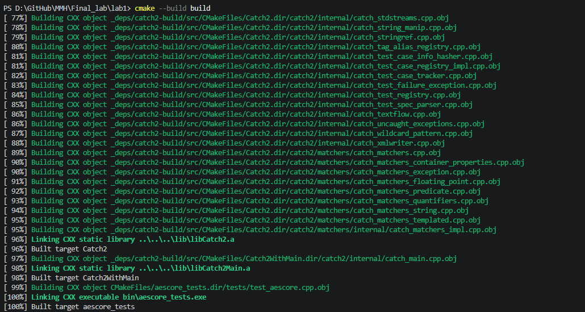
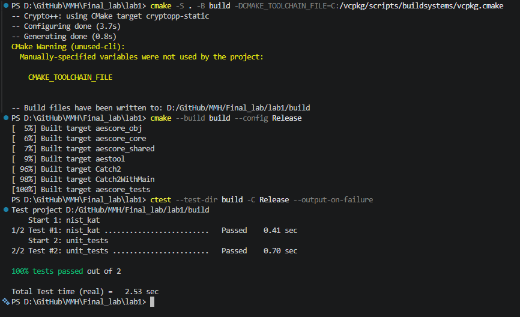

# Lab 1 — Mã hóa đối xứng với Crypto++ (`aestool`)

Công cụ dòng lệnh AES xây dựng trên **Crypto++**. Hỗ trợ các mode ECB, CBC, OFB, CFB, CTR, XTS và hai mode AEAD là CCM, GCM, kèm kiểm tra chống dùng sai (misuse prevention), trình chạy KAT (vector NIST) và chế độ benchmark.

> Crypto++ là thư viện mật mã duy nhất được sử dụng. Không dùng OpenSSL, libsodium hay thư viện mật mã nào khác. C++ STL được dùng cho I/O, phân tích CLI và đo thời gian.

## 1. Danh sách phụ thuộc (Dependencies)

| Thành phần | Phiên bản | Ghi chú |
|---|---|---|
| CMake | >= 3.16  | Build out-of-source |
| Trình biên dịch C++ | C++17 | GCC 11+ (Ubuntu), MSVC 2019/2022, MinGW-w64 GCC 11+ |
| Crypto++ | 8.9.0  | Thư viện mật mã duy nhất |
| vcpkg | mới nhất | Chỉ cho Windows / MSVC (cung cấp Crypto++) |
| Ubuntu LTS | 22.04 / 24.04 | Môi trường Linux đã kiểm thử |
| Windows | 10 / 11 | MSVC và MinGW-w64 |


## 2. Build
### 2.1 Linux

```bash
cmake -S . -B build
cmake --build build 
ctest --test-dir build --output-on-failure
```


### 2.2 Windows — MinGW-w64

```powershell
cmake -S . -B build -G "MinGW Makefiles"
cmake --build build -j
ctest --test-dir build --output-on-failure
```



### 3.3 Windows — MSVC

```powershell
cmake -S . -B build -DCMAKE_TOOLCHAIN_FILE=C:/vcpkg/scripts/buildsystems/vcpkg.cmake
cmake --build build --config Release
ctest --test-dir build -C Release --output-on-failure
```



> MSVC là generator đa cấu hình (multi-config), nên bắt buộc phải có `--config Release` / `-C Release`.

### 3.4 Ghi chú về cấu hình build

- `if(MSVC)`: dùng `/W4 /EHsc`, định nghĩa `NOMINMAX`, `WIN32_LEAN_AND_MEAN`
- `if(MINGW)`: dùng tùy chọn static linking
- `if(WIN32)`: link `ws2_32` và `advapi32` (thư viện hệ thống; Crypto++ cần `advapi32` cho RNG của hệ điều hành)

### 3.5 Vị trí file thực thi

| Nền tảng | File thực thi |
|---|---|
| Linux | `./build/bin/aestool` |
| Windows (MinGW) | `.\build\bin\aestool.exe` |
| Windows (MSVC) | `.\build\bin\aestool.exe`  |

---

## 3. Cách sử dụng

```
aestool <lệnh> [--in INFILE | --text "..."] [--out OUTFILE]
        [--key KEYFILE | --key-hex HEX] [--iv IV] [--nonce NONCE]
        [--mode ecb|cbc|ofb|cfb|ctr|xts|ccm|gcm] [--aead]
        [--aad FILE | --aad-text STRING] [--encode hex|base64|raw]
        [--threads N] [--kat vectors.json] [--allow-ecb] [--verbose]
```

Các lệnh: `keygen`, `encrypt`, `decrypt`, `bench`, và `--kat` để chạy KAT.

### 3.1 Ví dụ

Trên Windows dùng `aestool.exe` (đường dẫn như mục 3.5).

```bash
# Sinh khóa 256-bit
./build/bin/aestool keygen --bits 256 --out key.bin

# Mã hóa AES-256-GCM (IV/nonce tự sinh và lưu trong header của file đầu ra)
./build/bin/aestool encrypt --mode gcm --key key.bin --in plaintext.bin --out ciphertext.aest

# Giải mã (mode, IV/nonce và tag được đọc từ header)
./build/bin/aestool decrypt --key key.bin --in ciphertext.aest --out recovered.bin

# Chạy known-answer tests của NIST
./build/bin/aestool --kat vectors/nist_vectors.json --verbose

# Benchmark
./build/bin/aestool bench --modes gcm,ctr,cbc --sizes 1k,4k,16k,256k,1m,8m --runs 1000 --bits 256 --dir both
```

### 3.2 Xử lý khóa, IV và nonce

- Khóa: `--key KEYFILE` (nhị phân thô hoặc hex có header) hoặc `--key-hex HEX`.
- IV/nonce: nếu không cung cấp (trừ ECB/XTS), công cụ tự sinh bằng `AutoSeededRandomPool` của Crypto++ và lưu vào header của file đầu ra.
- IV/nonce có độ dài không hợp lệ sẽ bị từ chối.
- CTR/CCM/GCM: nếu phát hiện dùng lại cùng khóa + nonce thì thao tác bị từ chối *(TODO: mô tả logic phát hiện của bạn ở đây; đề yêu cầu phải ghi rõ)*.

### 3.3 Chống dùng sai (Misuse prevention)

- **ECB**: in cảnh báo WARNING và từ chối file lớn hơn 16 KiB, trừ khi có `--allow-ecb`.
- **AEAD**: tag luôn được xác thực khi giải mã; nếu sai thì công cụ dừng (fail closed) và không ghi plaintext ra.
- Đầu vào sai định dạng (header hỏng, độ dài sai, dữ liệu bị cắt) đều bị từ chối với mã thoát khác 0.

### 3.4 Mã hóa đầu ra (Encoding)

- Hiển thị trên màn hình mặc định là hex; ghi ra file mặc định là nhị phân thô.
- Có thể đổi bằng `--encode hex|base64|raw`.
- Đầu vào/đầu ra an toàn với UTF-8 và dữ liệu nhị phân.


## 4. Kiểm thử

```bash
ctest --test-dir build --output-on-failure           # unit test
./build/bin/aestool --kat vectors/nist_vectors.json  # KAT
```

- KAT: vector NIST SP 800-38A (CBC, CFB, OFB, CTR), NIST GCM và CCM. Kết quả in PASS/FAIL cho từng case kèm bảng tổng kết.
- Negative test: sai khóa, sai IV, sửa ciphertext (non-AEAD và AEAD), tag không hợp lệ, độ dài IV không hợp lệ.


## 5. Hạn chế đã biết 

- Cơ chế phát hiện nonce reuse chỉ dựa trên các header mà công cụ nhìn thấy; không phát hiện được việc dùng lại nonce giữa các file hay máy không liên quan.
- XTS chỉ bảo đảm bí mật, không có tính toàn vẹn (integrity).
- ECB chỉ dành cho học tập và benchmark, mặc định bị chặn với file lớn hơn 16 KiB.
- Khóa được đọc từ file hoặc dòng lệnh; `--key-hex` có thể bị lộ qua lịch sử shell và danh sách tiến trình.
- Kết quả benchmark phụ thuộc vào CPU governor / power plan, việc có AES-NI hay không và cờ build của Crypto++; chỉ nên so sánh giữa các nền tảng khi cờ build tương đương.
- Đã kiểm thử build với MSVC và MinGW trên Window và gcc trên Linux Ubuntu các trình biên dịch khác chưa được kiểm thử.
