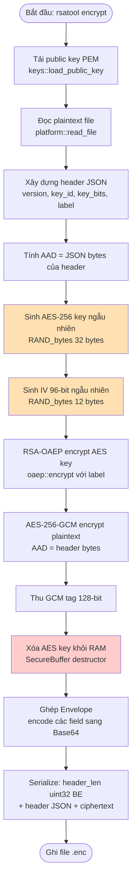
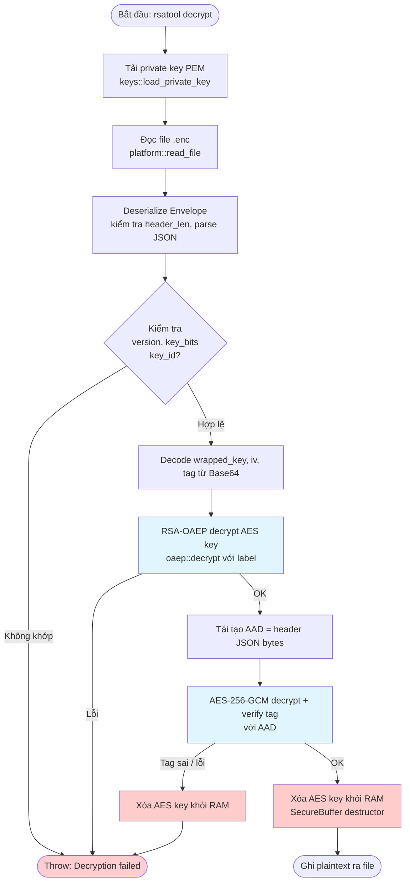

# Tài Liệu Thiết Kế Kỹ Thuật — rsatool

> **Phiên bản:** 1.0 | **Ngôn ngữ:** C++17 | **Thư viện:** OpenSSL 3.x

---

## Mục Lục

1. [Tổng quan kiến trúc](#1-tổng-quan-kiến-trúc)
2. [Giải thích từng module](#2-giải-thích-từng-module)
3. [Luồng dữ liệu (Data Flow)](#3-luồng-dữ-liệu-data-flow)
4. [Lý do chọn tham số mật mã](#4-lý-do-chọn-tham-số-mật-mã)
5. [Công thức giới hạn thông điệp (mLen)](#5-công-thức-giới-hạn-thông-điệp-mlen)
6. [Bảo mật chống Oracle Attack](#6-bảo-mật-chống-oracle-attack)
7. [Bố cục byte của Envelope](#7-bố-cục-byte-của-envelope)
8. [Quản lý bí mật — Xóa an toàn bộ nhớ](#8-quản-lý-bí-mật--xóa-an-toàn-bộ-nhớ)
9. [Hỗ trợ đa nền tảng](#9-hỗ-trợ-đa-nền-tảng)

---

## 1. Tổng Quan Kiến Trúc

```
┌─────────────────────────────────────────────────────────────────┐
│                           main.cpp                              │
│          (phân tích CLI, điều phối encrypt / decrypt)           │
└───────────────────────────┬─────────────────────────────────────┘
                            │
            ┌───────────────▼───────────────┐
            │         envelope.hpp/cpp       │
            │  (đọc/ghi file, ghép/tách gói) │
            └───────┬───────────┬───────────┘
                    │           │
        ┌───────────▼──┐  ┌─────▼──────────┐
        │  hybrid.hpp  │  │   codec.hpp    │
        │  /cpp        │  │   /cpp         │
        │ (AES-256-GCM)│  │ (Base64 / Hex) │
        └──────┬───────┘  └────────────────┘
               │
        ┌──────▼───────┐
        │  oaep.hpp    │
        │  /cpp        │
        │ (RSA-OAEP    │
        │  wrap/unwrap)│
        └──────┬───────┘
               │
   ┌───────────▼────────────┐
   │      keys.hpp/cpp      │
   │ (tạo khóa, load/save)  │
   └───────────┬────────────┘
               │
   ┌───────────▼────────────┐  ┌──────────────┐  ┌──────────────┐
   │      secure.hpp        │  │ platform.hpp │  │  errors.hpp  │
   │   (SecureBuffer RAII)  │  │  /cpp        │  │  (exception) │
   └────────────────────────┘  └──────────────┘  └──────────────┘
```

---

## 2. Giải Thích Từng Module

### 2.1 `errors.hpp`

**Vai trò:** Định nghĩa hệ thống ngoại lệ (exception hierarchy) thống nhất cho toàn bộ dự án.

**Các lớp chính:**

| Lớp | Kế thừa từ | Mô tả |
|-----|-----------|-------|
| `RsaToolError` | `std::runtime_error` | Lớp cơ sở cho mọi lỗi rsatool |
| `CryptoError` | `RsaToolError` | Lỗi từ OpenSSL (ERR_get_error) |
| `IoError` | `RsaToolError` | Lỗi đọc/ghi file, đường dẫn |
| `FormatError` | `RsaToolError` | Lỗi định dạng envelope, header JSON |
| `KeyError` | `RsaToolError` | Lỗi khóa không hợp lệ, kích thước không hỗ trợ |

**Thiết kế quan trọng:** Mọi đường dẫn giải mã thất bại đều ném ra **một thông điệp lỗi duy nhất** `"Decryption failed"` (xem mục 6).

**Hàm tiện ích:**
```cpp
// Lấy chuỗi lỗi từ OpenSSL ERR queue
std::string openssl_error_string();

// Ném CryptoError nếu ptr == nullptr
template<typename T>
T* check_openssl(T* ptr, const char* ctx);
```

---

### 2.2 `secure.hpp`

**Vai trò:** Cung cấp `SecureBuffer` — một RAII wrapper quanh `std::vector<uint8_t>` đảm bảo bộ nhớ nhạy cảm được xóa sạch khi ra khỏi scope.

**Lớp chính:**

```cpp
class SecureBuffer {
public:
    explicit SecureBuffer(size_t n);           // cấp phát n byte, zeroed
    SecureBuffer(const uint8_t* data, size_t n); // copy từ raw pointer
    ~SecureBuffer();                           // gọi OPENSSL_cleanse()
    
    uint8_t*       data();
    const uint8_t* data() const;
    size_t         size() const;
    
    // Di chuyển được, không sao chép được (move-only)
    SecureBuffer(SecureBuffer&&) noexcept;
    SecureBuffer& operator=(SecureBuffer&&) noexcept;
    SecureBuffer(const SecureBuffer&) = delete;
    SecureBuffer& operator=(const SecureBuffer&) = delete;
};
```

**Cơ chế xóa:** Destructor gọi `OPENSSL_cleanse(data(), size())` trước khi giải phóng bộ nhớ — đảm bảo trình biên dịch không tối ưu hóa bỏ lệnh xóa (vấn đề với `memset` thông thường).

---

### 2.3 `platform.hpp` / `platform.cpp`

**Vai trò:** Trừu tượng hóa các thao tác phụ thuộc hệ điều hành để code còn lại có thể biên dịch và chạy trên cả Linux và Windows.

**Các hàm:**

```cpp
namespace platform {

// Mở file ở chế độ nhị phân (binary), ném IoError nếu thất bại
std::ifstream open_binary_in(const std::filesystem::path& p);
std::ofstream open_binary_out(const std::filesystem::path& p);

// Đọc toàn bộ file vào vector<uint8_t>
std::vector<uint8_t> read_file(const std::filesystem::path& p);

// Ghi vector<uint8_t> ra file (tạo thư mục cha nếu cần)
void write_file(const std::filesystem::path& p,
                const std::vector<uint8_t>& data);

// Trả về path chuẩn hóa (xử lý ký tự đặc biệt Windows)
std::filesystem::path normalize(const std::string& s);

} // namespace platform
```

**Lý do có module này:**
- Windows dùng `\r\n` trong text mode → mọi I/O phải dùng binary mode.
- `std::filesystem` có hành vi khác nhau với symbolic links trên Linux vs. Windows.
- Tập trung logic nền tảng vào một chỗ giúp test và bảo trì dễ dàng.

---

### 2.4 `codec.hpp` / `codec.cpp`

**Vai trò:** Mã hóa và giải mã Base64 / Hex cho dữ liệu nhị phân.

**API chính:**

```cpp
namespace codec {

// Base64 (chuẩn RFC 4648, không padding tùy chọn)
std::string    base64_encode(const uint8_t* data, size_t len);
SecureBuffer   base64_decode(const std::string& s);

// Hex (chữ thường, uppercase tùy chọn)
std::string    hex_encode(const uint8_t* data, size_t len, bool upper = false);
SecureBuffer   hex_decode(const std::string& s);

} // namespace codec
```

**Xử lý lỗi:** `base64_decode` và `hex_decode` ném `FormatError` với thông báo chung nếu chuỗi đầu vào không hợp lệ — tránh rò rỉ thông tin qua thông báo lỗi chi tiết.

---

### 2.5 `keys.hpp` / `keys.cpp`

**Vai trò:** Sinh cặp khóa RSA, tải/lưu khóa theo định dạng PEM, và kiểm tra kích thước khóa hợp lệ.

**API chính:**

```cpp
namespace keys {

// Kích thước khóa được hỗ trợ
constexpr int KEY_BITS_3072 = 3072;
constexpr int KEY_BITS_4096 = 4096;

// Sinh cặp khóa mới (EVP_PKEY*, dùng EVP_PKEY_CTX)
using KeyPair = std::pair<EvpPkeyPtr, EvpPkeyPtr>; // {public, private}
KeyPair generate_keypair(int bits);

// Tải từ file PEM
EvpPkeyPtr load_public_key(const std::filesystem::path& p);
EvpPkeyPtr load_private_key(const std::filesystem::path& p,
                             const std::string& passphrase = "");

// Lưu ra file PEM
void save_public_key(const std::filesystem::path& p, EVP_PKEY* key);
void save_private_key(const std::filesystem::path& p, EVP_PKEY* key,
                      const std::string& passphrase = "");

// Kiểm tra kích thước (ném KeyError nếu không phải 3072 / 4096)
void validate_key_size(EVP_PKEY* key);

// Lấy kích thước modulus theo byte (k)
int modulus_bytes(EVP_PKEY* key);

} // namespace keys
```

**Quản lý lifetime:** Sử dụng `using EvpPkeyPtr = std::unique_ptr<EVP_PKEY, decltype(&EVP_PKEY_free)>` để đảm bảo giải phóng bộ nhớ tự động.

---

### 2.6 `oaep.hpp` / `oaep.cpp`

**Vai trò:** Thực hiện mã hóa và giải mã RSA-OAEP (wrap/unwrap khóa AES).

**API chính:**

```cpp
namespace oaep {

// Mã hóa (wrap) dữ liệu ngắn bằng khóa công khai RSA
// label: chuỗi ngữ cảnh (AAD tương đương) gắn vào lHash
SecureBuffer encrypt(EVP_PKEY*          pub_key,
                     const uint8_t*     plaintext,
                     size_t             pt_len,
                     const std::string& label = "");

// Giải mã (unwrap) bằng khóa riêng tư RSA
// Ném CryptoError("Decryption failed") nếu thất bại (không tiết lộ lý do)
SecureBuffer decrypt(EVP_PKEY*          priv_key,
                     const uint8_t*     ciphertext,
                     size_t             ct_len,
                     const std::string& label = "");

} // namespace oaep
```

**Tham số OpenSSL được đặt:**

```cpp
EVP_PKEY_CTX_set_rsa_padding(ctx, RSA_PKCS1_OAEP_PADDING);
EVP_PKEY_CTX_set_rsa_oaep_md(ctx, EVP_sha256());   // Hash: SHA-256
EVP_PKEY_CTX_set_rsa_mgf1_md(ctx, EVP_sha256());   // MGF1 hash: SHA-256
// Label được set qua EVP_PKEY_CTX_set0_rsa_oaep_label()
```

**Xử lý lỗi thống nhất:** Mọi nhánh thất bại trong `decrypt()` đều ném ra:
```cpp
throw CryptoError("Decryption failed");
```

---

### 2.7 `hybrid.hpp` / `hybrid.cpp`

**Vai trò:** Thực hiện mã hóa lai (hybrid encryption): sinh khóa AES-256 tạm thời, mã hóa dữ liệu bằng AES-256-GCM, bảo vệ khóa AES bằng RSA-OAEP.

**API chính:**

```cpp
namespace hybrid {

struct EncryptResult {
    SecureBuffer wrapped_key;  // RSA-OAEP(AES key) — độ dài = modulus_bytes
    SecureBuffer iv;           // 96-bit GCM IV
    SecureBuffer ciphertext;   // AES-GCM ciphertext
    SecureBuffer tag;          // 128-bit GCM authentication tag
};

// Mã hóa: sinh khóa AES ngẫu nhiên, mã hóa plaintext, wrap khóa bằng RSA
EncryptResult encrypt(EVP_PKEY*          pub_key,
                      const uint8_t*     plaintext,
                      size_t             pt_len,
                      const uint8_t*     aad,      // Additional Authenticated Data
                      size_t             aad_len,
                      const std::string& label = "");

// Giải mã: unwrap khóa AES bằng RSA, giải mã AES-GCM
SecureBuffer decrypt(EVP_PKEY*          priv_key,
                     const uint8_t*     wrapped_key, size_t wk_len,
                     const uint8_t*     iv,          size_t iv_len,
                     const uint8_t*     ciphertext,  size_t ct_len,
                     const uint8_t*     tag,         size_t tag_len,
                     const uint8_t*     aad,         size_t aad_len,
                     const std::string& label = "");

} // namespace hybrid
```

**Luồng mã hóa nội bộ:**

1. Sinh 256-bit (32 byte) khóa AES ngẫu nhiên qua `RAND_bytes()` → lưu vào `SecureBuffer`.
2. Sinh 96-bit (12 byte) IV ngẫu nhiên qua `RAND_bytes()`.
3. Gọi `oaep::encrypt(pub_key, aes_key, 32, label)` → `wrapped_key`.
4. Khởi tạo `EVP_CIPHER_CTX` với `EVP_aes_256_gcm()`.
5. `EVP_EncryptInit_ex`, set IV length = 12.
6. `EVP_EncryptUpdate` với AAD (không xuất ciphertext).
7. `EVP_EncryptUpdate` với plaintext → ciphertext.
8. `EVP_EncryptFinal_ex` → flush.
9. `EVP_CIPHER_CTX_ctrl(ctx, EVP_CTRL_GCM_GET_TAG, 16, tag)` → 128-bit tag.
10. Xóa `aes_key` (SecureBuffer destructor).

---

### 2.8 `envelope.hpp` / `envelope.cpp`

**Vai trò:** Định nghĩa cấu trúc gói (envelope) hoàn chỉnh, ghép/tách các thành phần, đọc/ghi file `.enc`.

**Struct dữ liệu:**

```cpp
struct Envelope {
    // --- Header (JSON, được mã hóa Base64 trong field "header") ---
    std::string   version;        // "1.0"
    std::string   key_id;         // fingerprint SHA-256 của public key
    int           key_bits;       // 3072 hoặc 4096
    std::string   oaep_label;     // label dùng trong RSA-OAEP
    std::string   wrapped_key_b64; // RSA-OAEP(AES key), Base64
    std::string   iv_b64;          // 96-bit IV, Base64
    std::string   tag_b64;         // 128-bit GCM tag, Base64
    // -------------------------------------------------------------
    
    std::vector<uint8_t> ciphertext; // AES-GCM ciphertext thô (nhị phân)
};

// Tuần tự hóa: Envelope → bytes (xem bố cục mục 7)
std::vector<uint8_t> serialize(const Envelope& env);

// Giải tuần tự hóa: bytes → Envelope (ném FormatError nếu lỗi)
Envelope deserialize(const std::vector<uint8_t>& data);

// Ghi envelope ra file
void write_envelope(const std::filesystem::path& p, const Envelope& env);

// Đọc envelope từ file
Envelope read_envelope(const std::filesystem::path& p);
```

---

### 2.9 `main.cpp`

**Vai trò:** Điểm vào chương trình — phân tích tham số CLI và điều phối các lệnh.

**Các lệnh được hỗ trợ:**

| Lệnh | Mô tả |
|------|-------|
| `keygen` | Sinh cặp khóa RSA mới |
| `encrypt` | Mã hóa file với public key |
| `decrypt` | Giải mã file với private key |
| `inspect` | In thông tin header của file `.enc` |

**Cấu trúc xử lý lỗi ở main:**

```cpp
int main(int argc, char* argv[]) {
    try {
        // ... phân tích CLI và gọi sub-command ...
    } catch (const RsaToolError& e) {
        std::cerr << "[ERROR] " << e.what() << "\n";
        return 1;
    } catch (const std::exception& e) {
        std::cerr << "[FATAL] " << e.what() << "\n";
        return 2;
    }
    return 0;
}
```

---

## 3. Luồng Dữ Liệu (Data Flow)

### 3.1 Luồng Mã Hóa (Encrypt)



### 3.2 Luồng Giải Mã (Decrypt)



> **Nguyên tắc "decrypt-then-release":** Chỉ ghi plaintext ra file sau khi **toàn bộ** xác thực GCM tag thành công. Không có byte plaintext nào được giải phóng ra ngoài trước khi xác thực hoàn tất.

---

## 4. Lý Do Chọn Tham Số Mật Mã

### 4.1 Hàm băm SHA-256

| Tiêu chí | SHA-256 | SHA-1 (cũ) | SHA-512 |
|----------|---------|-----------|---------|
| Độ bảo mật va chạm | 128-bit (an toàn) | ≤63-bit (bị phá) | 256-bit (quá mức cần) |
| Chuẩn hóa | NIST FIPS 180-4 | Deprecated | FIPS 180-4 |
| mLen còn lại (k=384) | 318 byte | 342 byte | 254 byte |
| Phần cứng AES-NI hỗ trợ | SHA-NI trên x86 | Không | Chậm hơn |

**Quyết định:** SHA-256 cân bằng tốt giữa bảo mật, hiệu năng và không gian thông điệp. NIST và RFC 8017 đều khuyến nghị SHA-256 cho OAEP hiện đại.

### 4.2 MGF1 (Mask Generation Function 1)

OAEP yêu cầu một MGF để tạo mặt nạ. MGF1 với SHA-256 là lựa chọn chuẩn theo RFC 8017, Phần B.2.1:

```
MGF1(mgfSeed, maskLen) = T = T_0 || T_1 || ... 
  T_i = Hash(mgfSeed || I2OSP(i, 4))
```

Việc dùng **cùng SHA-256 cho cả OAEP hash lẫn MGF1** (thay vì kết hợp SHA-256 + SHA-1) đảm bảo bảo mật đồng nhất và đơn giản hóa kiểm thử.

### 4.3 IV 96-bit cho AES-GCM

- **Khuyến nghị NIST SP 800-38D:** IV 96-bit (12 byte) là độ dài "khuyến nghị" tối ưu cho GCM vì cho phép counter được khởi tạo trực tiếp mà không cần băm thêm.
- Với IV dài hơn hoặc ngắn hơn 96-bit, GCM phải tính `J0 = GHASH(H, IV || 0^(s+64) || len(IV)_64)` — tốn kém hơn.
- Mỗi IV được sinh **ngẫu nhiên** bằng `RAND_bytes()` → xác suất va chạm với 2³² file đầu tiên: `< 2^(96) / 2^32 / 2 = 2^63` (không đáng kể).

### 4.4 AAD Gắn Header (Header Binding qua AAD)

GCM tag xác thực cả ciphertext lẫn AAD mà không mã hóa AAD. Bằng cách đặt `AAD = header JSON bytes`:

- Bất kỳ thay đổi nào ở header (version, key_id, key_bits, label) → GCM tag xác thực thất bại → `EVP_DecryptFinal_ex` trả về lỗi → ném `CryptoError("Decryption failed")`.
- Điều này ngăn kẻ tấn công hoán đổi header của một envelope hợp lệ sang envelope khác (**header substitution attack**).
- Không cần HMAC riêng cho header — GCM cung cấp bảo mật AEAD (Authenticated Encryption with Associated Data) tích hợp sẵn.

---

## 5. Công Thức Giới Hạn Thông Điệp (mLen)

Theo RFC 8017, Phần 7.1.1, giới hạn tối đa của dữ liệu thuần (plaintext) trong một thao tác RSA-OAEP:

```
mLen ≤ k - 2·hLen - 2
```

Trong đó:
- `k` = kích thước modulus RSA tính theo **byte** (= `key_bits / 8`)
- `hLen` = độ dài output của hàm băm tính theo **byte** (SHA-256 → `hLen = 32`)

**Với SHA-256 (`hLen = 32`):**

| Kích thước khóa | `k` (byte) | `2·hLen` | `+2` | `mLen` tối đa |
|----------------|-----------|---------|------|--------------|
| RSA-3072       | 384       | 64      | 2    | **318 byte** |
| RSA-4096       | 512       | 64      | 2    | **446 byte** |

> **Ý nghĩa:** RSA-OAEP chỉ bảo vệ trực tiếp tối đa 318 / 446 byte. Đây là lý do tại sao khóa AES-256 (32 byte) luôn nằm trong giới hạn, nhưng không thể mã hóa trực tiếp file lớn — đây là động lực của thiết kế hybrid.

---

## 6. Bảo Mật Chống Oracle Attack

### 6.1 Vì sao dùng một thông báo lỗi duy nhất?

**Bleichenbacher Attack (1998)** trên RSA-PKCS#1 v1.5 cho thấy: nếu hệ thống trả về thông báo lỗi **khác nhau** tùy theo *loại* lỗi padding, kẻ tấn công có thể dùng oracle này để giải mã ciphertext RSA tùy ý chỉ bằng cách gửi nhiều ciphertext biến thể.

**Manger Attack (2001)** trên RSA-OAEP tương tự: nếu padding oracle tiết lộ thông tin về bit đầu tiên của `EM` (encoded message), kẻ tấn công có thể binary search giải mã ciphertext.

**Biện pháp trong rsatool:**

```
Bất kỳ lỗi nào trong decrypt() (sai padding, sai label, sai tag, sai key...)
         ↓
throw CryptoError("Decryption failed")
         ↓
main.cpp chỉ in: "[ERROR] Decryption failed"
```

Kẻ tấn công **không thể phân biệt** lỗi nào xảy ra → không có oracle.

### 6.2 Nguyên tắc Decrypt-Then-Release

```
1. Giải mã RSA-OAEP → AES key (trong RAM)
2. Giải mã AES-GCM → plaintext (trong RAM)
3. Xác thực GCM tag → thành công hay thất bại
4a. Nếu thất bại: xóa AES key + plaintext → ném lỗi (KHÔNG ghi file)
4b. Nếu thành công: ghi plaintext ra file → xóa AES key khỏi RAM
```

Không có trường hợp nào plaintext được ghi ra file trước khi xác thực tag hoàn tất. Điều này ngăn **chosen-ciphertext attack** dạng partial decryption.

---

## 7. Bố Cục Byte Của Envelope

File `.enc` được viết hoàn toàn ở định dạng nhị phân (binary). Cấu trúc:

```
Offset                  Độ dài         Nội dung
─────────────────────────────────────────────────────────────────
0                       4 byte         header_len (uint32, big-endian)
4                       header_len     Header JSON (UTF-8)
4 + header_len          (còn lại)      AES-GCM ciphertext (nhị phân thô)
─────────────────────────────────────────────────────────────────
```

**Chi tiết Header JSON** (ví dụ):

```json
{
  "version":     "1.0",
  "key_id":      "a3f8...e2c1",
  "key_bits":    3072,
  "oaep_label":  "rsatool-v1",
  "wrapped_key": "BASE64(RSA-OAEP(AES_KEY))",
  "iv":          "BASE64(12-byte IV)",
  "tag":         "BASE64(16-byte GCM tag)"
}
```

**Giải tuần tự hóa (`deserialize`):**

```cpp
// Bước 1: Đọc 4 byte đầu
uint32_t header_len = read_be32(data, 0);  // big-endian

// Bước 2: Kiểm tra độ dài hợp lệ
if (4 + header_len > data.size())
    throw FormatError("Truncated envelope: header_len exceeds file size");
if (header_len == 0)
    throw FormatError("Empty header");
if (header_len > MAX_HEADER_LEN)   // ví dụ 1 MiB
    throw FormatError("Absurd header_len");

// Bước 3: Parse JSON
auto header_json = std::string(data.begin() + 4,
                               data.begin() + 4 + header_len);
// ...

// Bước 4: Lấy ciphertext
env.ciphertext = std::vector<uint8_t>(data.begin() + 4 + header_len,
                                      data.end());
```

**Lý do dùng big-endian:** Chuẩn mạng (network byte order) và nhất quán trên mọi kiến trúc CPU. `header_len` được encode/decode bằng `htonl` / `ntohl` (hoặc tương đương portable).

---

## 8. Quản Lý Bí Mật — Xóa An Toàn Bộ Nhớ

### 8.1 Vấn đề với `memset` thông thường

Trình biên dịch C++ được phép **tối ưu hóa bỏ** `memset` nếu biến không được dùng sau đó. Ví dụ:

```cpp
void bad_clear(uint8_t* key, size_t len) {
    memset(key, 0, len);  // Trình biên dịch CÓ THỂ bỏ dòng này!
    free(key);
}
```

### 8.2 Giải pháp: `OPENSSL_cleanse`

OpenSSL cung cấp `OPENSSL_cleanse()` — đảm bảo không bị tối ưu hóa bỏ (thường dùng `volatile` hoặc memory barrier):

```cpp
SecureBuffer::~SecureBuffer() {
    if (!data_.empty()) {
        OPENSSL_cleanse(data_.data(), data_.size());
    }
    // std::vector destructor giải phóng bộ nhớ sau
}
```

### 8.3 Vòng đời của khóa AES

```
hybrid::encrypt()
  │
  ├─ SecureBuffer aes_key(32);     ← cấp phát
  ├─ RAND_bytes(aes_key.data(), 32) ← điền ngẫu nhiên
  ├─ oaep::encrypt(aes_key)        ← RSA wrap
  ├─ EVP_EncryptUpdate(aes_key)    ← dùng mã hóa AES
  │
  └─ [end of scope / return]
       └─ ~SecureBuffer()
            └─ OPENSSL_cleanse()   ← xóa sạch
            └─ free()              ← giải phóng
```

Khóa AES **không bao giờ** xuất hiện trong output file (chỉ dạng được RSA-OAEP bảo vệ).

---

## 9. Hỗ Trợ Đa Nền Tảng

### 9.1 I/O Nhị Phân

Mọi thao tác đọc/ghi file đều dùng `std::ios::binary`:

```cpp
// platform.cpp
std::ifstream platform::open_binary_in(const std::filesystem::path& p) {
    std::ifstream f(p, std::ios::binary);
    if (!f) throw IoError("Cannot open file: " + p.string());
    return f;
}
```

Điều này tránh Windows tự ý chuyển đổi `\n` ↔ `\r\n` làm hỏng dữ liệu nhị phân.

### 9.2 `std::filesystem`

- Sử dụng `std::filesystem::path` thay vì `std::string` cho mọi đường dẫn.
- Trên Windows, `path` xử lý ký tự Unicode (UTF-16) nội bộ.
- `platform::normalize()` chuyển đổi dấu `\` thành `/` để code còn lại nhất quán.

### 9.3 CMake Cross-Platform Build

`CMakeLists.txt` phát hiện nền tảng và link đúng thư viện:

```cmake
if(WIN32)
    target_link_libraries(rsatool PRIVATE ws2_32 crypt32)
endif()

find_package(OpenSSL REQUIRED)
target_link_libraries(rsatool PRIVATE OpenSSL::SSL OpenSSL::Crypto)
```

### 9.4 Endianness của `header_len`

`header_len` được encode theo **big-endian** bằng code portable (không dùng `htonl` trực tiếp vì Windows có thể cần include riêng):

```cpp
static void write_be32(std::vector<uint8_t>& buf, uint32_t v) {
    buf.push_back((v >> 24) & 0xFF);
    buf.push_back((v >> 16) & 0xFF);
    buf.push_back((v >>  8) & 0xFF);
    buf.push_back((v >>  0) & 0xFF);
}

static uint32_t read_be32(const std::vector<uint8_t>& buf, size_t off) {
    return (uint32_t(buf[off])   << 24) |
           (uint32_t(buf[off+1]) << 16) |
           (uint32_t(buf[off+2]) <<  8) |
           (uint32_t(buf[off+3]) <<  0);
}
```

---

*Tài liệu này được tạo cùng với source code và phải được cập nhật khi có thay đổi API.*
