# Note
- Anh Tự có điểm danh, hãy đi học!
- DUALBOOT DUALBOOT
- Anh Tự ghét người đi trễ, hãy đi sớm, càng sớm càng gud. Hoặc là đi trễ và bị var, hát 1 bài/5 phút đi trễ
- Luôn check MSTeam, anh ấy hay đột kích và gửi bài trước giờ G.
- Đừng lướt mxh trong giờ ảnh pls, all in tập trung để ảnh hỏi còn trả lời được.
- Cái gì làm trước được thì cứ làm trước trừ lab cài đặt mấy cái có ver cũ (Openssl, cryptopp) - TvT (người phải cài lại cho hay)
- Hãy cài vào thư mục một cách **đúng trình tự**, giống anh ấy càng tốt và **phải nhớ** vị trí thư mục để dùng cho sau này.
- Luôn mang máy tính đi học
- AI có thể hỗ trợ nhưng phải hiểu và sửa đc, khuyến khích mindset học sâu hơn, tự học vì ầy chỉ cho hiểu base và cách nó hoạt động
# Week 01: Introduction
*Bữa này tôi cúp*

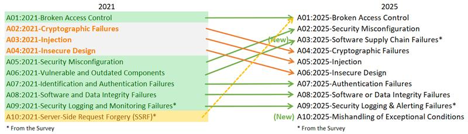

Chung quy là tìm hiểu và thử decode vài mật mã dựa trên web hoặc trình code nào đó(?)
# Week 02: Cryptanalysis SPN ciphers
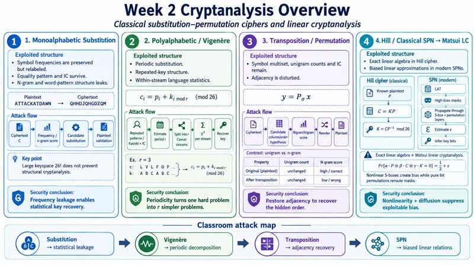

Chung quy hôm này thì ae sẽ được code của anh Tự, tìm hiểu về tần suất các chữ cái -> giải mã

Cơ chế giải mã của tuần này là dạng ánh xạ nên dựa vào tần suất sẽ giải ra được, còn how to tính tần suất và cách dùng thì rcm nghe anh Tự nha. Có thể check sơ bằng web [Dcode](https://www.dcode.fr/en)

BTVN week 2 của anh Tự giao tui nà: [BTVNWeek02](Class/Week02/25521638_MaHoaTiengViet.md)

# Week 03: Stream Ciphers - Algorithms and Cryptanalysis
Cài PyQt6 cho python để chạy demo cho buổi học

```python -m pip install PyQt6```

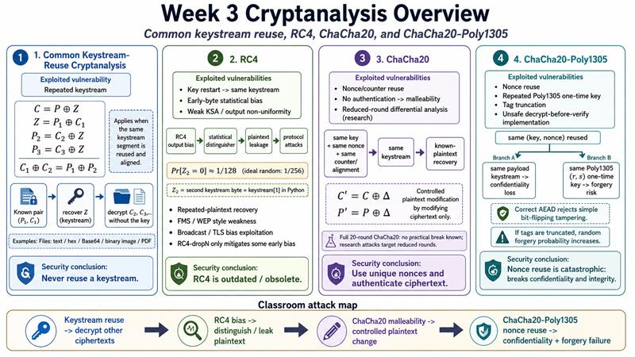

Tuần này sẽ cần thư viện OpenSSL để encode và decode text,file. Chung quy sẽ học về cách encode và decode của các chế độ mà sơ khai, tránh tình trạng đọc tần số để giải mã.

-> Nó mã hóa bằng cách ánh xạ ma trận tạo riêng, mã hóa dòng, mã hóa cột, xoay vòng,...(nên nghe anh Tự giải thích thật kĩ)

-> chỉ có Chacha20-Poly1305 mới có key check nội dung có bị đổi không, còn lại đều có lỗ hỏng thay đổi cipher text

## Thực hành Week 1: cài đặt môi trường
- Hãy cài đặt trước mingw, visual code (tím), docker (nếu được), **Dual boot (bắt buộc)**
- Thư viện mật mã thì nên kiếm cái mới nhất mà cài, hoặc là không cài và đợi thầy

**Bonus**: Docker

# Week 04: Modern Symmetric Ciphers – AES
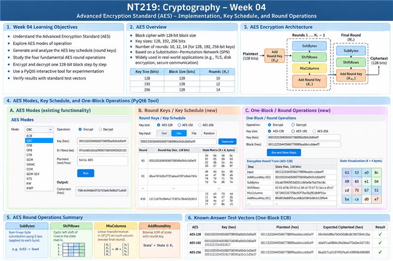

Tìm hiểu cơ chế hoạt động của AES, các mode AES. Giải mã và mã hóa AES(?)

# Week 05: Cryptanalysis the Modes of Operation of Block Ciphers
Update của week 4 vì week 4 chỉ mã hóa 1 block, giờ ta đi mã hóa một file lớn gồm nhiều block.

Có thể là làm task mã hóa và phân tích hiệu năng các mode AES.

## Thực hành week 2: AES
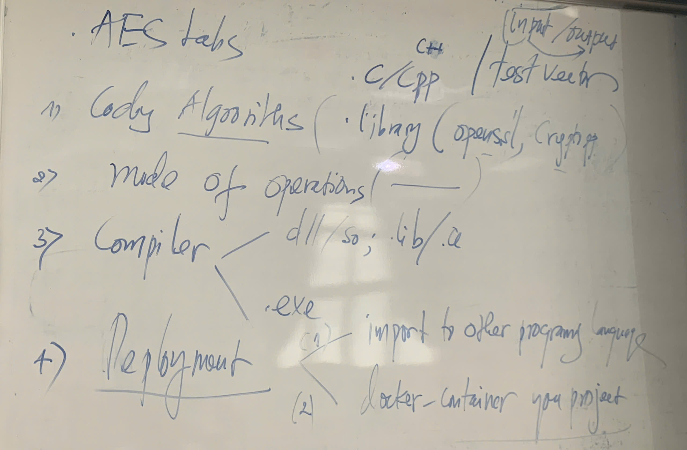 ✅

**Bonus**: Docker, guii, dynamic aes
# Week 06: RSA and Cryptanalysis
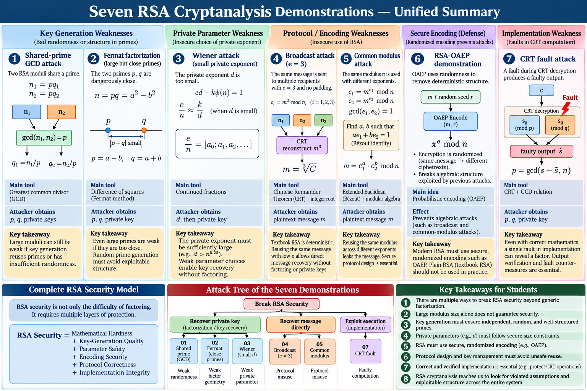
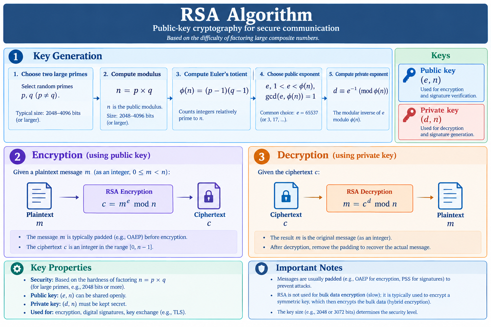
-> Tạo key đóng gói (pub) để giải (private)

# Week 07: Discrete-Logarithm Cryptography and Cryptanalysis
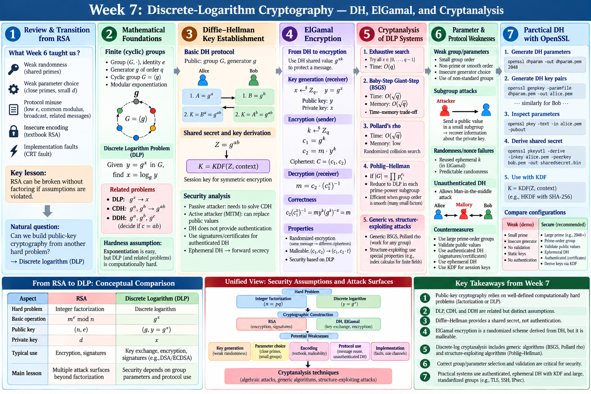

-> Cải tiến là key không ai handle full mà là mỗi người làm 1 phần

Tuần này học về FF, tuần sau thì học EC

VD: $3^x= 5 mod (31)$

-> $x = {0,1,2....30}$

-> thuật toán đảo mod

### Cơ chế PHE

Security lớn hay không phụ thuộc hoàn toàn p có lớn k. Giống cái mode 2048, 3072,... trong file [ffdhe](Class/Week07/week07_codes/ffdhe_openssl_pyqt6.py) là hiểu sơ cách khoa pub ngta + pri mình -> z chung. Cơ chế này không chống được việc biết ng cầm là ai

Khó khăn
- Không biết key thật key giả
- Có thể sửa được ndung file
- ver này tính toán nặng
- Không có tính giá trị thực dụng cao

Nếu như server có public key thì làm sao dùng đc 1 round để gửi cả mess key
-> gửi public key mình, file mã hóa

- p cần đủ lớn và g cần có bậc đủ lớn ($g^m$) để tránh bị burf force
- tốt nhất bậc/số ptu g nên gần bằng q

->> Pratical DH with **OpenSSL**

### Why Openssl?
Đọc cái này [thư viện cryp](https://en.wikipedia.org/wiki/Comparison_of_cryptography_libraries), check cái verify

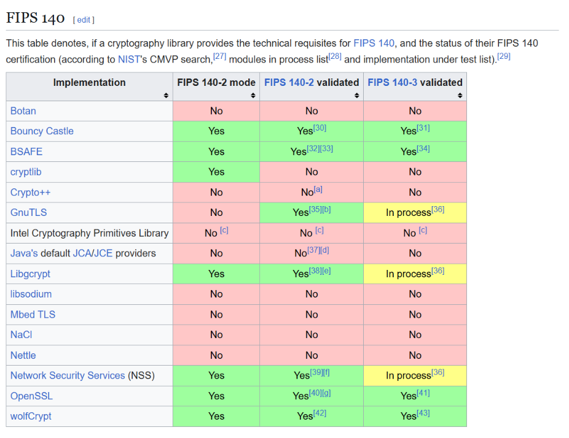
- Dùng thư viện nhưng không dùng cái **có sẵn**
- Crypto++ vẫn ok nhưng không rcm

> week 7 và 6 bổ sung cho nhau về aes, nhược điểm là tính toán lớn -> week 8 sẽ giúp update cái thuật toán này
## Thực hành week 3: Sử dụng thư viện cho RSA và OpenSSL
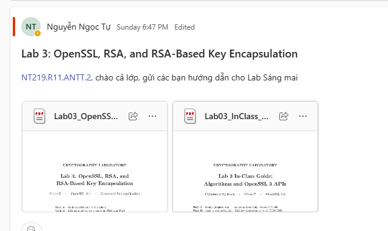
- abcdef in class
- abcdef at home project

Chủ yếu là làm quen với task.json, cmake, lệnh của OpenSSL.
# Week 08: Elliptic-Curve Cryptography and Cryptanalysis
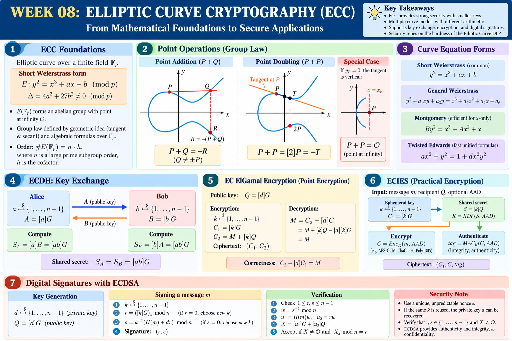

**Tuần sau báo cáo, MỖI NHÓM 3 PHÚT**
```
Chiều dki đồ án, tuần sau báo cáo proposal
Đồ án -> 3 góc nhìn:
- Secure Communication
- Secure Storage
- Secure process logics
Đồ án fail? Why ?
Ko xác định dc system ? rủi ro where ?
Weakness: Process Logic
Breakdown --> Problem? Solution?

Vẽ 2 hình quan trọng?
- system ontology
- implement ontology

Bám sát nội dung:
slide 1: câu chuyện ? rủi ro ? giải pháp
slide 2: triển khai ? kiến trúc ?
slide 3: phân phối
```
RSA, FF DHE đã được thay thế bởi ECS

Cách xem public key của web.

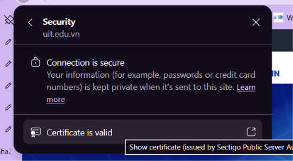
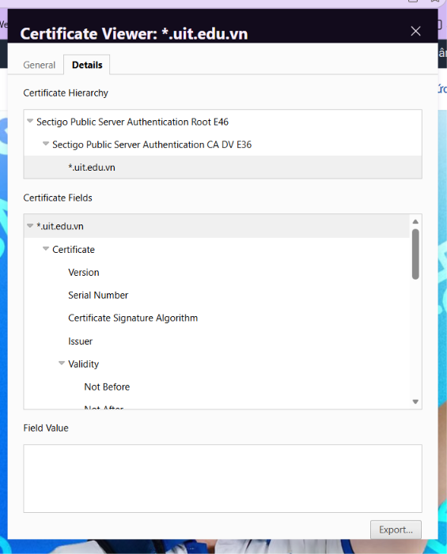

Lí do ECS được dùng: chi phí tính toán nhẹ hơn.

Thuật toán Eculid
- Sau này sẽ code trực tiếp từ thư viện
- Phần [ECC dưới](Class\Week08\Week08_Codes\ECC_Cryptanalysis) tự học ở nhà.

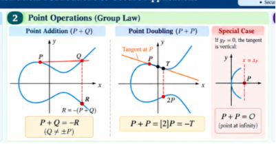
Dk: 
- luôn luôn có 2 nhánh vô cực. P+Q =T đối xứng xxuống dưới mới ra tổng
- Đường cong trơn luôn luôn khả vi
- Lưu ý: P+P viết tắt thành 2P

> Infinity(O)? Why, where? Nhưng mà đối xứng xuống vẫn cứu đc

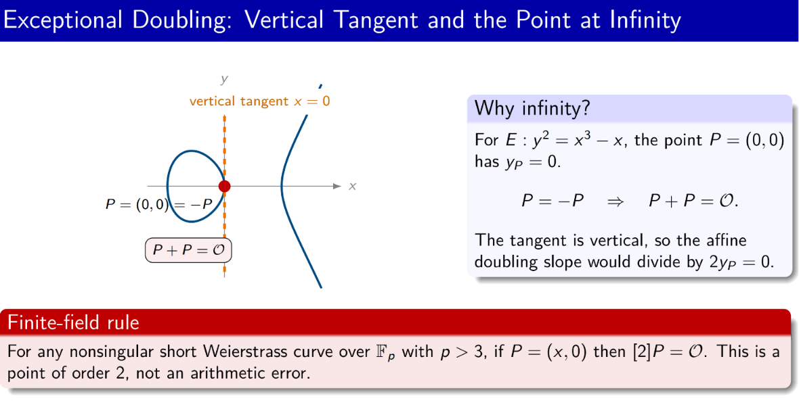

P=(x,y)

p'=(x,-y) = -p

p+p' = O

p+O=p -> vì o vs p cắt điểm trên mà k lấy điểm trên, đối xuống -> b

O+p=p

Vai trò nó na ná số 0 nhưng nó không phải số 0.

Dựa vào model mà nó sẽ có nhiều cách thay đổi

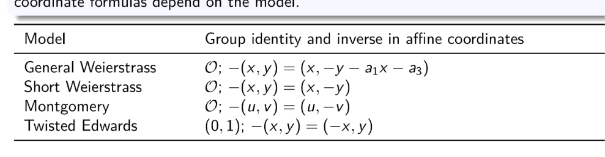

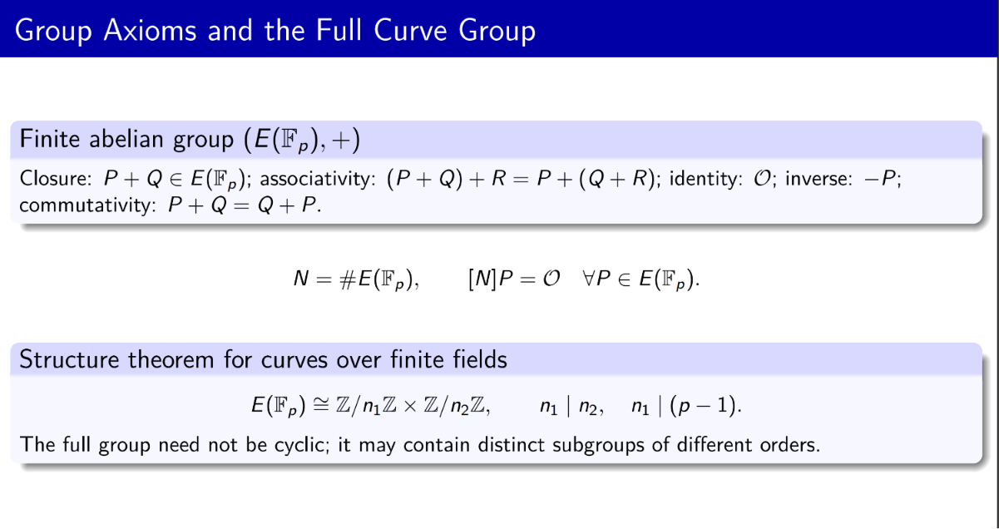

-> Công trừ giao hoán được, có đối được, có cả identity O (không ảnh hưởng tới phép tính)

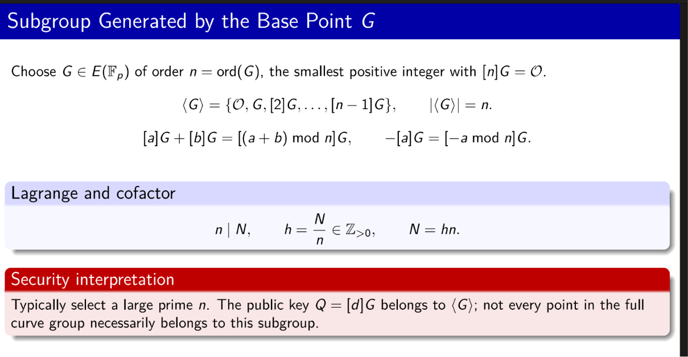
Elliptic group
- Cái hay là nó ranodm, khó và gần như k thể biết được. tập cần đủ lớn để giấu d
- n phải lớn, phải chọn G sao nó k biết thành 1 vòng lập lại

[secure curve](https://safecurves.cr.yp.to/) công bố về curve, nên xem qua.
curve225519, $2^255$-19
> Triển khai chuẩn kháng lượng tử

Chốt: 
- d là secret
- Q= G+G+G...+G (cộng d lần)

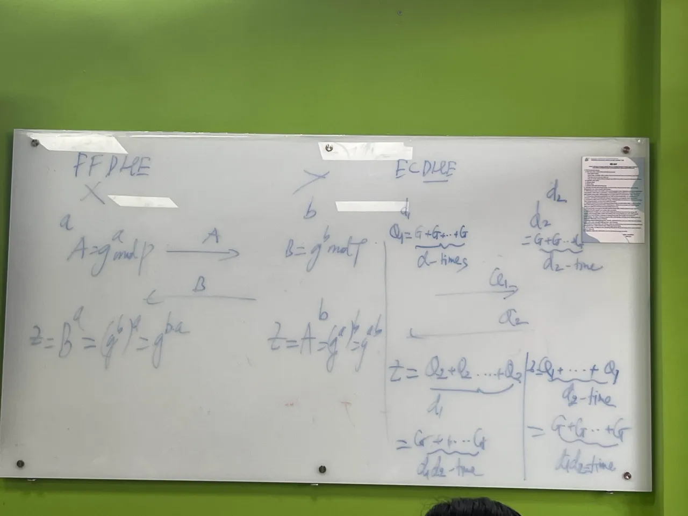

task:
thỏa thuận curve, gửi public key, tính z có cùng k
tình khóa k cho aes
> về nhà làm task 3ng
> từ tạo ra đến an toàn -> câu chuyện khác

# Lab 4
file lab 4 in class guide
a,b,c làm tại lớp
d,e,f hoàn thành nộp bài cuối kì
```
Task A(task_a_ec_arith.cpp): group law, double-and-add, invalid-curve point
Task B(task_b_ec_keys.cpp): keys for six curves, Q = dG, raw import
Task C(task_c_ecdh.cpp): ECDH, X25519 ladder, ECIES
Task D(task_d_rsa_sig.cpp): forgeries, blinding attack, PKCS#1 v1.5, PSS    
Task E(task_e_ecdsa.cpp): ECDSA, RFC 6979, nonce reuse, malleability 
Task F(task_f_eddsa.cpp): Ed25519 by hand, all schemes compared
```
làm vc với curve ec

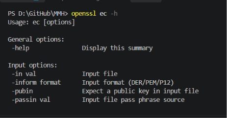

> task chính nộp cuối kì là dùng cmake ba môi trường setting g++, clang, msvc

Số học:
- convert mọi thứ -> curve
- curve -> int, string,..

-> task cần làm

load lên mtrg vs -> compile đc = cl

compile openssl cl, gcc,msvc-> về check lại laptop và pc trên cả hai hệ

isogenry (NIST round 3)-> hẹo 

**chuẩn hiện tại là nist round 4**

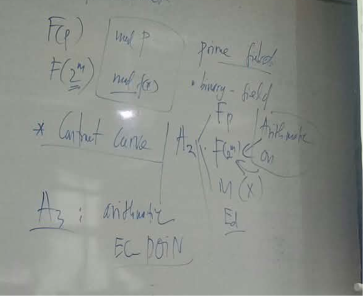

> Arithmetic computation on F(2^m) in openssl?

Hình học xạ ảnh -> phép chiếu vector, hãy đọc nếu bạn đủ tày

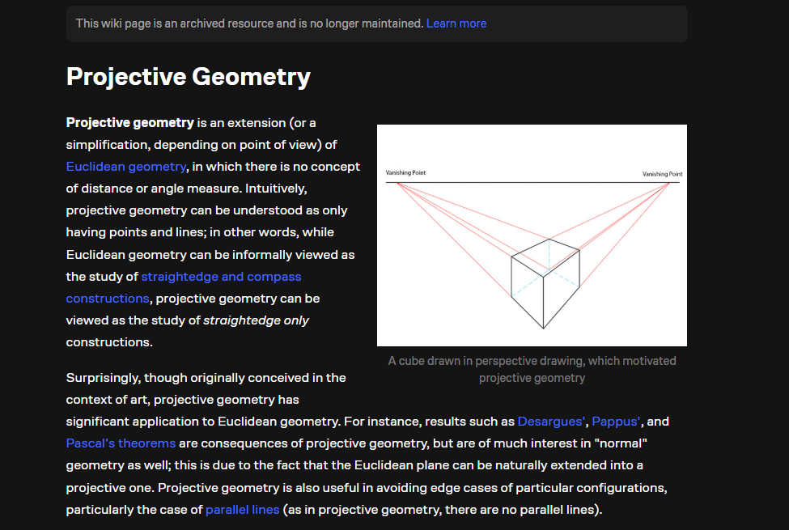

mình sẽ làm bignumber -> point là chính, còn lại tự tìm hiểu

Nhớ các API để ktra. Để compile thành thư viện thì bắt buộc hàm main không có funcion, methods, chỉ call

task: code c->Build thư viện -> nhúng python

# Week 09: Authentication (P1): Hash, MAC and HMAC. From Integrity to Symmetric Message Authentication

muốn check xem file có bị thay đổi không? -> tính toán SHA256 rồi so sánh với SHA256 của chính chủ

vd nhứ ubuntu: [sha256 ubuntu](https://nl.releases.ubuntu.com/releases/24.04.3/)
Nếu k khớp là bị sửa.

Hàm SHA256 này chỉ có thể từ file convert ra chứ k convert ngược lại file -> dảm bảo data base an toàn 

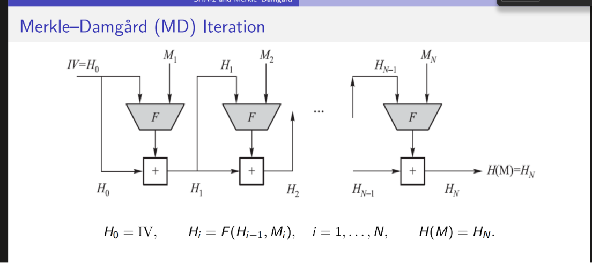
- Message lớn hay nhỏ đều có thể linh hoạt trong thuật MD, đầu ra cố định đc đầu ra
- Tính tuần tự nhưng lồng kết quả vào nhau-> chỗ nào sửa cũng thay đổi. xét đầu ra hàm F

SHA2:
- bitwise operation (flip,or,srl,sll)-> rất nhẹ
- 1 chiều
- hàm compress vào 3 ra 1 F

-> [length extension attack](https://viblo.asia/p/sha-2-and-length-extension-attack-pgjLNmWdJ32) -> sha2 vẫn tính đc mã băm ms khi thêm message mà k cần biết ndung

> task về  nhà: sửa role, k cần secret key vẫn đc token mới và vẫn verify đc

token = mess + tag

# Week 10
mess: user=student&role=viewer&note=lab
tag: hash(key|mess)
fake mess:
757365723d73747564656e7426726f6c653d766965776572266e6f74653d6c616280000000000000000000000198

26726f6c653d7472756d70 ~ &role=trump
```
Guessed key length : 18 bytes
Glue padding       : 13 bytes (hex: 80000000000000000000000198)
Forged message     : 57 bytes
```
Đời sha2 cook vì ngta có thể lấy true + fake ra để hack length extent vì nó tính theo tuần tự

Sha3: khắc phục lỗi sha2

tag: hmac=h(k||h(k||m))

> overcom

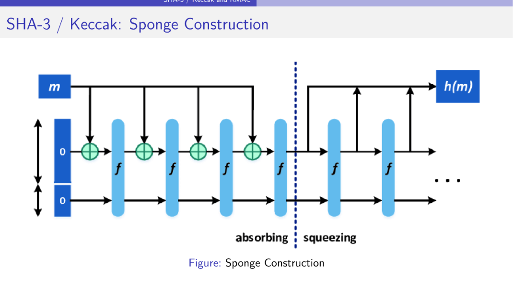

- mess nó k liên quan đến đầu ra cuối cùng của h(k||mess)
-> chống đc length extension
- Thay đổi đc chiều dài
- Kế thừa đời thứ 2 nma là ma trận 3 chiều, 5 5, lớp là bằng chiều dài của block, bội của 25
- tính toán dựa trên thay thế và chuẩn vị

1) ưu điểm:
- sha3 512
- chi phí tính toán ít (phép thay thế và chuyển vị)
2) nhược điểm:
- hiểu quả trong 1 vs 1

rainbow table

hashkiller.io, crack station,hashmob.net, md5

task tiếp theo: ktra xem mkhau mình lộ chưa

task tuần này: thỏa thuận khóa, hmac trao đổi mess (k bị sửa), làm pair