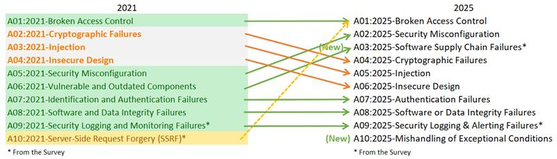
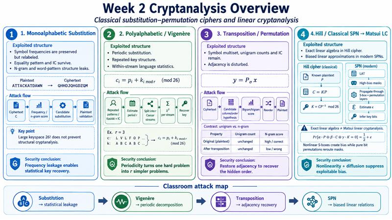
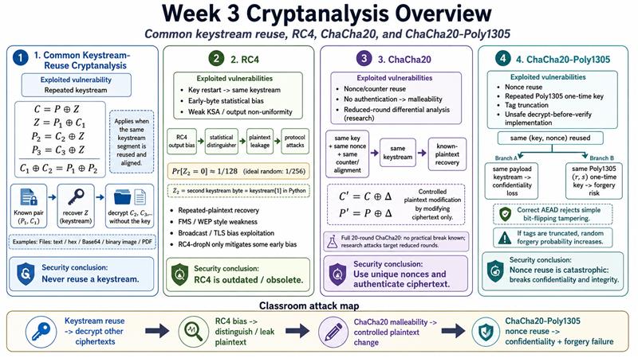
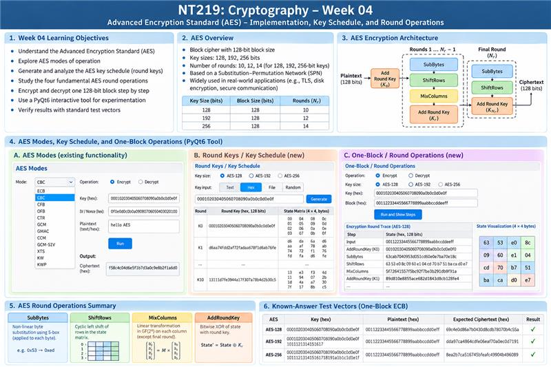
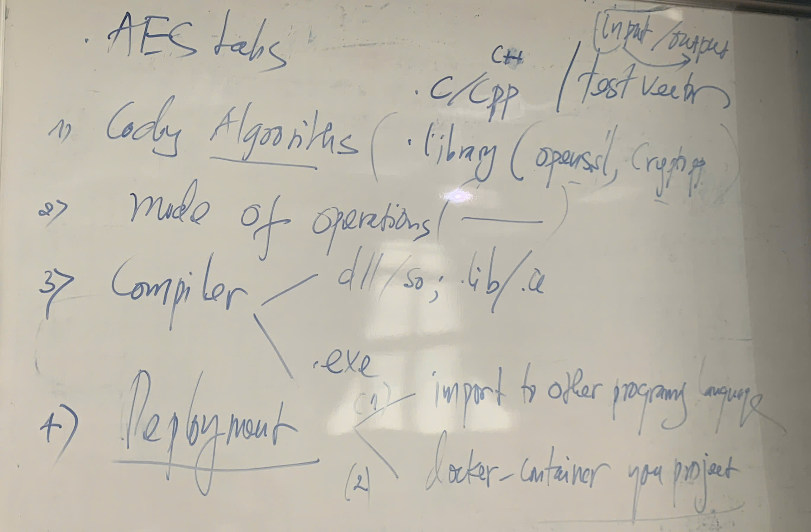
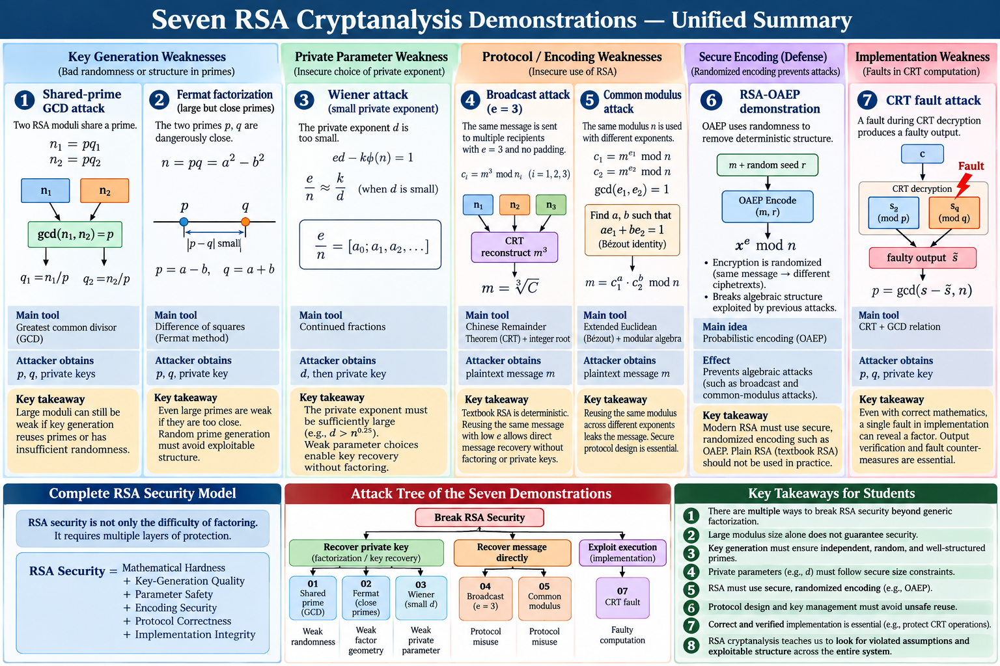
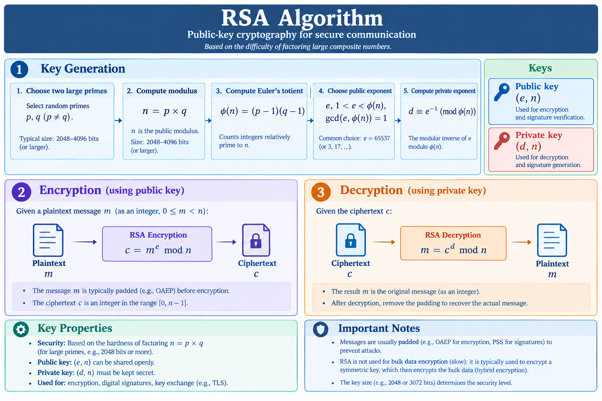
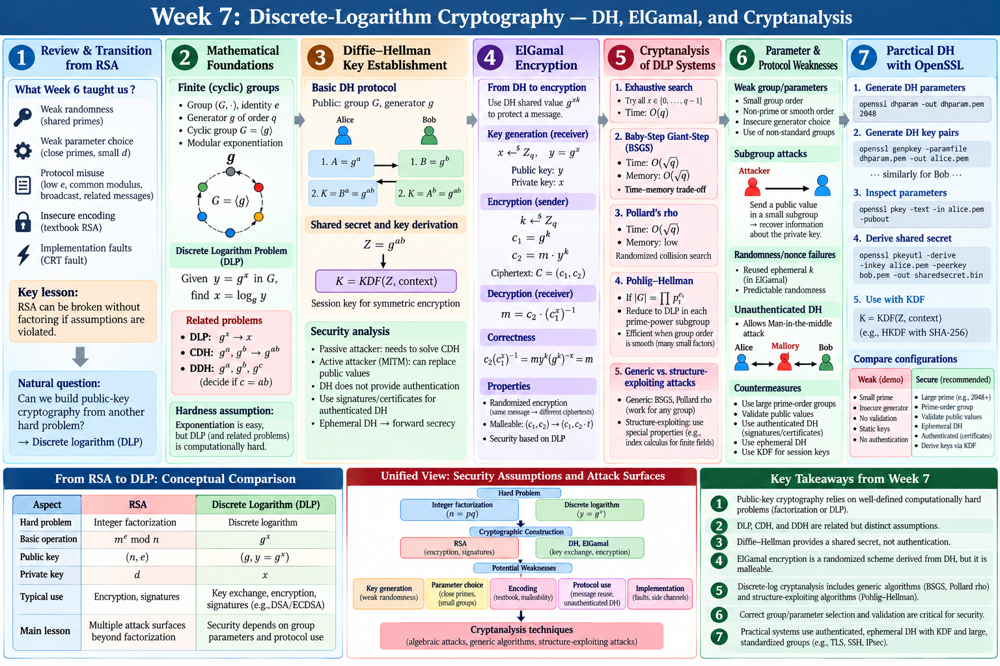
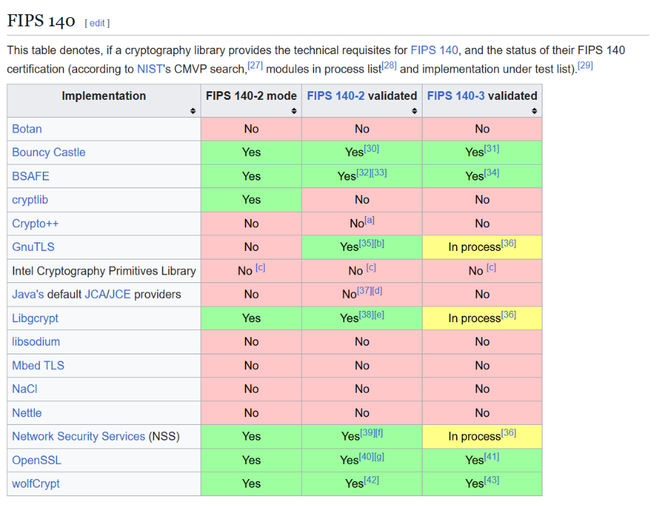
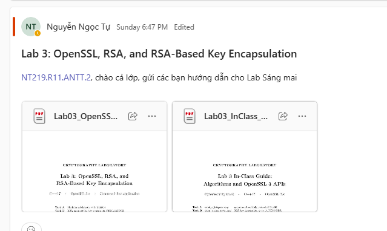

# Note
- Anh Tự có điểm danh, hãy đi học!
- Anh Tự ghét người đi trễ, hãy đi sớm, càng sớm càng gud. Hoặc là đi trễ và bị var, hát 1 bài/5 phút đi trễ
- Luôn check MSTeam, anh ấy hay đột kích và gửi bài trước giờ G.
- Đừng lướt mxh trong giờ ảnh pls, all in tập trung để ảnh hỏi còn trả lời được.
- Cái gì làm trước được thì cứ làm trước trừ lab cài đặt mấy cái có ver cũ (Openssl, cryptopp) - TvT (người phải cài lại cho hay)
- Hãy cài vào thư mục một cách **đúng trình tự**, giống anh ấy càng tốt và **phải nhớ** vị trí thư mục để dùng cho sau này.
- Luôn mang máy tính đi học
# Week 01: Introduction
*Bữa này tôi cúp*


Chung quy là tìm hiểu và thử decode vài mật mã dựa trên web hoặc trình code nào đó(?)
# Week 02: Cryptanalysis SPN ciphers

Chung quy hôm này thì ae sẽ được code của anh Tự, tìm hiểu về tần suất các chữ cái -> giải mã

Cơ chế giải mã của tuần này là dạng ánh xạ nên dựa vào tần suất sẽ giải ra được, còn how to tính tần suất và cách dùng thì rcm nghe anh Tự nha. Có thể check sơ bằng web [Dcode](https://www.dcode.fr/en)

BTVN week 2 của anh Tự giao tui nà: [BTVNWeek02](Class\Week02\25521638_MaHoaTiengViet.md)

# Week 03: Stream Ciphers - Algorithms and Cryptanalysis
Cài PyQt6 cho python để chạy demo cho buổi học

```python -m pip install PyQt6```



Tuần này sẽ cần thư viện OpenSSL để encode và decode text,file. Chung quy sẽ học về cách encode và decode của các chế độ mà sơ khai, tránh tình trạng đọc tần số để giải mã.

-> Nó mã hóa bằng cách ánh xạ ma trận tạo riêng, mã hóa dòng, mã hóa cột, xoay vòng,...(nên nghe anh Tự giải thích thật kĩ)

-> chỉ có Chacha20-Poly1305 mới có key check nội dung có bị đổi không, còn lại đều có lỗ hỏng thay đổi cipher text

## Thực hành Week 1: cài đặt môi trường
- Hãy cài đặt trước mingw, visual code (tím), docker (nếu được), **Dual boot (bắt buộc)**
- Thư viện mật mã thì nên kiếm cái mới nhất mà cài, hoặc là không cài và đợi thầy

# Week 04: Modern Symmetric Ciphers – AES


Tìm hiểu cơ chế hoạt động của AES, các mode AES. Giải mã và mã hóa AES(?)

# Week 05: Cryptanalysis the Modes of Operation of Block Ciphers
Update của week 4 vì week 4 chỉ mã hóa 1 block, giờ ta đi mã hóa một file lớn gồm nhiều block.

Có thể là làm task mã hóa và phân tích hiệu năng các mode AES.

## Thực hành week 2: AES

# Week 06: RSA and Cryptanalysis


-> Tạo key đóng gói (pub) để giải (private)

# Week 07: Discrete-Logarithm Cryptography and Cryptanalysis


-> Cải tiến là key không ai handle full mà là mỗi người làm 1 phần

Tuần này học về FF, tuần sau thì học EC

VD: $3^x= 5 mod (31)$

-> $x = {0,1,2....30}$

-> thuật toán đảo mod

### Cơ chế PHE

Security lớn hay không phụ thuộc hoàn toàn p có lớn k. Giống cái mode 2048, 3072,... trong file [ffdhe](Class/Week07/week07_codes/ffdhe_openssl_pyqt6.py) là hiểu sơ cách khoa pub ngta + pri mình -> z chung. Cơ chế này không chống được việc biết ng cầm là ai

Khó khăn
- Không biết key thật key giả
- Có thể sửa được ndung file
- ver này tính toán nặng
- Không có tính giá trị thực dụng cao

Nếu như server có public key thì làm sao dùng đc 1 round để gửi cả mess key
-> gửi public key mình, file mã hóa

- p cần đủ lớn và g cần có bậc đủ lớn ($g^m$) để tránh bị burf force
- tốt nhất bậc/số ptu g nên gần bằng q

->> Pratical DH with **OpenSSL**

### Why Openssl?
Đọc cái này [thư viện cryp](https://en.wikipedia.org/wiki/Comparison_of_cryptography_libraries), check cái verify


- Dùng thư viện nhưng không dùng cái **có sẵn**
- Crypto++ vẫn ok nhưng không rcm

> week 7 và 6 bộ sung cho nhau về aes, nhược điểm là tính toán lớn -> week 8 sẽ giúp update cái thuật toán này
## Thực hành week 3: Sử dụng thư viện cho RSA và OpenSSL


Chủ yếu là làm quen với task.json, cmake, lệnh của OpenSSL.
